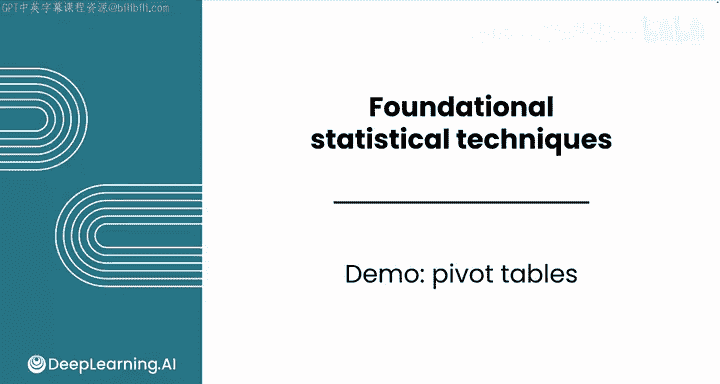
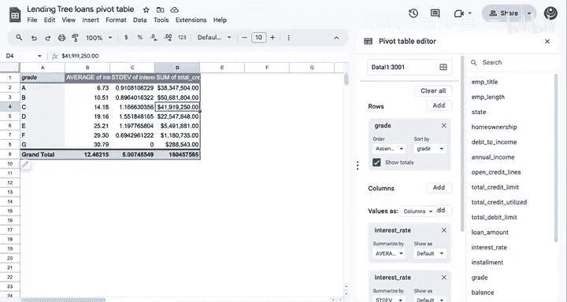
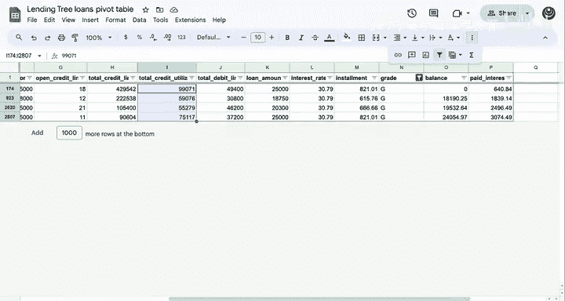
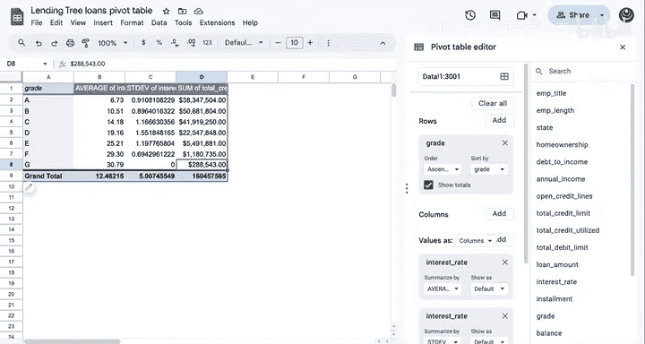

# 吴恩达《数据分析（数据分析基础／应用统计学，1-2课／共5课）｜DeepLearning.AI Data Analytics》中英字幕（claude-4-s - P97：26_演示：数据透视表.zh_en - GPT中英字幕课程资源 - BV1SCXrYuEwr

In addition to charts， you'll typically want to examine the descriptive statistics for your segmented data。

 spreadsheet power users employ pivot tables for this task， let's see how they work。

As a reminder， you were previously working with data about different loans to analyze potential investment opportunities。

 Different kinds of loans have different risk levels for the lender。

 which reflects the likelihood that the borrower will not be able to pay the loan and the interest rate reflects those risk levels。

 High risk loans have higher interest rates。 So these loans can be more profitable as long as the borrower is able to repay。

 supposeuppose you're interested in investigating the differences in interest rates to understand your potential loans better。

 in order to do this， you probably want to segment the interest rates by grade。

 remember that grade is the classification system that involves assigning a quality score to a loan where grade A represents the lowest risk and grade G is the riskiest。

 remember to check the downloads tab for this spreadsheet and the solution。

 So in order to perform this analysis， you're going want to select the entire data set and then insert a pivot table。

 a popub menu appears。 select insert to a new sheet。Alternatively。

 you could use an existing sheet for this and select the cell where you want the pivot table to be on the right。

 you will get the pivot table editor。😊，Here is where you set up the pivot table。 So for rows。

 you're going to add the gray feature。 This is the feature that you want to use for segmentation。

 You can see that all of the unique grades appeared on the left side or the table for columns。

 if you want to pivot over two features， this is the place to add it， but let's skip this for now。😊。

For values， you can add the feature that you want to aggregate so you can click on add and then select the interest rate。

 you can see after you selected the values that they're populated here in the pivot table。

HThis is interesting what does an interest rate of 4786 mean for grade A This is caused by the selection of the summarization function。

 which defaults to sum so this is actually totaling the interest rates across all of the loans with grade A This is not how you want to summarize the interest rates for each loan grade to change this you change the summarize by option in this case you might want to select average now you can see that the results updated and now you see more reasonable interest rates across the different grade categories Let's change the format to a number so that you only get two decimal points。

Be mindful that these represent presents， so you do not want to change the format to present。

 As expected， grade a loans pay the lowest interest rate。

 and it gets consistently higher for riskier grades。 Again， higher risk means higher interest rate。

 If you accidentally close the pivot table editor， just click on the pencil button on the lower left corner of the table and you get all the options again。

 You can also add more values to your pivot table。 Suppose you also wanted to explore the variability in the interest rate。

 you can add the interest rate again， change the sum summarization function to standard deviation。

 This gives you a sense of the variability in the interest rates for each grade category for loans。

 There's not a simple pattern here， but it does appear that as you move towards riskier loan categories。

 the variability actually increases。 This is to be expected because the interest rates are generally higher。

 which are often associated with higher variability。

 notice that the standard deviation for grade G is actually zero。

 When do you think is happening here。 Either every interest rate for G grade loans is the same as the average or there's only one。

😊，Data pointin you can also add more features so in this case maybe you want to look at a different feature like total credit utilized change the summarization function to an average。

 you can format the results to dollars and this represents the total amount of blend funds on the platform for each grade category the total amount of credit utilized mostly lands in the higher quality grades So it's interesting that if we assume there is only one loan with the grade of G it's $288。

000 So this is worth a check in the data to see what's actually going on with the G grade loans so let's go back to the data。

Here you can actually see that there's four G grade loans overall。

 so there's not just a single G grade loan， as you might have originally suspected。

 it turns out that those's  four G grade loans and they all have the exact same interest rate so it's possible that for this lower quality loans。

 there's a maximum interest rate and they all have this value and then you can see that the four loans actually total up to the 288。

000 you saw in the pivot a table it was pretty interesting to investigate all of these statistics segmented by grade。

Excellent work with segmentation。 You learn how to assemble two dataset sets into one。

 visualize the segments in your data and calculate descriptive statistics for each one using pivot tables coming up you'll take the practice assessment for this lesson you'll also complete the two graded items for this module including the graded assessment and the graded lab in the lab you'll use all the skills you learn in this module to help the Portuguese National Park Service prevent forest fires After you completed these items。

 you'll move on to the next module， probability and simulation once you've taken a sample of the population and describe the distribution of that sample you can apply the rules of probability and statistics to estimate features of the entire population I'll see you in the next module to learn more。

😊。