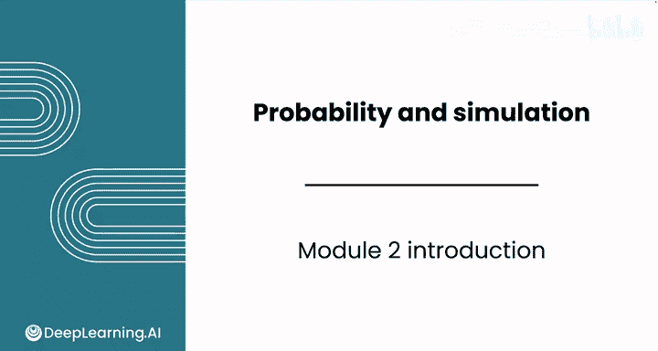
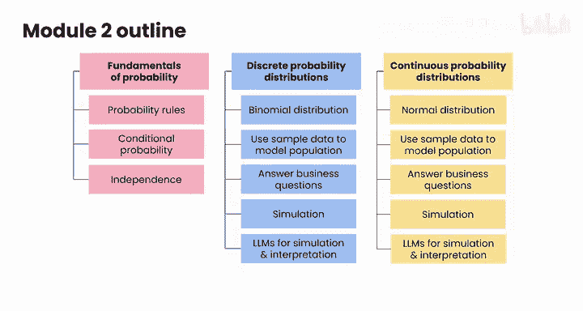

# 吴恩达《数据分析（数据分析基础／应用统计学，1-2课／共5课）｜DeepLearning.AI Data Analytics》中英字幕（claude-4-s - P98：27_模块2 简介.zh_en - GPT中英字幕课程资源 - BV1SCXrYuEwr

Welcome to probability and simulation In this module。

 you'll start by learning about probability the language used to quantify uncertainty。

 you'll cover key probability rules and concepts like conditional probability and independence all with real world examples you'll encounter as a data analyst then you'll explore probability distributions both discrete and continuous you'll learn about common distributions like the binomial and normal distributions and how they model realro phenomena you'll also see how you can use sample data to understand the distribution of your population and how to answer business questions like how common are certain outcomes Throughout this module you'll get hands-on with simulation techniques。

 you'll see how to generate random data following specific distributions。

 allowing you to model complex scenarios and informed decision making you'll also use a large language model to create interfaces for simulation and help you interpret results By the end of this module。

 you'll have a solid foundation and probability and simulation crucial tools for any data analyst。😊。

These concepts will prepare you for more advanced statistical techniques and future modules。

 including creating confidence intervals and performing hypothesis tests， let's get started。

 follow me to the next video which is all about randomness and uncertainty。

