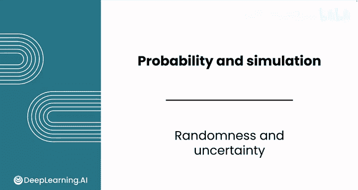
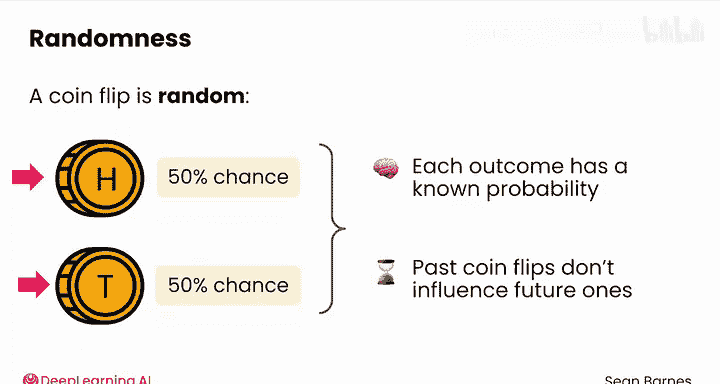
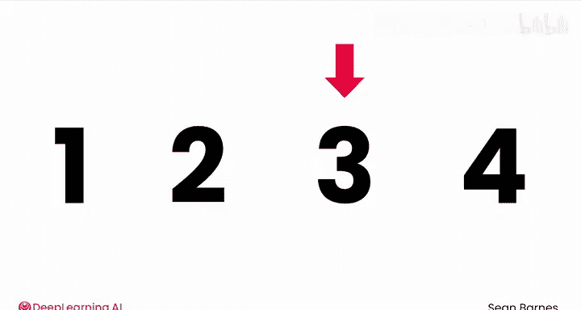
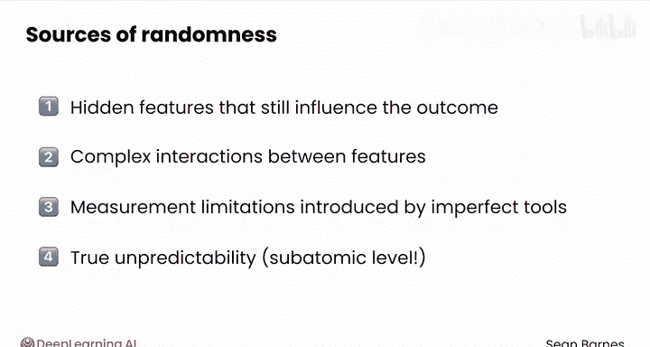
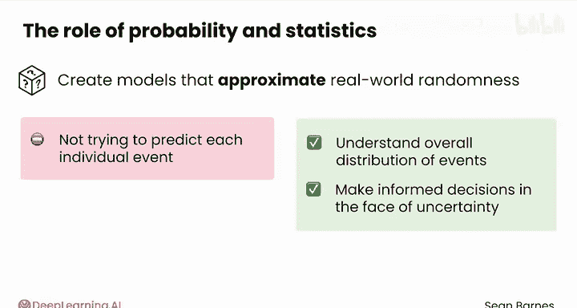
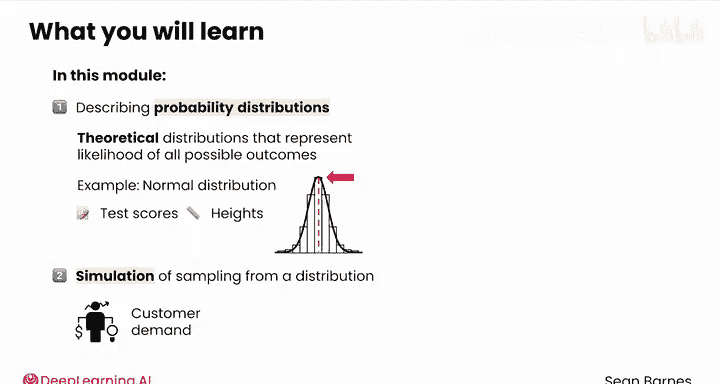
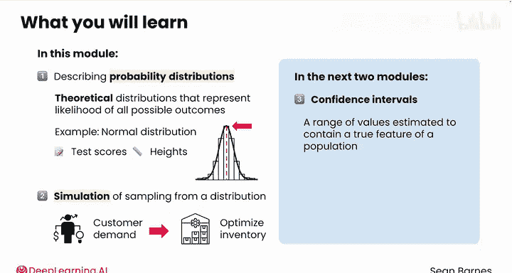

# 吴恩达《数据分析（数据分析基础／应用统计学，1-2课／共5课）｜DeepLearning.AI Data Analytics》中英字幕（claude-4-s - P99：28_随机性与不确定性.zh_en - GPT中英字幕课程资源 - BV1SCXrYuEwr

Probability is the language of uncertainty。

Imagine you're waiting for the train during your morning commute。

Will it come at 752 or 759 Real world data like train times is subject to randomness。

 Proability provides the tools for you as a data analyst to quantify and reason about this uncertainty。

 Let's talk about randomness for a moment。 A coin flip is random。 A 5050 chance of heads or tails。

 However， coin flips are an example of an experiment where each outcome has a known probability The chance of occurring and past coin flips don't influence future ones。

 You'll get heads about half the time。 entails about half the time。

 Real worldorl randomness is more complex。 I'll give you an example。

 I'm going to show you some numbers of the next slide， and I like for you to pick one of them。

 Don't think too much about it。 Just pick one。😊。

Let me guess， did you pick three you may be surprised to know that nearly 75% of people do you can try this on your friends and family even for a task as simple as pick one of these four numbers。

 people don't really pick randomly what seems simple like a one inf chance is behind the scenes a very complex experiment Here's another example say you're trying to predict whether your friend will arrive on time for coffee they are countless factors at play the traffic whether their alarm clock went off how they're feeling that day most of these factors are unknown or unmeasurable to you this type of randomness or uncertainty stems from several sources。

 including hidden features that you don't know about but that still influence the outcome or complex interactions between features So even if you know all the features they might interact in ways that are difficult to model you can also have measurement limitations introduced by our imperfect tools for observing the world and there's also true unpredictability especially at the someatomic level Yes I'm talking physics some things are truly impossible to predict。

Analysts use probability and statistics to create models that approximate this real- worldor randomness。

 You're not trying to perfectly predict each individual event。

 but rather to understand the overall distribution of events and make informed decisions in the face of uncertainty you've already explore distributions of sample data in the previous module in this module you'll start by describing probability distributions which are theoretical distributions that represent the likelihood of all possible outcomes in a random experiment On the other hand。

 distributions of sample data come from actually going out in the world sampling from a population One example of a probability distribution is the so-cal normal distribution which models the behavior of distributions or most values cluster around the mean like test scores or heights It's possible to perform a simulation of sampling from a distribution which you'll see throughout the last two lessons For instance。

 you might simulate customer demand to optimize inventory levels In the next two modules you will also explore two statistical tools based on probability theory and distribution。

Confident intervals， a range of values estimated to contain a true feature of a population。

 such as the mean and hypothesis testing， a technique that helps you determine if an observed result is likely to represent a true effect or not these definitions won't make a ton of sense right now。

 but you'll become very comfortable with them in the next module。

Now that you've seen the purpose of probability for data analysts to quantify and model randomness or uncertainty。

 join me in the next video to learn about the fundamental rules of probability。

