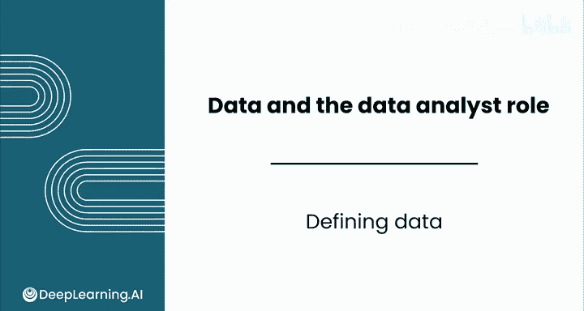
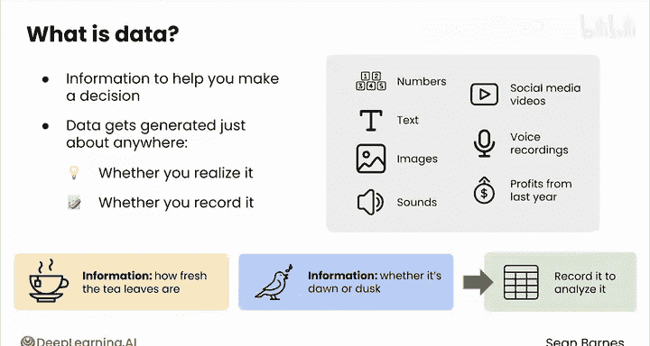
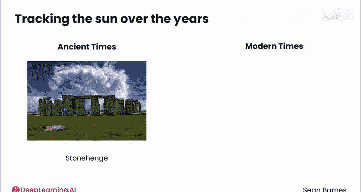
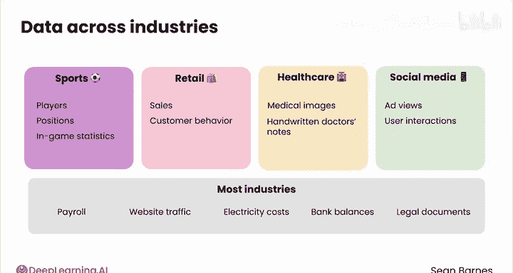
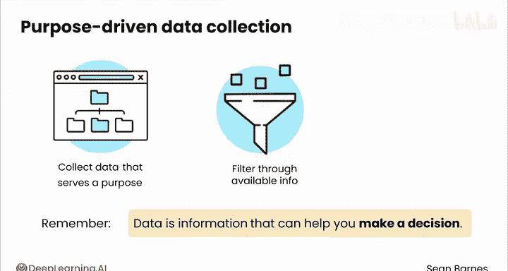
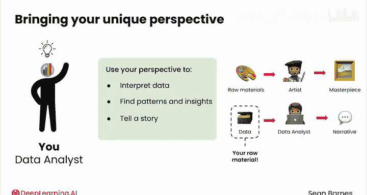

# 吴恩达《数据分析（数据分析基础／应用统计学，1-2课／共5课）｜DeepLearning.AI Data Analytics》中英字幕（claude-4-s - P9：8_定义数据.zh_en - GPT中英字幕课程资源 - BV1SCXrYuEwr

Let's talk about the raw material that powers this field Data Data is a very broad term。

 as a data analyst， you should think of data as any information that can help you make a decision。

It comes in many forms from numbers and texts to images and sounds， social media videos。

 voice recordings， profits from last year。 all this information can help you make a decision。

 and data gets generated just about anywhere whether you realize it。

 whether you record it the taste of your morning cup of tea gives you information about how fresh the tea leaves are。

 That's data when you hear the sound of birds chirping。

 that might give you information about whether it's dawn or dusk。 That's data too。

 you can take that data one step further and record it in order to analyze it。

 you saw them the last lesson how curiosity about data has ancient roots。

 but our ability to generate and capture data has massively accelerated in the last few decades Thou of years ago An peoples track the position of the sun to determine the best times for planting and harvesting but they had to do so using rock structures like Stonehenge Now we can do the same thing with way less effort through satellite imagery and digital calendars note the distinct lack of 25 ton stones different。

generate different types of data in sports， you might work with highly structured data about players。

 positions and in game statistics in retail you're likely to encounter transactional data about sales and customer behavior healthcare data often includes unstructured information like medical images and handwritten doctor's notes while social media platforms collect data about ad views and user interactions Most industries will also have payroll data and website traffic and electricity costs and bank balances and legal documents and a lot more nowadays it can sometimes feel like everything that can be tracked is tracked。

But here's the thing just because you can collect data about something doesn't mean you should You should only collect data that serves a purpose。

 remember our definition as a data analyst， data is not just information。

 It's information that can help you make a decision your job is to filter through all the available information and decide what's most relevant for the problem at hand as a data analyst。

 you also bring a unique perspective to data。 you don't just consume it。 you interpret it。

 you find patterns and insights and you use it to tell a story。

 just as an artist uses raw materials like Cla paint to create a masterpiece。

 You use data to craft a narrative that informs and inspires data is your raw material and you can create something beautiful and functional with it Data is a powerful tool for driving impact whether you're trying to analyze customer behavior interpret medical imaging or recommend videos。

 Let's get more specific about data。 something this broad。

 inevitably has classifications In the next video。

You'll learn the intricacies of unstructured data， which is a very natural and human way of capturing information。

 I'll see you there。