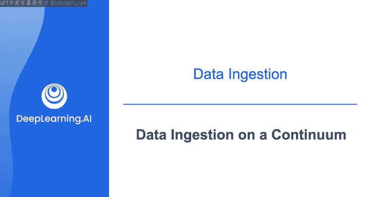
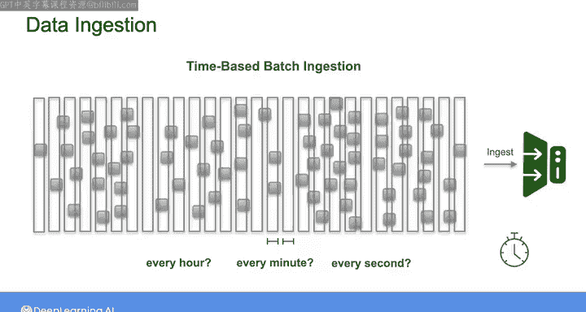
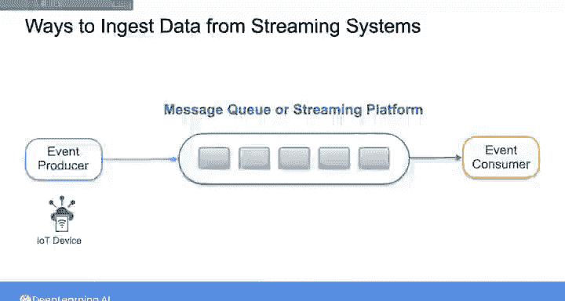

# 吴恩达《数据工程（导论，源系统、数据摄取和管道，数据存储和查询｜1-2-3课）｜DeepLearning.AI Data Engineering》 - P100：22_数据摄取的连续体.zh_en - GPT中英字幕课程资源 - BV1wTtWeeEH5

At various points throughout these courses so far， we've been looking at the differences between batch and stream processing as you will encounter them in your work as a data engineer。

And as I've said before in some sense， you can think of nearly all data as representing a continuous stream of events。

 These events might be things happening out in the real world like a stock price changing or your favorite sports scene scoring goal or a user clicking a button on a website and for the purposes of these courses。

 we care about the digital data that is generated when code is run and these events are recorded and so when it comes to data ingestion the way I like to think about it is that whatever system you're working with。

 you have data being generated somewhere as a continuous stream of events that is unbounded and by that I mean that the stream doesn't have any particular beginning or end if you ingest those events individually one at a time as they're generated then that's an example of stream ingestion if instead you impose some boundaries on that stream and ingest all the data within those boundaries as a single unit then。

That's batch ingestion you can of course think of a number of different ways you could decide to impose boundaries on a stream of data you could。

 for example boundary data by a certain size threshold say for example into 10 gigabyte chunks or by the total number of records like ingesting every 1000 events as they are generated or more commonly you can boundary data by time so you might decide to ingest all sales order data from the past week or you might choose to ingest data more frequently like daily in which case you're just imposing a different set of boundaries on the initial stream of data and of course you could continue this exercise and say。

 well if you want to retrieve new data from a source system once every hour or every minute or every second what do you think will happen as you continue to increase the frequency of ingestion at some point with super high frequency batch ingestion you would have essentially made your way all the way back to streaming。

AndSo the point here is that really batch and streaming are not two completely separate approaches to data ingestion Instead they exist along a continuum and where your data pipeline sits along that continuum will depend on what kind of source system you're working with and the end use case you're ultimately aiming to serve traditionally speaking batch processing has usually implied moving and processing large chunks of bounded data together as a single unit and for a long time。

 this was really your only option Now as tools and technologies have become more powerful and flexible running batch processing more frequently on smaller chunks of data has become possible and in recent decades。

 so-called micro batchch processing tools have emerged that begin to blur the lines between batch and streaming。

 There's no rule or industry standard for where the official cutoff is between what you call batch or micro batchch or exactly how close to realtime data needs to be to be processed in order to。

Be considered streaming。In practice， your approach to ingesting data in batches or in a stream will depend on the business use case。

 identify it from gathering stakeholder requirements and the type of source system you're interacting with for some databases you can use connectors like JDBC or ODBC as we looked at briefly last week or you could set up ingestion to occur at regular intervals or as soon as a certain amount of new data is recorded or you could opt for a serverless ingestion tool like AWS glue ETL that can be configured to connect to a source database and ingest data on a regular basis if you're ingesting data from API as you'll do in the first lab this week you'll be required to set up a connection based on that API specific protocols and it'll be subject to that API's various constraints and limitations when it comes to how much data you can ingest in one go or how frequently you can call the API at this point in time there's no universal standard for data exchange over APIs So this can be a somewhat frustrating。

Process that involves reading documentation， communicating with external data owners and writing and maintaining your own custom API connection code With that being said。

 we are seeing trends in the industry now toward vendors providing API client libraries that remove much of the complexity of API access and there are more and more managed data connecting platforms out there that provide simpler connectivity to many data sources。

So if you find yourself looking to ingest data from an API。

 my recommendation would be to use existing solutions whenever possible and reserve your custom connection work for times when there's no other option。

 when it comes to files as a source system as we look at last week you might be working with an optic storage system as your data source。

 but you might also encounter scenarios where ingestion of files can't be completely automated which is to say you simply need to manually download a file and get someone to send it to directly file transfer protocols。

 you can use the command line like SFTP or SCP which stand for a secure file transfer protocol or secure copy respectively。

 or other common ways you may ingest files if you want to ingest IoT device or center data from a streaming system。

 regardless of whether you ultimately aim to do batch or streaming processing。

 you may have no other choice but to set up a message queue or other streaming system to ingest this type of data。

In any case， I think the only way to get comfortable with all the various considerations and caveats around different ingestion patterns is to dive into some practical use cases we've set up this week of materials primarily as two case studies。

 one for batch ingestion from an API and another for streaming ingestion from a kinesis data stream in the reading item that follows this video you'll learn a bit more about ingestion from different source systems we touch on so far in this course as well as some that we haven't after that join me the next lesson to have a conversation with a marketing analyst who needs to ingest external data from an API。

