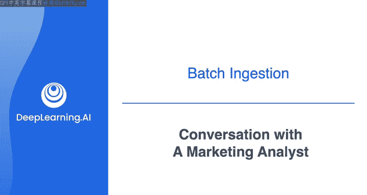

# 吴恩达《数据工程（导论，源系统、数据摄取和管道，数据存储和查询｜1-2-3课）｜DeepLearning.AI Data Engineering》 - P101：23_与市场分析师的对话.zh_en - GPT中英字幕课程资源 - BV1wTtWeeEH5

In the first course of the specialization， we did some requirements gathering based on conversations we had with various stakeholders。

 including a data scientist， the chief data officer， a product marketing manager。

 and a software engineer at a fictitious e-commer company。Through these conversations。

 you learn from the chief data officer that the company aims to expand to new markets and increase retention with existing customers。

And you worked with these stakeholders who set up a data pipeline for a recommender system。

Here we're going to build on that set of conversations and talk with a marketing analyst that's been tasked with looking for insights and product sales trends。

And so in this video， I'll play the data engineer and my friend Colleen will play the marketing analyst。

 let's jump in。Colleen number four， Good to meet you。 Good to meet you too。 Hi， I'm Joe。

 I'm new data engineer and looking forward to hearing more about what you're working on。Yeah。

 absolutely I'm really excited to be working with you。

 So what I'm working on is trying to understand what kind of external factors might be signals that we could connect to customers purchasing habits。

 And so on the marketing team， we have been brainstorming on what kind of things these might be。

 and we've come up with a few ideas we'd like to explore further。 sounds cool。

 I want't you to tell me more about that。 Sure things。

 So we were thinking that perhaps broadly speaking how someone is feeling like happier or sad。

 Ex or relax， might affect their behavior when it comes to shopping online。 Of course。

 we have no way of knowing exactly how our customers are feeling on any given day。

 but we thought we could explore some ideas in particular。

 we would like to look into what kind of music people are listening to across the various regions where we saw our products。

 and then comparing those with product sales。 I see。

 So you're thinking you would like to pull in public data from some external sources and information on the。

😊，people are listening to Yes exactly so I've been looking into it and it looks like Spotify has a public API where we could pull data on what musical artists are trending in different regions and people's listening trends over time Does that sound like something you could potentially help us with for sure I'm a big niback fan definitely like music a lot Yeah so I'll just need to have a closer look at the Spotify API and once I figure out the details and maybe we could talk through exactly what kind of information you would like to pull in and how you'd like that served Okay yeah that sounds fantastic let me know if there's anything I can help with in the meantime and I'll look forward to talking more with you once we have the details sort out that's great Thank you。

Alright， so that was an example of a conversation with a marketing analyst where they describe their data needs for a project focused on pulling in data from a public API that they would like to analyze alongside product sales data Now I'll acknowledge and maybe you're thinking this as well that studying regional trends and what kind of music people are listening to might not sound like a particularly brilliant approach to marketing and you're probably right。

 but believe me， I've seen all kinds of crazy stuff when it comes to what kind of data different stakeholders want to get their hands on So the point here is not to dwell on whether this seems like a worthy endeavor but instead to identify the key requirements for the system you'll need to build In this case。

 there is certainly more information required to know exactly what the best approach will be when it comes to building out the entire data pipeline for this project but for the moment we're going to say focused on the ingestion piece the key things you'll learn here are that you're going to need to ingest data from a third part。

APpiI you'll eventually need to consider other details like how you're ultimately going to store and serve the data to the analyst。

And this will depend on what the analyst needs。In general， when ingesting data from an API。

 you'll be looking at some kind of batch ingestion process。

 but exactly how that looks will depend on what you aim to do with the data。In the next video。

 we'll take a closer look at the tradeoffs between the popular batch data processing paradigms of extract transform。

 load or ETL versus extract load transform or ELT as relate to your ingestion of data。And after that。

 we'll take a look at connecting to and adjusting data from a RE API。I'll see you in the next video。

