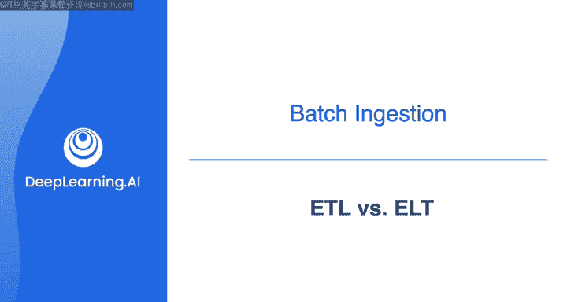
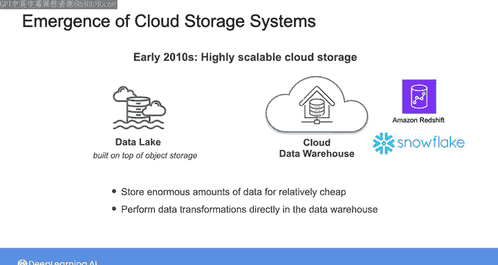
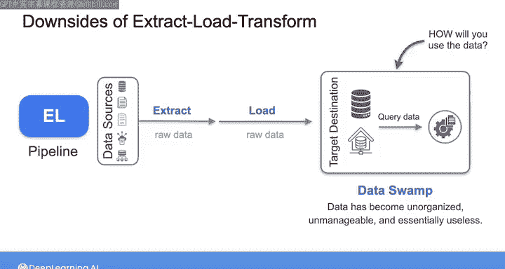
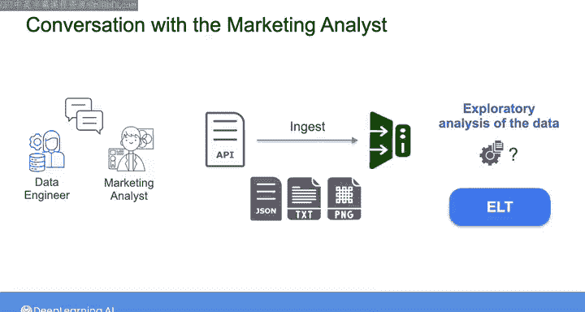

# 吴恩达《数据工程（导论，源系统、数据摄取和管道，数据存储和查询｜1-2-3课）｜DeepLearning.AI Data Engineering》 - P102：24_ETL vs ELT.zh_en - GPT中英字幕课程资源 - BV1wTtWeeEH5

In the previous video， our marketing analysts shared their goals for a project they're working on to incorporate some external data into their analysis of product sales For this project。

 it sounds like the analyst will mostly be looking at historical trends in the data and may in the future want to move on to more explicit analysis of current data but not necessarily in a real-time or urgent sense。

 Furthermore， you know you'll be pulling the data from a third-party API。

 Well you'll generally have some flexibility in terms of how often or how much data you poll。

 you'll be constrained to some form of batchsh ingestion。

 This is because API calls work similar to web requests where you send a request for data and receive a response and the number of requests you can make per time is typically limited So in terms of data ingestion for this project you're looking at a batch process。

 In the previous course， I briefly introduced ETl and ELT which stand for extract transform load and extract。

transform respectively these are two very common batch ingestion patterns and while they technically include components of the transformation and storage stages of the data engineering lifecycle in practice。

 you'll need to be thinking about the tradeoffs between these patterns in the instion stage so that's what I would like to do right now first I'll say a bit more about what distinguishes these two processes and then we'll look at which one might be a good fit for the use case of our marketing analyst ETl or extract transform load is really the original batch ingestion pattern that gain popularity in the 1980s and 90s the process starts with extracting raw data from a store system which could be done by directly  querying a database or using an API for example then you transform the data in an intermediate staging area and then you load the data into a target storage destination like a database or a data warehouse back in the 80s and 90s storage and computing power were extremely limited and so。

Important to have a plan in place for exactly what data you wanted to ingest and how you wanted to store and access the data in what format and so on Data warehouses were expensive to set up and not well suited for running heavy queries that included complex joins and transformations So in those days one had no choice but to be very intentional about how to transform raw data during the ingestion process to ensure it could be stored and made available in an efficient manner ETL is still very popular today as an ingestion pattern but now with a relatively low cost of cloud storage and increase computational power It's no longer the only option In the early 2010s。

 Cloud storage systems became highly scalable and we saw the emergence of data lakes built on top of object storage systems like S3 and cloud data warehouses like Redshift and stuff like this made it possible to store enormous amounts of data relatively cheaply and to perform all of your data transformations directly in your data warehouse that's when the concept。

Of ELT or extract load transform came about in the ELT process you extract raw data from So systems and load it directly into the target database or data warehouse or even object storage without performing any transformations the exciting idea with ELT is that you don't need to decide upfront how you want to use your data this could be attractive because in some sense you could say that by applying transformations to raw data and only storing the process results like you do with ETL there's some information that's lost in the process but with ELT all the options remain on the table as you simply capture all the data and say it for later use and then you can query and transform the raw data however you like and no information is ever lost Now as attractive as this paradigm might sound to be honest when I first heard about the idea of ELT I thought it was a terrible idea。

Why I thought would you want to just pile up a bunch of raw data in storage without thinking deeply about how you want to use it and as I have been emphasizing throughout these courses。

 the first step in any data engineering project should be firmly establishing what your end goals are and only then thinking about how to build a system to achieve those goals。

Over time， however， I did start to see the potential benefits of ELT For one thing。

 ELT is faster to implement because it doesn't require detailed planning ahead of time on exactly how you want to transform your data it's also possible to make data available more quickly ten users albeit in raw form because ELT removes the need for a staging server and inf data transformations and with the processing power of the modern data warehouse。

 transformations can still be done efficiently after the data is loaded into storage beyond that。

 as I said before， when you want to store all of your raw data you can cite later to adopt different transformations or analyzed data in a different way then might have been possible if you only store transform data in the first place so what's the downside of ELT well in short if you're not careful your pipeline can simply become an EL pipeline where you extract and load enormous quantities of raw data into storage without figuring out how to transform it into something。

Useful when you don't want to spend time up front planning how you will use your data。

 you could end up with what's commonly known as a data swamp。

 which is a situation where your data has become unorganized。

 unmanageable and essentially useless I like to show this image when the topic of data swamps come up So here you have a data engineer sitting in his data samp or he's kept absolutely everything he thought might be of some value someday。

 but now of course， even if he could remember what all was in there。

 he likely wouldn't even be able to find it in the early 2010s data samps were common as companies found it possible to keep literally every scrap of raw data just in case nowadays much of this has been cleaned up do part to regulations that require companies to store data in such a way that it can be audited or deleted in an orderly fashion for example。

 a user requests that their data be removed from company systems Well that being said the relatively low cost of storage today combined with the。

ing power of modern data warehouses and other storage abstractions means that both ETL and ELT can be reasonable approaches to batch processing。

 but no matter which approach you take， it's important to have a clear set of and goals in mind and manage your data accordingly and so let's think back to the conversation with the marketing analysts for this project you'll be ingesting data from a thirdparty API Most often the data you'll receive through an API connection will be semistructured data。

 perhaps in JSON format In some cases， you might also be retrieving unstructured data like text and images。

In this case， it seems like the marketing analyst aims to do some exploratory analysis of the data and wouldn't be able to say upfront exactly what transformations might be required。

 and so an ELT pipeline is probably the right choice for this ingestion scenario as it gives you more flexibility with the transformation and serving stages for this project the big component of this ingestion use case that we haven't talked about in detail yet is a part about ingesting data from an API and so that's where we're headed next。

Join me in the next video for a look at how you'll work with an API as a data source。

