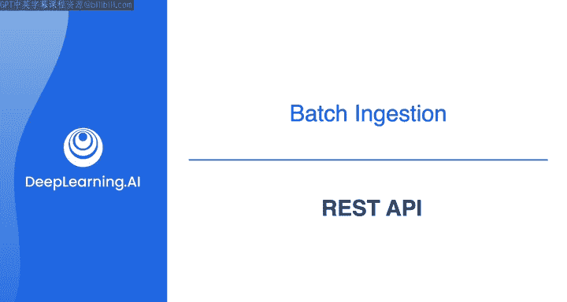
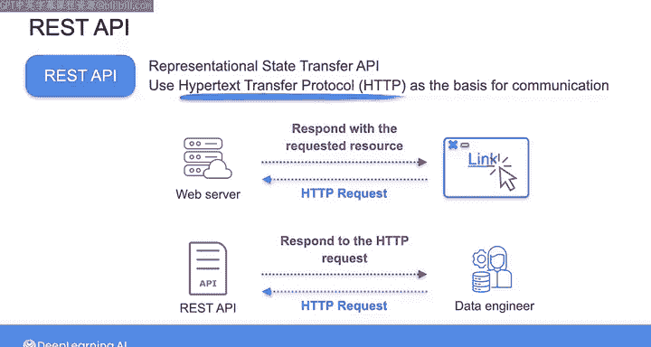

# 吴恩达《数据工程（导论，源系统、数据摄取和管道，数据存储和查询｜1-2-3课）｜DeepLearning.AI Data Engineering》 - P103：25_REST API.zh_en - GPT中英字幕课程资源 - BV1wTtWeeEH5

In the previous course， I mentioned the so-called API mandate that came in the form of an email from Jeff Bezos to all Amazon employees in 2002 the gist of this email was that going forward。

 all teams would be required to use service interfaces otherwise known as application programming interfaces or APIs to communicate as well as a serve data and functionality the problem the same to solve was that prior to that time Team of Amazon and at every other organization for that matter。

 didn't have a consistent or stable way to exchange data and services leading to inefficiencies by setting up APIs as a stable and predictable service interface between different teams。

It meant that any individual team could provide data functionality and communications to other teams。

 no matter what kind of complicated mess that teams might have going on in their own systems the other part of the API mandate was that all these service interfaces or APIs had to be built from the ground up to eventually be publicfa to developers in the outside world this reorientation towards service interfaces lay the foundation for what would eventually become Amazon web services and set the direction for how companies around the world would eventually share data and services。

 both internally and externally， and so an API is essentially a set of rules and specifications that allows you to programmatically communicate and exchange data with an application and by programmatically communicate I mean communicate by running code if you've done some software development you might be familiar with connecting to APIs but even if you haven't set up API connections yourself。

 you're no doubt using APIs directly on a daily basis。

As you search for things online or use the apps on your phone and this is because today。

 APIs are built to the functionality of a wide range of software applications。 For instance。

 social media apps uses effects and display data from the web servers to end users As are also used to facilitate transactions between ecommerce-commerce websites and payment systems Many companies provide public facing APIs so that you as a developer can access their data and services and integrate them into your own applications as a data engineer。

 you will uses to connect with and extract data from various sources such as web services。

 cloud platforms or thirdpart providers by sending request and receiving responses in a standardized format As can also provide metadata documentation authentication and error handling features to facilitate data extraction The most common type of API is what's known as a rest API or rest stands for representational state transfer rest APIs commonly use。

transfer protocol or what you might know more familiarly as HTTP methods as a basis for communication。

 and so you can think of interacting with RE APIs as similar to what you're doing when you browse the Internet when you click on a link in your browser you are sending an HTTP request to a server for a specific resource like a web page and the server responds by providing that resource with a RE API youre also sending an HTP request for a particular resource and the API is set up to respond based on the content of your request in the conversation we have the marketing analysis we learned that they would like to do analysis of data that is stored on a thirdparty platform Spotify in this case and available via API this is a really common scenario you'll run into as a data engineer where the source system you need to extract data from whether an internal system or an external thirdpart system is accessible via API in the reading item that follows。

V I've included some of the technical details that you should be familiar with when it comes to interacting with APIs to ingest data from So systems。

 but the best way to get familiar with how this works is to jump in and do it yourself and that's what you'll do in the next lab and so in the video that follows the reading I will walk you through how all that's going to work。

