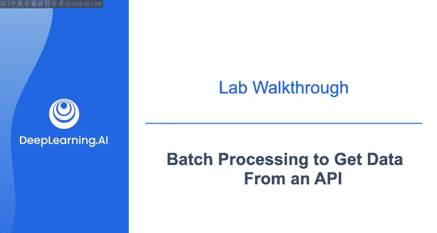
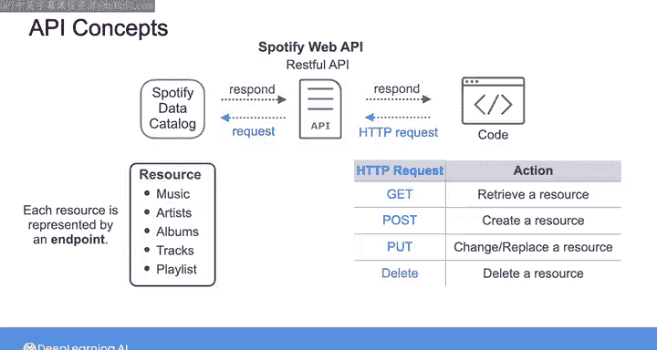
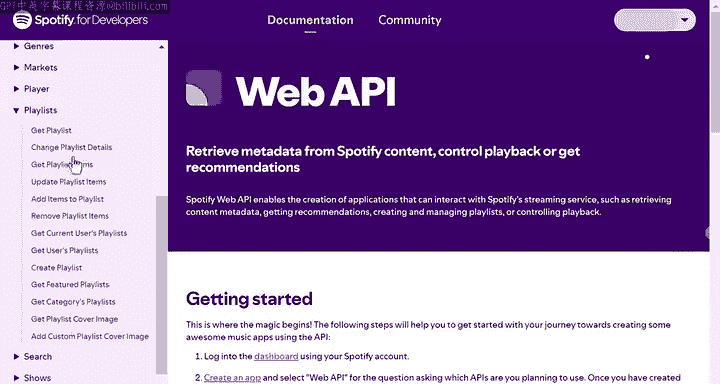
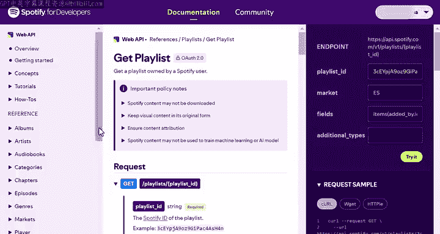
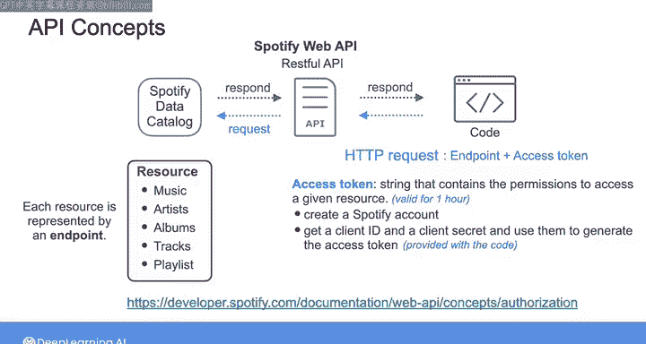
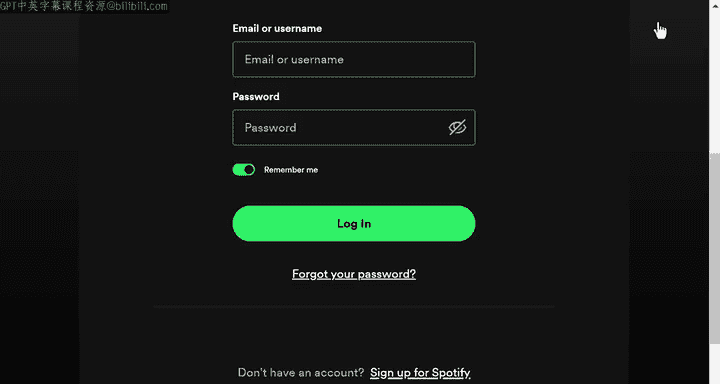
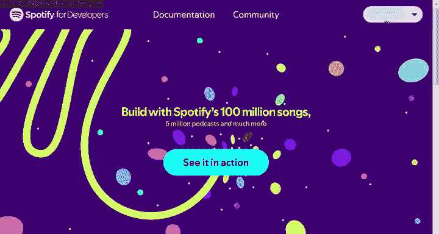
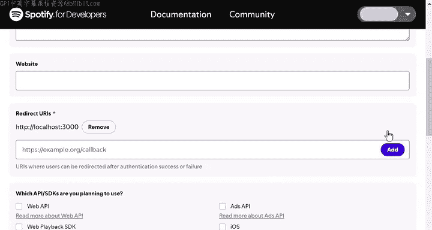
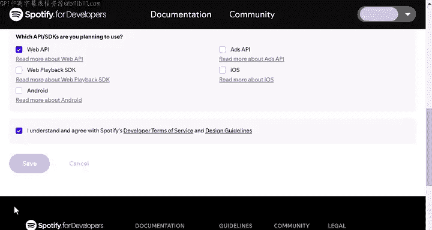
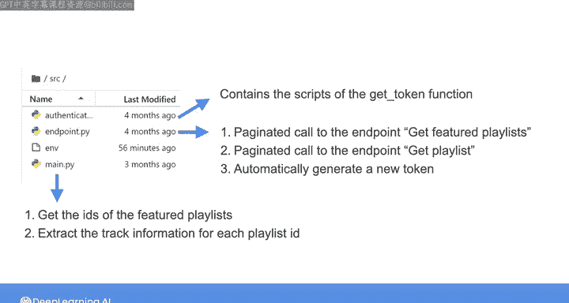

# 吴恩达《数据工程（导论，源系统、数据摄取和管道，数据存储和查询｜1-2-3课）｜DeepLearning.AI Data Engineering》 - P104：26_实验演练：使用批处理从API获取数据.zh_en - GPT中英字幕课程资源 - BV1wTtWeeEH5

In the upcoming lab you'll practice interacting with the Spotify API to extract data。

 explore what pagination means and learn how to send an API request that requires authorization In this video I'll first go through some API concepts that you'll work within the lab and then give you an overview of the lab tasks for the lab exercises you'll need to have a Spotify account to get the credentials you need to extract data from the API This is because any request you send to the Spotify API requires authorization and to get that authorization you need an account Now just to be clear。

 I don't want you to think that I'm promoting Spotify here or asking you to sign up for an account for no reason in fact when you're working with thirdparty APIs as a data engineer。

 it's very common that you'll have to sign up for an account on that thirdparty platform in order to use the API So the purpose of this lab is to have you go through that workflow just like you would experience it on the job and of course if you like you can go ahead and cancel your Spotify account immediately after you complete the lab but for now if you don't already have one I encourage you to。

Create a Spotify account and check out the documentation for the Spotify API so you can follow along with what I'm going to show you here。

 The Spotify web API is a restful API to which you can send request to access music artists albums and tracks directly from the Spotify data catalog。

 Each specific item of data such as a playlist artist or album is called a resource that you can access by sending an HtP request to the endpoint representing that resource there are different types of Htp request but the common ones are get put post and delete get allows you to retrieve a resource post allows you to create a resource allows you to change and or replace resource and delete allows you to delete resources。

 For example， in the API documentation of Spotify if you click under playlist you can see all the request that you can use to interact with this resource。

 For instance， you can perform a get request to get a playlist owned by a Spotify user using this endpoint you can also use a get request to。

Freve the list of Spotify featured playlists using this endpoint If the request is successful。

 it returns a response in a JSON format containing information about the requested resource For example。

 here's a response sample to a get playlist request and here's another response sample to a get featured playlist request。

If the request is not successful， it returns an object error containing a status code that explains why the request was not successful。

 For example， a code of 400 means a bad request that could be due to malform syntax and a code 404 means a requested resource could not be found you can find in the documentation here。

 a list of status codes and the meaning of each。When you make a request to Spotify Web API。

 you need to specify the endpoint to the resource as well as an access token。

 The access token is a string that contains the credentials and permissions that you use to access a given resource to get the access token。

 you will need to create a Spotify account first and from your account。

 you'll be able to get a client I and a client secret which can be used in the authorization process and the generation of the access token。

 The access token is valid for one hour After that time。

 the token expires and you need to request a new one in the lab。

 you'll be provided with the code that you can use to request an access token using your client I and the client secret to learn more about the authorization process with Spotify。

 you can check out the documentation。 Note that you may work with other APIs that don't require authorization or the authorization process might be different from the Spotify1 So as suggest that you always check the documentation of the API you'll be working with before I get into more details about the lab。

 feel free to pause a video to check the Spotify documentation as well as a two API request examples。

 Get playlist。

And get featured playlists Before you start interacting with the Spotify API。

 you need to create an account in order to get the keys that we'll use to generate the access tokens。

 So first make sure to sign up and fill in the required information to create your account。

So here I'm already logged into my account， I'll click on the account name in the right top corner and then click on the dashboard and then on create app。

In app name， I'll type this name。In app description。

 I'll type Spotify app to test the API for redirect URI， I'll specify this local host。

And here I'll choose Web API。 finally， I'll click on saveve。

If you get the error that your account is not ready。

 you can log out and wait for a few minutes and then log back in and repeat the steps。

 Once the app is created， you can click on it to go to the app home page。

Here I'll click on these settings to find the clientient ID and the clientient secret。

You will need to copy these values to use them in the lab once you start the lab and follow the lab setup instructions。

 you'll be in the Jupyter notebook here under the SRC or source folder。

 I'll click on the M file and then paste the client ID in Cls secret to store them in these environment variables。

Back to the Jupiter notebook， I'll first run the cell to import the required packages and then this cell to load the environment variables。

 and then these two variables to represent the client and client secret next to obtain an access token。

 you can find in this cell the function get token that expects your clientin and client secret to generate the access token。

 I use the API documentation to know what details should go inside this function。

 feel free to check this link to learn more about these details。I'll now call the get token function。

 which returns this token response。It's a dictionary containing three keys， access token。

 the token type， and expires in。 You'll use the string。

 which is the value of the access token key and all your API calls in this lab。

 So let's take a look at some of the API call examples to create your API calls in Python。

 You can use the request package， which I already imported into the notebook。

 This package is a popular library that provides a simple and easy to use way to interact with APIs。

For example， to perform a get request in the Spotify API， you can call the method request dot get。

 you will need to pass in the endpoint of the resource you want to access and specify the access token using the parameter headers by assigning it to a dictionary in this format。

 in the lab， you're provided with this function that automatically creates the authorization header given the access token。

 So here in the get request， I'll use the provided function get offth header and assign it to the headers parameter for this function。

 I'll use the token response to pass in the access token。

 note that the second get is not the Hp get request。

 It's the method that you apply on a Python dictionary to extract the value corresponding to a key。

 Let's now get the endpoint of the get featured playlist and look at the returned response。

 The response is a Sify response object that you can convert to a Python dictionary using the dot Json method as shown here。

 Here's the response。You can see that there are two keys， message and playlist。For playlists。

 there is another set of key value pairs。 You verify the keys for each by calling the method dot keys。

 So the response actually contains two keys， message and playlists。

 Let's check the keys for playlists。Here are the keys for playlists。

 let's go through each one HR contains the link or the endpoint to the resource。

You can see that the two parameters were added to the endpoint get featured playlists。

 which are offset and limit。 These two parameters are expected by the get featured playlist request。

 So by default， an offset of 0 and a limit of 20 were added to the endpoint。

 which means that the response contains the info of the first 20 playlists。

 You can find the details of these playlists using the key items。

You can also check the values used for the offset and limit and get the total number of elements。

 which is 100， and finally next contains the same endpoint。

 but with different values for offset and limit。In this case， it refers to the first 20 items。

So if you want to specify your own offset and limit you can do so using this endpoint here I chose 40 for offset 40 and 20 for limit in the lab。

 you're given this function that performs the get request for the featured playlist It takes in the offset and limit as parameters and uses them to construct the endpoint for the get request or it can use the full endpoint specified in the last parameter when it's not empty。

 your task will be to complete this function Next you'll need to perform pagination to extract the entire list of featured playlists instead of extracting all the 100 items in one get request call you can perform pagination to extract the items chunk by chunk so you can start with your first API call starting with an offset0 and choosing the limit you want and then you can keep on repeating the same call specifying a different offset each time to continue reading from where you left off in the previous API call or you can use the endpoint provided in the next field of the returned response So in the lab you are provided with these two functions。

 The first one performs pagination by manually changing the。

set for each new API call and the second one uses the next field provided by the response of the current API call。

 So you'll be tasked to complete these two functions in the second part of the lab。

 you're given these python functions that you will need to complete these functions will allow you to create a batch ingestion process that extracts the track information such as track name album and artist for the featured playlists。

 So in this part you will need to perform two paginated API calls in the first one。

 youll get the list of featured playlist using the same paginated call you use in the first part of the lab and in the second one。

 youll get the track information for a given playlist using the get playlist endpoint the authentication python file contains a script of the get token function that returns an access token。

 the endpoint file contains two functions。 the first one corresponds to the pageaginated call to the endpoint get featured playlist and the second one corresponds to the paginated call to the endpoint get playlist youll need to complete these functions youll also need to complete a piece of code that automatically。

a new token when it's expired。 and finally， in the main function。

 youll call the first pageaginated API call to get the IDs of the featured playlists。

 Then for each playlist ID， youll call the second pageaginated API call to extract the track information for each playlist I。

 You'll need to complete part of this code。 So make sure to read the instructions carefully and have a look at these functions to understand how they work together。

 The lab also contains some optional parts so you can check to learn more about API calls。 Again。

 before you start the lab， I encourage you to check the Spotify API documentation and to create your account。

 After you finish the lab， join me in the next lesson to explore streaming andgestion patterns。

