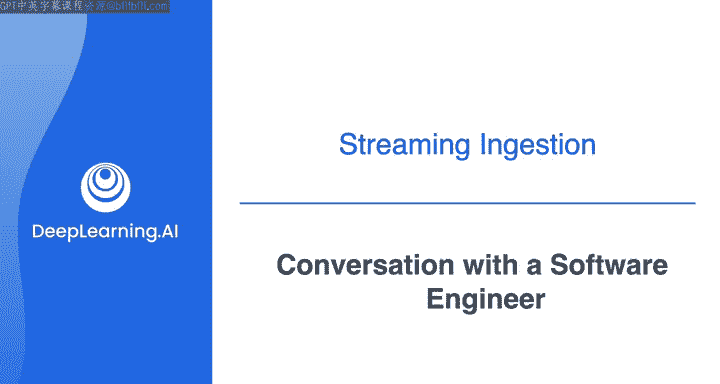

# 吴恩达《数据工程（导论，源系统、数据摄取和管道，数据存储和查询｜1-2-3课）｜DeepLearning.AI Data Engineering》 - P105：27_与软件工程师的对话.zh_en - GPT中英字幕课程资源 - BV1wTtWeeEH5

Now it's time to look at streaming ingestion in more detail in the previous course you worked with a product recommender system in the last lab。

 but we didn't really get into the details of how streaming ingestion was set up for that system so in this video we'll do another stakeholder conversation or I'll talk with a software engineer about the ingestion details for that recommender system。

After that you'll build the system yourself in the next lab。

 so let's jump into the follow up conversation we'll have with the software engineer。

It's good to see you and Colleen。 get to see you too。

 Thank you So I'm working on getting a new product recommender system set up。

 and I'd like to work with you to better understand how data ingestion can work in terms of receiving realtime user activity data from the website for sure so the way the system works on the website and is that we're continuously recording events in the web server log and those events include everything from internal system performance metrics and any errors or other anomalies that are generated as well as user activity like the buttons or links our users are clicking on as they browse different products or check out and make purchases。

 Okay well in an ideal scenario， I'd probably like to be ingesting all of the user activity data and none of the internal system metrics do you think it would be possible for you to separate out event records related to user activity and push those into a separate log from me adjustgest from Yeah。

 we can certainly do that I can imagine a number of ways that might。

But if we pushed user activity messages into a Kafka topic or kinisesis stream。

 you could ingest directly from there into your pipeline Okay great yeah that sounds like a good solution I think if you could push into a kinesis data stream that would work great for me I've been exploring how some other aspects of the pipeline could work using Kinisesis so that seems like a good fit for now the other question I have is around the data payload itself and expected message rate could you tell me more about what I can expect in terms of the format of the individual messages and the rate of messages writing in the stream Yeah so the messages are recorded in JSON format so the payload you can expect is a JSON including a session ID and all the customer information like location as well as their browsing activity in terms of which products they have looked at or added into their cart with regard to the size of the individual messages they vary a bit but are generally around a few hundred byte each the rate of messages。

you can expect will vary a lot depending on how many users are on the platform at any given time。

 but as you can imagine one user might generate several events per minute and then we might have as many as 10。

000 or so users on the platform at peak times so that might translate into as much as maybe 1 thousand00 events per second Okay great so let's see maybe back of envelope estimate then we might have say a thousand events。

Per second at a few hundred0 bytes each in size。 That's like like less than1 mebyte per second。

 So that should be well within the capacity of the kinesis data stream。

 I think they can handle hundreds of megabytes per second depending on the configuration。 All right。

 And then the other thing I'll need to configure on my end is how long messages are obtaineded in the stream as you know。

 the stream will be essentially in app pen only log。

 but we'll set it up so that the messages are removed after a period of time。 right， Well， of course。

 the idea is that we'll be using the data in real time to make recommendations and we'll also be saving the inputs and outputs of the recommender model for analysis later on。

 So if everything goes well， we won't need to reread messages from the stream。

 But I suppose you know， something goes wrong， we may want to have the ability to back up and replay the stream of something breaks。

 maybe we could retain messages in the stream for one day after they are initially written。Sure。

 so let's see on a busy day， we might be writing， like you said。

 around one megabyte per second to the stream and there are sort of order of magnitude around 100。

000 seconds in a day， so the total size of the stream could grow to like what would that be 100 gigabytes worst case scenario so that seems reasonable。

All right， Well， is there anything else you would like to know or should we go ahead and just get going building this。

 I think that's all for now。 Let's build it。 Vi it。Okay。

 so that was an example of a conversation with a software engineer who be an upstream stakeholder and the owner of the source system you'll need to ingest data from as I've been emphasizing at several points throughout these courses so far there are a number of other things you should be discussing with So system owners when it comes to understanding potential disruptions to your data pipeline。

 things like schema changes or outages， but for now we'll just focus on understanding the data itself and the mechanism for ingestion you'll be using in this case join me in the next video where we'll unpack some of the details of this conversation and look more closely at streaming ingestion。

