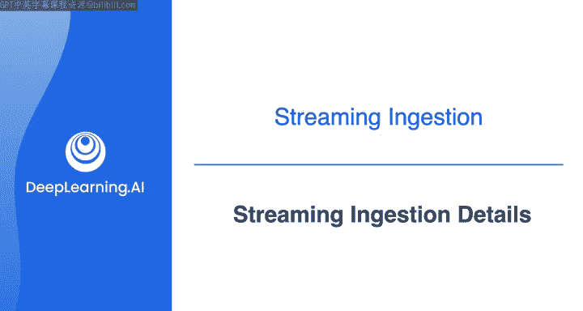
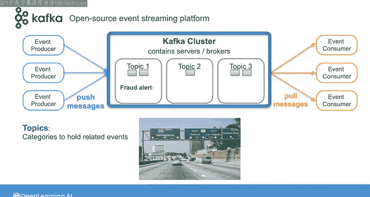
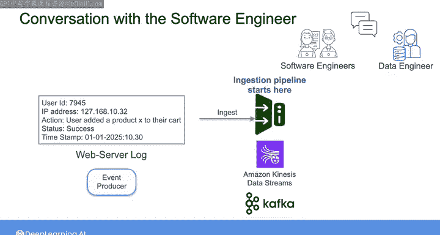
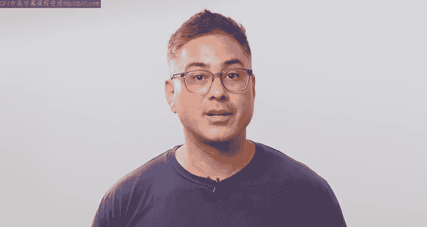

# 吴恩达《数据工程（导论，源系统、数据摄取和管道，数据存储和查询｜1-2-3课）｜DeepLearning.AI Data Engineering》 - P106：28_流摄取详解.zh_en - GPT中英字幕课程资源 - BV1wTtWeeEH5

In week1 on this course， we looked at streaming systems including message queuees and event streaming platforms from the perspective of these being So systems where data pipeline was on the consumer end of these data sources。

 I also mentioned that depending on the system you're working with。

 the actual source might just be the event producer or multiple elements of a streaming system like multiple producers。

 brokers and consumers could be upstream of your ingestion system and the conversation we just had with the software engineer the plan we came up with was for the engineer to set up a kinesis data stream and you'll be consumer of messages from that stream。

In this video I'd like to talk a little more about the details of message streams and after that you'll be on your way to the lab and so as a quick reminder。

 you'll have event streaming platforms and message queuees as the two main modalities of streaming ingestion A message queue is essentially a buffer use to deliver messages from an event producer to a consumer in an asynchronous matter message queuees typically operate on a first in first out or FiIO basis。

 meaning that the event consumer we'll always read the oldest message in the queue first and once a message is consumed。

 it is deleted from the queue Even streaming platforms on the other hand function by soaring messages in a persistent way in an appendon log the event router distributes messages in the log to the subscribers and it's possible to replay or reprocess any messages in the log you'll be using Amazon's kinesis service as your event streaming platform in the lab but another widely used。

Platform is Apache Kafka in this video I'll use Kafka as the example platform to talk through some of the details and draw parallels with kinesis where they exist and then in the next video Morgan will go through kinesis in more detail so by at the end of this week you can have some context on both of these solutions So Apache Kafka is an open source of event streaming platform and while streaming platforms come in a number of different flavors and varieties the principles of how events are routed and stored are similar across platforms at a high level event producers send or push messages over the network to a Kafka cluster which contains one or more servers also called brokers then event consumers read or pull messages from that Kafka cluster let's zoom in a bit on the Kafka cluster I have here within a Kafka cluster message streams or split up and routed into what are called topics you can think of a topic like a category that holds a collection of related events。

or maybe in another sense， like a road to somewhere and so messages line up in topics similar to how rows of cars line up on different highways based on their destination a topic could contain any type of messages。

 for example， fraud alerts。

Customer orders or temperature readings from Io devices。

 And it's a job of the producer to send a message to its corresponding topic。

 Each topic has one or more partitions， which are just logs containing ordered immutable sequences of messages that you continually add new messages to using the roads to somewhere analogy Partitions are like lanes on the highway。

 More lanes allow more cars to pass through And so each partition handles a subset of messages as they're added to the topic。

 This allows for more efficient traffic or message flow。 And again。

 it's a job of the producer to decide on which partition to send each message。

 the decision could be based on a round robin strategy for example。

 or by computing the destination partition based on the message key。 with kinesis。

 all these concepts are essentially the same。 but instead of topics。

 you have streams and instead of partitions， you have what are called shards。 Now， on the other end。

 consumers are grouped and each consumer group。Subscribe to one or more topics the consumers of a group cooperate together to consume the messages from all partitions of a given topic each partition can only be assigned to a single consumer in the group and each consumer consumer' messages from a different subset of partitions when a producer publishes a message to a topic partition that messages is delivered to one consumer within each subscribing consumer group once a message is published to a topic the Kafka cluster retains that information for a configurable period of time whether or not the message was consumed this allows consumers to replay and reprocess messages as needed in our conversation with the software engineer we learned that the user actions on the website are recorded as messages in the web server log and those messages will be routed to a kinisesis data stream Similarlyly those messages could be routed to a Kafka topic and you consume them from there by subscribing to that topic under a different set of circumstances you could imagine a scenario。

Where you have direct access to monitor the web server log for new messages。

 then you could treat the web server log as the event producer。

From their events could be ingested to a Kafka topic or a Kinisesis stream as a first step in your ingestion pipeline。

 you could also monitor database activity through a process known as continuous change data capture or a continuous CDC by processing the database log you can stream data changes into your data pipeline to ensure that the data in your pipeline is synchronized with the data updates and the source database Up next。

 Morgan will walk you through the details of Amazon Canisesis Data streamams。

 which you'll use as the streaming ingestion tool in the upcoming lab and after that I'll be back to give you a quick walkthrough of the last lab before you jump in to build your own streaming ingestion solution。

