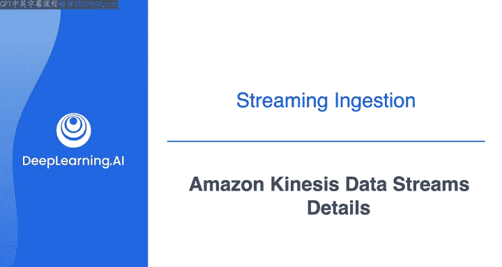
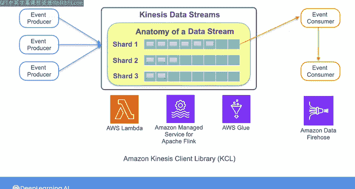

# 吴恩达《数据工程（导论，源系统、数据摄取和管道，数据存储和查询｜1-2-3课）｜DeepLearning.AI Data Engineering》 - P107：29_Kinesis Data Streams详解.zh_en - GPT中英字幕课程资源 - BV1wTtWeeEH5

You just learned a bit more about how Apache Kafka works。

 and now I want to help you understand how Amazon Kinesis data streams works before you head into the lab。

As you already know， similar to Kafka， there are event producers that push data to the stream and consumers which read data from the stream In the upcoming lab。

 you'll be working with a kinesis data stream as your upstream source system。

 And so you won't be responsible for setting up the stream itself。 However。

 you've also seen that you can incorporate producers。

 consumers and streams into other parts of your data systems as well。 So here。

 I'd like to walk you through some of the details of kinesis that are relevant when you're in control of the entire system。

 which includes the producer， consumer and the stream in this case。 Just like how in Kafka。

 producers send data to topics when working with Ksesis' data streams。

 a producer pushes data to a specific stream。 One stream is made up of many shards which provide the units of capacity for the stream。

 So as you need to scale your stream up to ingest more data。

 you need to add more shards to the stream in order to。

Kn how many shards you'll need for your use case or when you'll need to increase the number of shards。

 you'll need to know the size and rate of write and read operations you're expecting in your pipeline。

 W operations are when an event producer writes data to the stream and read operations are when downstream consumers read data from the stream。

 when it comes to capacity， each shard can support up to 5 read operations per second and those five operations can add up to a maximum total data read rate of 2 meby per second for writing data。

 a producer can write up to 1000 records per second to a shard。

 with a maximum total data write rate at 1 MBby per second。

 So to determine the number of shards you would need for a specific use case。

 it would take some analysis and some math。 Given the size and rate of read and write operations that you expect。

 Sometimes it can be hard to estimate the exact number of read and write operations。 For example。

 in a brand new application。Or in other cases， the only thing you might know for sure is that you expect the traffic in your application to vary dramatically over time。

 like on an e-commerce platform or other public facing applications for those situations you can use kinesis in on demandmand mode on demandd mode will automatically manage the scaling of the shards up or down as needed。

 and you are only charged for what you use。This can be more convenient from an operational perspective when compared to the alternative。

 which is provisioned mode With provision mode， you specify the number of shards necessary for your application based on the expected write and read request rate。

 and then it's up to you to add more shards or reshard when needed。

 provision mode might be a good fit for your work if you have predictable application traffic。

 or if you want to be able to control your cost more carefully。

 when it comes to the data moving through a stream。

 Each data record that is sent to the stream from a producer includes a partition key。

 a sequence number and the data itself in the form of what's called a binary large object or blob for short。

 when you are setting up the data producer for your system。 you need to choose a partition key。

 The partition key is then used to determine which shard the data record is placed into kinesis itself then assigns a sequence number as each record is written to maintain the order of the。

Reds within the shard。 For example， let's say you wanted to create a stream of transactions from an ecommerce-commerce platform。

 Then you might want to use the customer ID as the partition key。 In this case。

 all transactions for a single customer could be stored in the same shard。

 This would then make it easier for downstream consumers to pull records related to a single customer for aggregation and analysis。

 So a producer puts data into shards。 and a consumer reads data from shards。

 and it is common to have multiple consumers reading data from a shard。 By default。

 consumers share a shards read capacity， which is called shared fan out。

 and this means that the consumers are contending for read capacity。

 This can be an issue for some use cases so to avoid running into this capacity issue you can set things up so that each consumer is able to read at the full two megabys per second read capacity of the shard which is called enhanced fan out。

You can use managed services such as AWS Lambda， Amazon managedage Service for Apache Flink and AWS gluelu to process data stored in Kinsesis data streams。

 or you can write your own custom consumers using the Amazon Kisesis clientient library or KclL。

 You can also set things up so that the output of one stream becomes the input for another。

 which can allow you to build more complex realtime data processing workflows。

 consumers can also send data to other AWS services like integrating with Amazon data firehose to store data in Amazon S3。

 It's important to remember too， that Kisesis data streams allows for multiple applications to work with the same stream at the same time。

 Each one consuming the data independently and sending that data downstream to different systems。

 Next up， Joe will walk you through the details of the upcoming lab and then you'll be off to work on streaming ation with Kinisesis yourself。

 Good luck and have fun。

