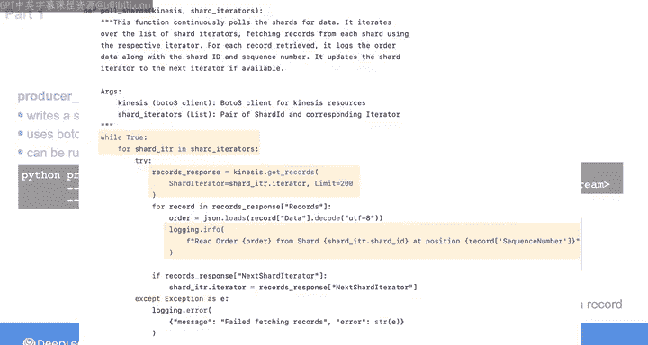
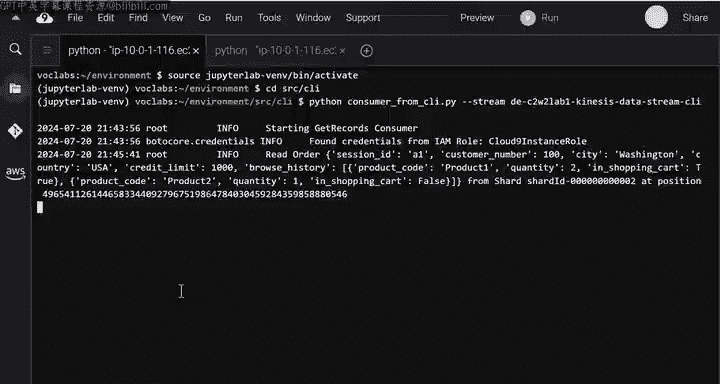
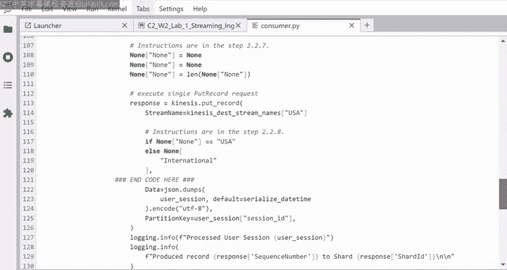
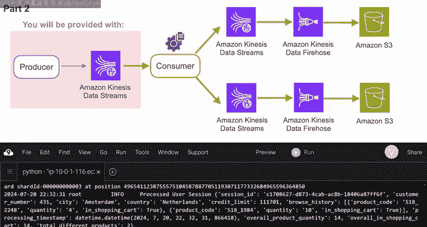

# 吴恩达《数据工程（导论，源系统、数据摄取和管道，数据存储和查询｜1-2-3课）｜DeepLearning.AI Data Engineering》 - P108：30_实验演练：流摄取.zh_en - GPT中英字幕课程资源 - BV1wTtWeeEH5

In the previous course， you implemented a streaming pipeline that looked like this with a kinesis data Firehose and S3 bucket you are provided with a kinesis data stream that streams online user activities as events or records you process these records to compute the product recommendations and use the data Firehose instance to deliver the records to the S3 bucket in your pipeline in the upcoming lab you will learn more about how you can continue streaming these records in your pipeline and further explore kinisesis data streams as a source the lab consists of two parts and the first part you will work with a Kinesis data stream acting as a router between a simple producer and a simple consumer and the second part you'll work again with the course1 scenario you will be provided with a kinesis data stream as a source but this time you will use another two kinesis data streams to continue streaming the records in your pipeline from each of these two new data streams data will be taken by a kinisesis data Firehose and delivered to the respective S3 bucket let's go through the first part of this lab to gain a better understanding of the component。

Of an event streaming platform who will first create a kinesis data stream and then interact with it from the producer and consumer sides。

 For that， you're provided with two Python scripts。 Consumer from Ci and producer from Ci。

 The producer script represents a simple producer application that writes a single data record into the Kinesis data stream。

 The data record is a JSON string that contains the details of a user session such as the session I customer number。

 city country and the browsing history。 The producer's Python script uses Boto3 to interact with Kinesis。

 you can run the script from the terminal， which expects two arguments。

 The name of the Kinesis data stream and the JSON string of a single record。In the producer script。

 these two arguments are passed into the Bodo3 method。

 put record to write the record into the kinisesis data stream。

 The consumer script also represents a simple consumer application that you can run from the terminal by specifying the name of the Kisesis data stream when you run the consumer script it'll iterate through all the shards of the data stream Ex all records to each shard and then print some information in the terminal about each record If you check the code of the consumer script you can see that Bodo3 is also used in the function pull shards the consumer continuously iterates through the shards of the data stream gets the records using the Bodo3 method。

 get records and then print this text in the terminal to explain which record was read from which shard and at what position within the shard in the first part of the lab。

 you won't edit the producer and consumer scripts but you will be tasked to run these scripts After you create the kinisesis data stream you'll first run the consumer script in the terminal to do that。

 you'll first activate the Jupiter lab environment then navigate to the folder source Ci or S。

CI and finally， run the consumer script as shown here by providing the name of the kinisesis stream you created。

 you'll notice that nothing will be printed in the terminal because the data stream is now empty。

 you will keep the terminal open to keep the consumer running and then in another terminal。

 youll run the producer script to write a record in the data stream。 Again， in the new terminal。

 youll activate the Jupyter lab environment， navigate to the folder source Ci or SRC Ci and then execute the producer script by specifying the name of the kissa stream and the JSson stream representing the record。

 So now if you check the first terminal where the consumer is running。

 you will see that the consumer has read the record that you just sent to the data stream after you're done with the first part of the lab。

 youll get back to the original ecommerce-commerce scenario。

 you'll be provided with a kinesis data stream that represents your source system So youll be at the consumer site ingesting data from the streaming source。

 you'll implement a streaming ETL pipeline where you will first apply a simple transformation on the ingested record and then continue streaming these records。

In your pipeline for that， you'll set up two kinesis data streams。

 you'll send the records that correspond to USA customers to one data stream and those that correspond to international customers to another data stream。

 This is assuming that your company notice that customers showed different purchase behaviors based on their countries So if they're located in the USA their online activities need to be processed by a certain recommendation engine。

 Otherwise， their online activities need to be processed by another recommendation engine for each of these two data streams。

 data will be automatically taken by a kinisesis Firehose and delivered to the respective S3 bucket。

 you will first create the two data streams。 the two firehose instances and the two buckets using Bodo3。

 Then you will write the transformation code in the consumer script that is provided to you under this ETl folder。

 This script can also be run from the terminal， and it expects the name of the source data stream and the names of the two destination data streams。

 The script contains this pull shards function where you're provided with the code that iterates to the shards to extract the records here。

 once a record is extracted。will need to complete this part of the code to transform the record。

 The transformation consists of adding three fields as shown here。

 The first field overall product quantity represents the sum of the product quantities that are listed in the browsing history。

 The second field overall in shopping cart represents the sum of the product quantities for the products that are placed in the shopping cart and the third field total different products represents the number of products that are listed in browse history。

 and finally， you will send the transform record to the corresponding data stream based on the value of the country field。

 After you apply these modifications to the consumer script。

 you will run the script in the terminal by specifying the name of the source data stream and the names of the two destination data streams as shown here。

 When you run this command， the consumer script will read the records from the source data stream。

 transform them and then send them to the corresponding kinisesis streams。

 The kisesis Firehose Indices will automatically deliver the data to the S3 buckets。

 So that was an overview of the tasks you'll perform in this lab and now。

y to get started after you finish the lab， join me back here for a quick summary of this week。

