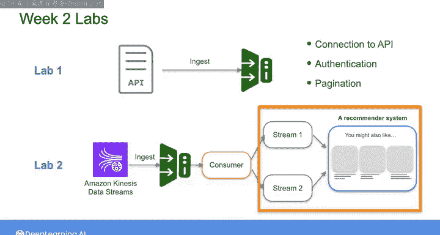

# 吴恩达《数据工程（导论，源系统、数据摄取和管道，数据存储和查询｜1-2-3课）｜DeepLearning.AI Data Engineering》 - P109：31_第2周总结.zh_en - GPT中英字幕课程资源 - BV1wTtWeeEH5

This week we've been looking at the ingestion stage of the data engineering lifecycle in the context of batch and streaming and some of the tools you can use for these two types of ingestion patterns。

You implemented a batch ingestion solution pulling data from a public API and you set up streaming ingestion for a recommender system so nice work。

 One of the main ideas we started with at the top of this week is that while batch and streaming ingestion are often discussed as two distinct ingestion paradigms they really exist along a continuum where at one end you have ingestion of relatively large batches of data on an infrequent cadence and on the other end。

 you have rule time streaming ingestion of individual messages as they' are generated in between you have a wide range of batch and micro batchch scenarios as well as different approaches to streaming whatever approach you take for your own data pipelines should be determined by what stakeholders really need and the requirements of your system when it comes a batch ingestion specifically we looked at ETL and ELT and how you might think about the tradeoffs and advantages of one versus the other depending on the requirements of the system you'。

You also saw however， that doing inflight transformations is something to think about in the context of streaming pipeline as well in the first lab you ingested data from a public API and got some practice with API specific concepts like the connection authentication and pagination steps that will apply to many different ingestion scenarios when your source is an API and then in the second lab you set up streaming ingestion for a recommender system in that case the source system was a kinesis data stream and you set up a consumer using Python code perform some inf transformations in the data and then push the messages in the two separate streams for downstream consumption by the recommender model with each of these labs and the concepts we've discussed in between you deepen and broaden into your knowledge of data ingestion next week will dig into one of the undercurrents of the data engineering lifecycle data ops。

We'll take a closer look at some of the key concepts of data ops， including things like data quality。

 automation， monitoring， and infrastructureized code。We'll see you there。

