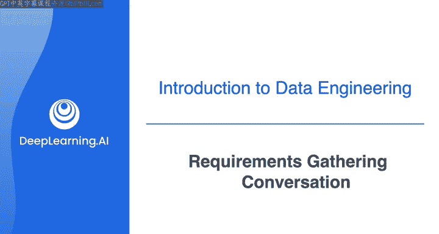

# 吴恩达《数据工程（导论，源系统、数据摄取和管道，数据存储和查询｜1-2-3课）｜DeepLearning.AI Data Engineering》 - P10：9_需求收集对话.zh_en - GPT中英字幕课程资源 - BV1wTtWeeEH5

Like I said in the previous video， the first step in any data engineering project is requirements gathering。

To give you a taste of what the step could look like on the job。

 throughout these courses we'll be featuring a number of conversations between myself and the role of data engineer talking to different stakeholders。

The point of these simulated conversations is to show you how you might go about the requirements gathering process for some example data systems。

 and so in this video I'm going to demonstrate what a conversation might look like between you。

 actually me in this case， the data engineer。And a key stakeholder， in this case， my friend Colleen。

 who will play the data scientists that need your help getting the data they need for their work in real life。

 Colleen is a data professional with lots of experience having stakeholder conversations in her own work and so she's going to help me with a number of these stakeholder conversations throughout these courses。

 but before we jump into this one， I'll just take a moment to introduce you to Colleen and then we'll get started with the conversation。

How it going Col Good， how are you。 Good。 thank you So today we're going to be talking with Colleen Foch。

 she is a senior technical manager and I guess that means you're a data scientist marketing analyst and a software engineer just all of them Yeah what is what what do you actually do Yeah so I specifically work with our marketing team and so I handled a lot of our marketing technologies work。

 So day to day I'm in snowflake a lot DBT building out data models。

 So doing a lot of data engineering。 So your book has helped me thank you and in her past life。

 you also did some interesting stuff。 Yeah I was in athletics for a really long time swam growing up went to Cal Berkeley won the national championship or two American record will big relay and then decided Crossfit。

 did that professionally for a few years went to the Crossfi games individually in team and then。😊。

Did Bob sledding for a few years made the US national team and then as the national progression goes went into data after so I literally did the same thing in that that's how we met Yeah。

 talkingking。WellA， so we're going to be doing a mock stakeholder interview where Colleen will play the role of a data scientist and I' will play the role of a data engineer。

 so let's get started。Hi， I'm Joe and I just joined this week as a new data engineer。

 I'm really excited to get started working on data projects with you。

 and I thought it would be great if we could discuss what you're working on and now I can help you。😊。

Yeah， absolutely。 It's really great to meet you and have you at the company。

 I actually just started here as a data scientist a few months ago， and it has been hectic。

 to say the least， hectic。 tell me more。 Yeah， so our marketing team is asking for a realtime analysis of our product sales by region。

 So they want to be able to look at things like which products customers bought and where the customers are located themselves amongst other things。

 So right now， all of our product sales， information and data is located in our production database for our sales platform。

 the software engineering team doesn't want to give me direct access because they're in a risk I might。

😊，Break something。 so because of that， they've been giving me a data and dump once a day。

 which I do a manual pull on。 So I see。 So you're getting the information you need。

 but it's a little cumbersome because you need to download it manually。 Well。

 I guess you could say that I'm getting the information I need。

 but I'm also getting a lot of stuff I don't need。 So I'm spending。😊。

A lot of my time sifting through this data， it's about 90% of the stuff that I don't need and I need it stored in various CSV and JSO files。

 So I need to run a series of processing steps to abstract what I need from each file， clean it up。

 aggregate the stuff and then save it in a format that I can actually use to build my dashboards on Okay so it sounds like you're spending a fair amount of time processing the data before you're able to use it for your analytics。

 Is that right Yeah， so for sure， I'm probably spending about 80% of my time cleaning and processing the data oftentimes my processing scripts crash because there are anomalies or unexpected entries in the files variety by this software team。

A few times， a software team has actually changed the format of what they're sending me。

 And I I've only found out when none of my processing scripts would run。

 And I had to refactor those things to work with a new format。

 It's not uncommon for me to spend an entire day getting the data into a format that is usable for the dashboards。

 Meanwhile， like I said， the marketing team wants the regional sales analytics in real time。

 And often by the time I'm pushing updates， the information is already two days old。Okay。

 so that sounds like a pretty painful process。 I can understand that it's been hectic for you。

 So in terms of being able to deliver results faster。

 it sounds like one issue is that you're only getting data dumps maybe once a day and then also the data cleaning and processing steps are laborious and a little unpredictable so that might add some time to your work except right Yeah。

 right now， I feel like it would be hard for me to deliver faster results at all under the circumstances。

 but the marketing team really wants current metrics， not ones that are two days old。

 I'm hoping you can help with that。 Yeah for sure。 So you mentioned they want a realtime updates。

 what are they hoping to do with information。 Well the work we've done so far。

 they've been focused on better understanding the effectiveness of their marketing campaigns as well as observing short and longterm trends in product sales so they can time their campaigns better。

 We've also been working on a recommendation engine for the website that。

Products to customers when they're browsing or making a purchase。 interesting。

 So it sounds like maybe a few distinct use cases there。

 So right now you're providing them with dashboards and a recommendation engine that addresses some of these needs。

 So you' doing Well， yes and no at the top level， the dashboards I'm providing show product sales by category and region over the past 30 days in aggregate with 30 day totals as well as timeline plots showing daily numbers。

 This was requested so they could see broadly what kind of trends are happening from region to region。

 They can also double click into any particular region to see a finer breakdown by individual product or on a finer time cadence like hourly instead of daily。

 But like I said， the data is typically at least two days old So it's not showing current numbers。

 And then for the recommender， I'm just doing some analysis to determine which products have been most popular over the past week or so and then passing those product at least to the software team。

 So they can then serve recommendations。A few popular products to everyone browsing the website。

 So it's not really customized to individual customers yet， just showing popular products。

 I've currently been working on training a model to do personalized recommendations using a content filtering method but haven't deployed anything yet Okay so it sounds like for the product recommendations system you might need more data for training and then once you have a model that you're actually ready to deploy you'll need some kind of system that serves user activity data from the sales platform to the model and then passes the output product recommendations back to the platform to be shown to the user as their browsing is that right Yes。

 that's the plan。 So just like you might see on any e-comce website or app as the user browsing or checking out and making purchases。

 it will see other products recommended based on what they've been looking at or what they put in their cart Okay that makes sense。

 and then for the dashboards you're providing to marketing you said that they want current data not data that's。

Like two days old do you have a sense of what actions marketing hopes to take based on current data that they can't do with the data that's maybe two days older or older Well they've talked about being able to target their ad campaigns based on current data and I suppose that might mean looking at what customers are doing currently in terms of purchases or other activity on the sales platform but I guess I'm not sure whether that means they need to know what customers are doing right this second or within the past hour or just more generally today and not yesterday Okay no worries I'll see if I can follow up with the folks on the marketing side to get a better sense of what they're hoping to do if I can get a handle on what action they plan to take based on the data that'll help me zero in exactly how it needs to be served up and how much they they can tolerate right in the system Yeah that makes sense let me know if there's anything else I can do to help out with all this Okay great well this has been really helpful。

If I've understood correctly， then it sounds like what would really help you is if we could figure out a way to do more direct and timely ingested data from the database where sales are recorded and then if we can figure out a better way to automate and orchestrate the transformation and serving of that data into the format you need for your dashboards and the recommender then we'd be heading in the right direction does that sound correct Yes。

 definitely that would be a massive help if the ingestion and processing of the data could be handled automatically such that it's stored in a format that I need that would make my life a lot easier and help me focus on the thing that I'm thus at which is analyzing data Okay great well thanks Colleen and I think a good next step would be to check in with the folks in the marketing team to better understand their needs。

Yeah， that sounds great。 Thank you， Joe， all right， thanks。Okay， well， that was fun。

 so that was an example of what an initial requirements gathering conversation might look like。Now。

 of course， in the real world， a conversation like this might not be so brief or straightforward as we' portrayed here。

 and each situation is going to be unique。Beyond that， there'll be more conversations to have。

 but at this point you can already start thinking about things like。

What were the main takeaways there， how might you start to parse that information into actual requirements for the system you'll eventually build。

 join me in the next video to look at the important components of the conversation we just had and what key information you can extract from a conversation like this。

