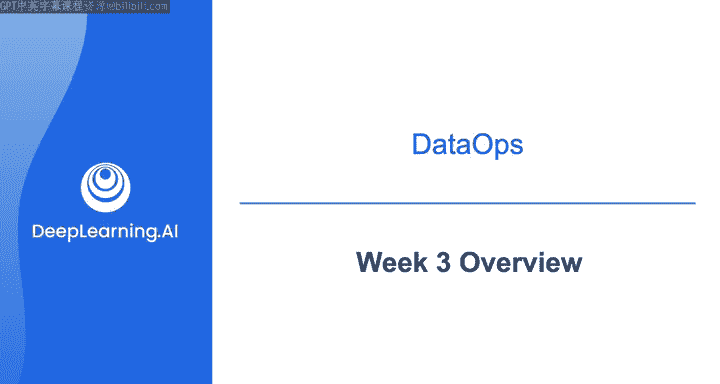
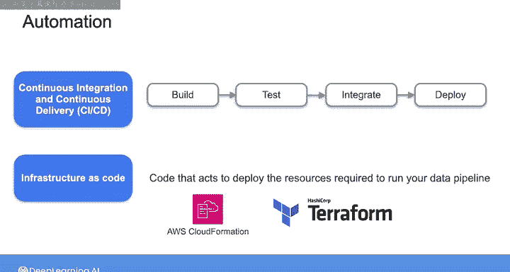
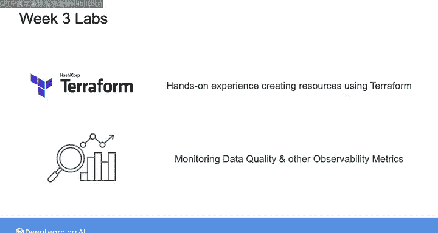
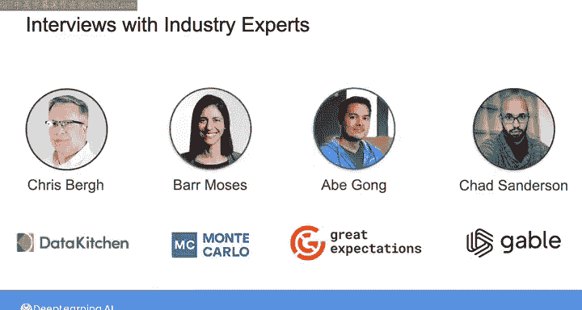

# 吴恩达《数据工程（导论，源系统、数据摄取和管道，数据存储和查询｜1-2-3课）｜DeepLearning.AI Data Engineering》 - P110：32_第3周概览.zh_en - GPT中英字幕课程资源 - BV1wTtWeeEH5

Welcome to Week three This week is all about dataOs。

 but really it includes elements of the software engineering and data management undercurrents as well as you learned in the previous course。

 dataOs is a set of practices and cultural habits centered around building robust data systems and delivering high quality data products and dataOs really emerge from DevOs which is a set of practices and cultural habits that allow software engineers to efficiently deliver and maintain high quality software products this week we're going to get into the details of each of the three pillars of data ops namely automation observability and monitoring and incident response Well actually to be fair we're going to spend more time looking at automation and observability and monitoring and not as much time with incident response but that's not because incident response is less important is just that incident response has more to do with the。

Habits side of data ops and it's harder to build practical exercises around that in an online course Anyhow when it comes to automation。

 we'll be revisiting some of the ideas covered in the previous course like continuous integration and continuous delivery or CICD and then zeroing in on the concept of infrastructure as code which is to say writing code that when you run it deploys the resources required to run your data pipeline in the previous labs in these courses。

 you've gotten some experience spinning up certain resources for your data infrastructure using the AWS console。

On the job as a data engineer， however， it's becoming common practice to do this deployment through infrastructure as code frameworks rather than manually spinning up instances and installing software。

In fact， you already have some experience with infrastructure as code in many of the labs you've already completed。

 we use infrastructure as code tools like cloud formation and Terraform to set up the lab environment and deploy various resources in your data pipelines in the first lab this week you'll get hands-on experience actually writing the code and Terraform to deploy your infrastructure and after that in the labs that follow you'll build on top of your infrastructure to include monitoring of your data quality and other important observability metrics another exciting thing we have in store for you this week。

 as they set of interviews with industry experts from the field of data ops and these interviews you'll be hearing about the key aspects of data quality and data observability from people who are actually building products to serve data engineers in these areas so it's going to be an action packed week materials to kick off this week we'll hear from one of my good friends Chrisburg who is a co-author of the data ops manifestifo。

And CEO at Data Kitchen， a popular data observability and DataOs tool and so the next video is a conversation I had with Chris where you'll hear how he defines dataOs and why he thinks this undercurrent is so important when building data products then after that we'll look at the first pillar of dataOs。

 which is automation。

