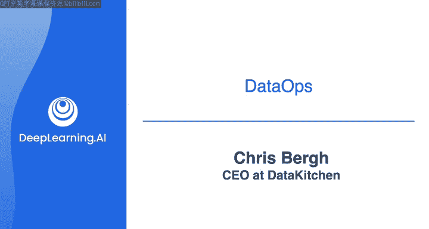

# 吴恩达《数据工程（导论，源系统、数据摄取和管道，数据存储和查询｜1-2-3课）｜DeepLearning.AI Data Engineering》 - P111：33_可选：与Chris Bergh的对话.zh_en - GPT中英字幕课程资源 - BV1wTtWeeEH5

Hi Chris， it's good to chat with you about data ops I think this is a topic that when I think of an next word of data ops in the field you're the first one that comes to mind so it's awesome to see you it's awesome to see you thank you yeah of course I guess maybe give a quick intro for people who don't know who you are。

So I'm Chrisburg， I run a company called Data Kitchen here in Massachusetts and so I'm an engineer by training sort of build software for a bunch of years at different companies like。

MIT Lincoln Laboratory NASA some internet startups and then I got the bright idea like in 2005 that I should do data full the time and so I started to manage a team of you know what we now call data engineers and data scientists and people who did data visualization and sort of my life really sucked things were breaking we can never go fast enough for our customers and you know I fired a bunch of people I probably shouldn't I blamed people for problems when in fact it really was a management problem on how I manage that team and so the question that I've been working on for past almost 20 years is how do you get a team of people a team of technical people doing data to deliver things quickly new insight quickly。

 how to deliver data and dashboards with really high quality and then sort of like how to live like how to not have a painful life and so I think it's great that you your。

Of course on data engineering， but we did a survey with data。

orld two years ago with 700 data engineers and something like。

78% wanted their job to come with a therapist。Yeah。And you know， I'm just maybe I'm cynical。

 but I was like， oh that's a little low and I think it is a very difficult career to have sort of thought between the rock and hard place a sort of insane customer demands and data and infrastructure that's just hard to live with and so you know the I came to the。

Krt of ideas of data appss sort of from that background interesting。I guess for the learners。

 what is data ops？How would you describe it so it's it's think of it as a method to make your yourself or your team deliver insight to your customers where they can trust the data and the insight and then you can make changes to that insight very。

 very quickly with low risk。And so that's really the idea is can you build a factory and push out new data sets and new insights that that's perfectly。

 perfectly good and change things in the factory as fast as you want。

It seems to take inspiration in lean， it sounds like。Yeah。

 I think that's one of the things that surprised me when I started to do data and analytics right I was a softwarephomore guy I'm like oh I'm great。

 this data thing will be easy and then you really are running a manufacturing line in a lot of ways and if you think about a data set coming in。

Being put in a bucket in a database in multiple levels and then being used at a model and a visualization and then governance。

 there should each step along the way， you could kind of think of it as a manufacturing station。

And then you know you don't have one right you have lots of them and so how do you get that manufacturing line to put out you know Toyos and not sort of AMC pacers from the 70s and and that's that's a hard problem that wasn't really in my software background like how to run up。

A manufacturing line and then the other weird part of it is that。

People are always going to ask you for new things， you know， your job are done。

And the best way to deliver new insight to a customer is。Sort of get it 80% done。

 get some feedback and then iterate on it and spend months building something when you can get some feedback early。

That helps those are two very opposite things， build a really good assembly line。

 but change the assembly line really quickly and those are hard to do。Right。

But if you go back to think places like Toyota， they were able to swap out manufacturing in there something like thing in days。

 not months， which is sort of the old mass manufacturing way of doing stuff right there's a yeah black bad yeah there is and I think that's how did they do it。

 they didn't do it by。Like buying fancy robots， I mean they have robots right。

 but it was the solution to that is is really about how do you think about what your job is and what sort of things optimize。

And so a lot of teams try to optimize on getting things done like I have to get my work done。

And and the definition of done is really interesting right， I've done my work， I've got my sequel。

 I'm done。And does it matter if someone used it。 Does it matter if it breaks next week。 I don't know。

 It's my job， right， And so really， it comes down to， it's about Toyota。

 but but Toyota also has focuses on the customer。 And how do you make customer successful。

 And unfortunately， a lot of people in data and analytics are not happy with their the customers are not happy with data and analyticslytic teams。

 And that's the。😊，You know， the dirty little secret is that most projects in data and analytics fail and to me it's not because we don't have cool tech and it's not because the people aren't smarted it's because the systems that people work in are kind of flawed and so these principles that come from software and manufacturing。

I think really apply。And they're not part， they're not rocket science they're just。

They're just ideas that are laying there that you can pick up and use。Absolutely。

 so if somebody's new to data so how should they think about this in their job？Well， I think about。

Yeah。Think about the thing that you do I'm building I do some sQL then the thing about the thing around it so number one as I build some SQL。

 how do I build a test or a validation to prove that that works？

And I get some new data and how do I know now？Why do you want to do that right because tests are sort of the gift that you give to your future self if you don't do that end up owning your piece of code forever and you have to and if something goes wrong。

 they call you maybe on your vacation or you get stuck owning more and more and more code。

And it's really tempting when you first start to be a hero。So like， I'm a hero。

 I wrote all this stuff， I keep writing it， I respond really fast to my customers and you go into full hero mode and what happens is over time。

You get burnt out and you get unhappy and you want a therapist and so in one lesson of data ops is be a hero maybe two。

 3% of the time， but the rest of the time build a system so you don't have to be a hero。

And that's what it's about building a system next to your code testing。obbservability deployment。

 it's all things that are sort of the environment around that squishy little code that you're writing that that can make your life tractable。

Okay。And then let's talk about the dataOs manifesto， so what inspired that？U。Like seven。

 eight years ago we went to a conference and no one knew what we were talking about and I explained I had data ops and they're like what's that and it was like oh man this sucks no one really gets what we're talking about and so we had to so I wrote on the plane I wrote the first version of the manifesto I mailed its around to some people got some feedback I wrote the Wikipedia article and we've had to write a lot over the years to talk about what data ops is。

😊，We have a free certification you can listen to me for three hours on our website。

 but really it's this。This idea that building systems of work is really important and sort of solving your team。

For kind of a couple problems， like if you look at it。You hire a new 23 year old in your team。

 they're new to data engineering， maybe they have a CS degree。

What do you want to do with that person in their first two weeks？I think。

A good organization says number one， if something goes wrong。

 they should be able to find the source of the problem， is it data， is it the integrated data。

 is it the model， is it the viz， like where's the problem？Or number two。

 like could they write some small， could they tweak something？Like anything。

 fix the bug and get that in the production quickly。

And those things are really hard in a lot of data engineering teams。

 you have to kind of learn things and almost becomes an apprentice and so like I think of what data ops is you've got two 23 year old problems。

 how fast the 23 year old can find a problem， how fast the 23 year old can fix and deploy a problem into production with low risk and then there's also probably a 46 year old problem which is like how do you measure your team。

 and to me data ops is about those set of problems。

 which really they don't really have to do with data engineering they have to do with how you sort of manage a group of data engineers working together。

And that's sort of where I come from it and there is a whole engineering task and I mean writing a good data quality validation test is important deployment speed is important doing DevOs。

 managing environments， test data， all those things are really important。Well。

 there is skill in that one question I'm sure that learners will have is how does data ops differ from DevOs？

😊，So I think。Yeah。In a lot of ways they're the same idea。

 they're all like how do you get a group of technically nerdy people to deliver things quickly with high quality and you certainly can do it badly both ways and so what DevO's idea is is that you should deliver your work in small chunks like don't work for don't work for months on something。

Because if you do that， you're most likely going to miss what your customer wants。

And so the main idea that's similar between DevOs and data ops is if your customer asks you for 10 things and it's going to take you three months。

 deliver one of those things in a week。Don't wait and get all 10 things done because most likely what's going to happen is you're going to get four things that they want they're not going to want six things and then they're going to say no I want three more and so you have this waste right that of doing all this work that didn't really matter。

And so I think the idea of devops is how do you manage short cycle times of delivery and how do you automate that and I think there is a sort of。

Observability， error reduction in production and DevOs， but I think。With data， you know。

With data officer。Whatever word you want to put on it it's the same idea right it's that you know run things run things with low errors and change it quickly and measure your work and they're very much the same ideas so you know whether you call it lean or whether you call it TqM or whether you call it devops or data ops they're all the same things how do you get nerdy people to be productive and that's really and to do that you actually have to do some things it's not just。

嗯。It's not just words， it's actually work， you have to build some stuff。

 you have to build the thing next to your environment。

 you have to build you have to build the manufacturinguring line。

 you have to build the machine that makes the machine。Yeah。Well thanks， it's been very educational。

 I guess to cap office there anything that you wish you would have known about data ops。

That you could tell your younger self。Maybe the learners for this course particularly is hope and heroism is like number one what I said before don't be a hero you're not doing yourself any favors and then the second part is。

Don't hope that things will work like just don't maybe it sounds paranoid but don't trust your data providers。

 don't trust your servers measure and prove that things work because both of which I've had so many problems within my career just hoping things in work are trying to be a hero and you can build systems around that so you can do you know have a little hope have a little heroism but it's better to build a high functioning organization that can do that and if you do you're just life's going be a lot better and you don't want to end up in a situation where you're like that 80% of the people we surveyed and said my job suck you know I need it therapist I'm so stressed。

えっと。Awesome， well thanks for your time Chris， it can be very helpful for the learners， so thank you。

😊。