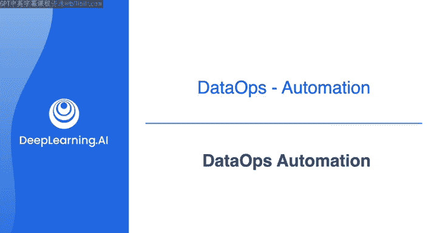
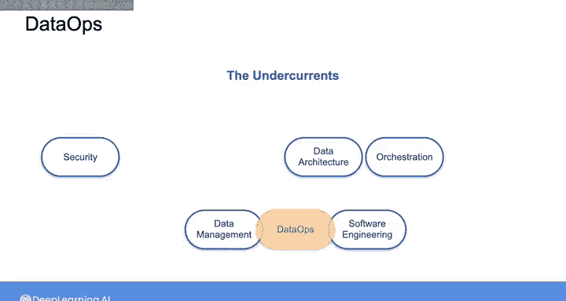

# 吴恩达《数据工程（导论，源系统、数据摄取和管道，数据存储和查询｜1-2-3课）｜DeepLearning.AI Data Engineering》 - P112：34_DataOps自动化.zh_en - GPT中英字幕课程资源 - BV1wTtWeeEH5

In this video， we're going to look at the automation pillar of data ops。

And as I said in the previous video， dataOs emerged from DevOs and while there are significant differences。

Between the requirements for delivering high quality software applications。

And those who delivering high quality data products， there's still a lot of overlaps。

And so here we'll be looking at some of the concepts that data ops borrows from DevOs when it comes to automation within software engineering。

 one key aspect of automation is the practice of continuous integration and continuous delivery or CICD for short in the context of software。

 the CICD process involves setting up systems for automatic review and testing of new code。

 then the automatic delivery or deployment into production code that has been reviewed and tested when it comes to dataOs。

 the practice of CICD can be applied directly to code and data within your data pipeline。

 much as it would be for a software product and so whether that's code for applying a particular set of data transformations or populating a database or the data itself。

 you can maintain it just like you would any other piece of software application code when it comes to the automation of actually running your data pipelines as I talked about in the previous course this is something you could do any number of。

ways， for example， have no automation and just run all the processes in your data pipeline manually or you could set up the stages of your pipeline to run according to a particular schedule or you could orchestrate your pipeline by defining it as a directed acyclic graph or DAG using an orchestration tool like airflow we'll look at daAs and the automation of testing and deployment more closely next week when we get into orchestration Now one key underpinning of any CICD system whether for a software product or a data product is version control or each new code version of the code is recorded this makes it possible to easily revert back to a previous version if for some reason the current version isn't working as expected or other problems occur you might already be familiar with version control in the context of your own code maybe be using a platform like Github and so within dataOs。

 a concept of version control also applies to data just like you can track change。

in your code and roll back to a previous version with data ops， you can track changes in the data。

 moving through your pipelines and be able to roll back to a previous version of the data if you run into problems another concept that dataOs borrows from DevOs in terms of automation is infrastructure as code whether you're building software applications or data pipelines with cloud platform resources。

 it's possible to maintain the design of your infrastructure as a code base just like you would for any other application code。

 you can run that code to deploy your infrastructure or modify the code to redefine your infrastructure and then run it again to deploy the updated infrastructure Now by defining infrastructure programmatically using code。

 you can then maintain version control over your entire infrastructure just like you would for any other piece of code or for your data and that way if you need to roll back to a previous version of your infrastructure it's as simple as rolling back to a previous version of your code and so there are a number of ways。

In which dataOs automation practices will be part of your work as a data engineer you can start to see how dataOs begins to overlap with the other undercurrents of the data engineering lifecycle so for example dataOs is closely related to software engineering and the sense that many dataOs practices are directly borrowed from DevOs and when it comes to the dataOs practice of maintaining version control over your data this ties directly with the undercurrent of data management in the sense that it allows you to deliver control and enhance the value of data throughout its lifecycle Next I'd like to dig deeper into infrastructure as code in the context of dataOs automation then in the next lab you'll get a chance to practice writing code to define your own infrastructure。

So join me in the next video for a closer look at infrastructure as code。

