# 吴恩达《数据工程（导论，源系统、数据摄取和管道，数据存储和查询｜1-2-3课）｜DeepLearning.AI Data Engineering》 - P113：35_基础设施即代码.zh_en - GPT中英字幕课程资源 - BV1wTtWeeEH5

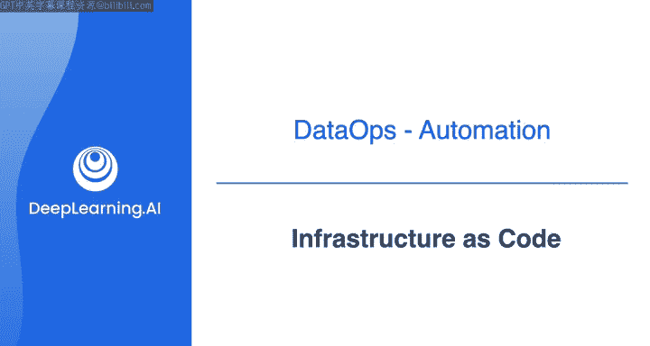

As I mentioned in the previous video， you can use infrastructure as code to programmatically define。

 deploy and maintain your cloud infrastructure This means you can automate the creation of all the resources you need for your cloud data pipelines including networking security computing storage and other data management and analytics resources but the concept of infrastructure as code actually precede cloud computing and has much older routes in configuration management dating back to the 1970s even back then engineers struggled to efficiently configure and manage a series of physical machines and they would write bass scripts to automate some configuration tasks and looking back you can think of this as the sort of primordial routes of infrastructure as code with AWS's release of EC2 and 2006 anyone could easily spin cloud computing resources whenever they needed them so engineers were able to build more scalable applications with many components。

In complex dependencies in the early 2010s， software engineers developed infrastructure as code tools like terraform。

Cloudformation and Ansible that allowed them to provision and configure their infrastructure using codebased configuration files and nowadays you can use these tools to easily manage infrastructure resources on the cloud with lines of code rather than manually clicking through resource setup windows or writing tedious batchsh scripts and in fact you already gain practice using infrastructure as code tools in some of the previous labs so for example in the first lab and the previous course you saw this architecture diagram for the data pipeline you' were building behind the scenes we use cloudformation to automatically create and configure all the necessary networking resources including the VpC and subnets and the RDS database that you needed for this lab and then you also ran some terraform scripts to deploy other parts of this infrastructure including the glue ETL job the S3 bucket and the glue crawler and this week's materials I'll focus mostly on Terraform because that's what you'll be using。

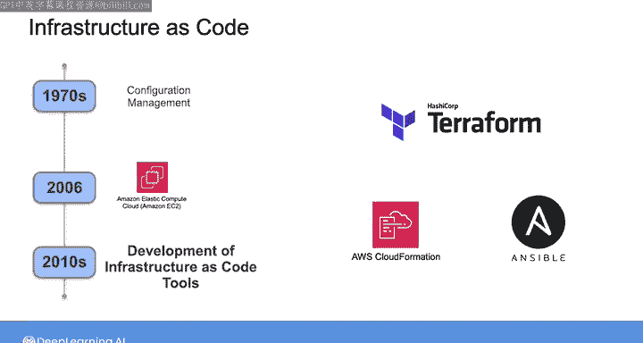

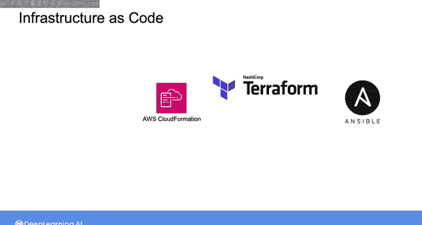

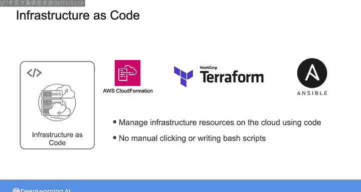

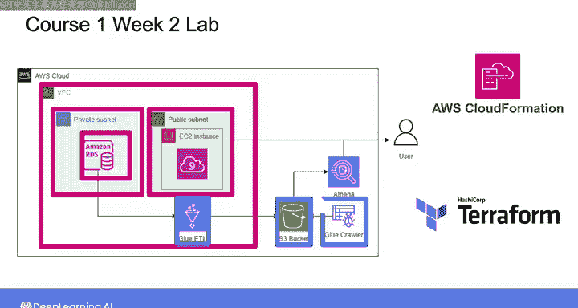

In the lab later this week， but it's worth noting that Cloudformation is another popular infrastructure as code tool and it's native to AWS  Terraform and Cloudformation are both well- supporteduped tools and have great documentation and depending on the organization you work in you might work with one tool over the other and in some cases you might even used both tools just like we have used both tools to support the labs in these courses Now let's take a look at some specific terraform configuration files that you ran to create the glue ETL and S3 bucket components of your data pipeline with zoom in on a part of the S3 configuration file to take a closer look with this first block of code you set up the S3 bucket this bucket has a unique name with the specified prefix based on the variables defined for you in this lab you use a second block of code to configure that bucket and provide public access to it notice that the language used in this configuration file is relatively easy to interpret it follows a simple pattern。

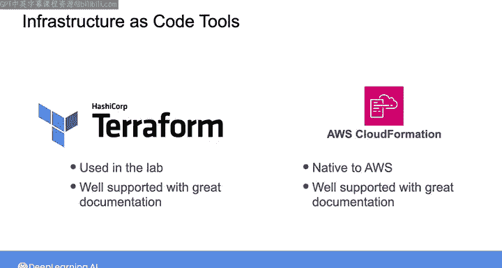

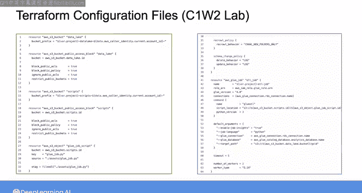

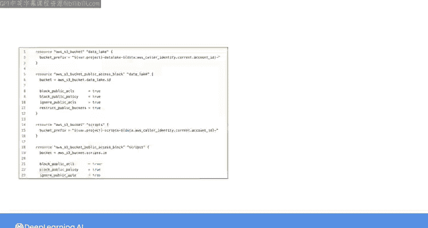

where you start with the keyword resource then you specify the resource type and the name you want to give this resource so in this example here where it says AWS underscore S3 underscore bucket you're telling terraform you want to set AWS as the provider and S3 as a resource you want to provision you will refer to this whole string as the resource type and data lake is the name you want to give this newly created resource then within the curly braces you can specify these configuration options using key value pairs This configuration file is written in a domainspecific language called HCclL or hashicorp configuration language which is name for hashicorp the company that create a terraform you can use the HCclL syntax with terraform to manage infrastructure resources across many cloud vendors For example。

 here's how you can use HCL to create or update AVPC and an E C2 instance in AWS notice this code follows the same pattern you saw in the。

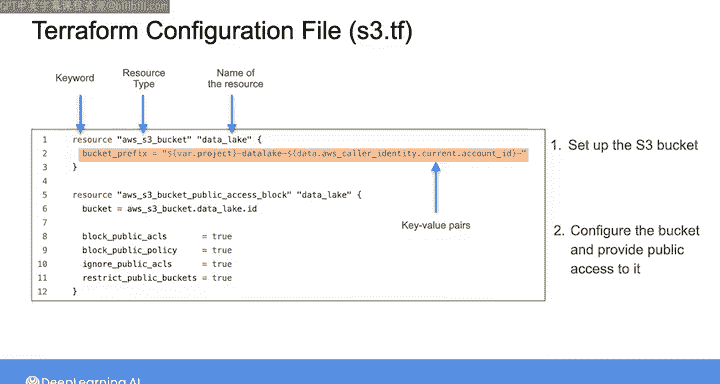

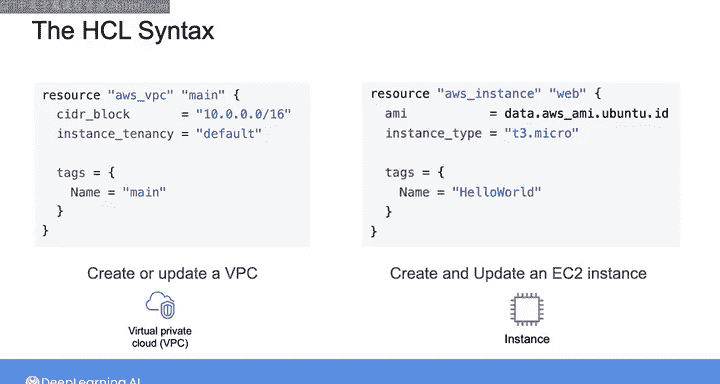

bucket configuration file and here's how you could provision a GCP compute instance using terraform as you see again。

 the code follows a similar pattern， but in this case you specify GCP as a provider HCL is what's called a declarative language meaning that you just have to declare what you want the infrastructure to look like for example what resources you want to create what values you want the configuration parameters to take and this is also known as the desired end state of the infrastructure  Terraform will then figure out the exact steps needed to achieve this desired end state this makes terraform highly ident which means that if you repeatedly execute the same HCclL commands。

 your infrastructure will maintain the same desired end state as the first time you ran the commands for example。

 let's say you run a terraform configuration file that creates five EC2 instances a terraform will first check the existing infrastructure to see if those EC2 instances with these specific configurations already。

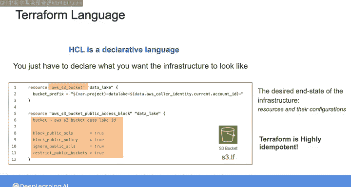

If they don't existterraform will create the missing EC2 instances if there are already EC2 instances that exist。

 but don't match the configurations， you specified terraform will update the existing EC2 instances。

To match the desired state。And if these exact EC2 instances already exist。

 terraform will do nothing and let you know that it didn't make any changes。

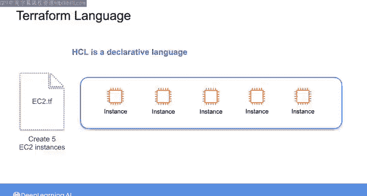

This is in contrast to the imperative or procedural language used batchsh scripts and some configuration management tools where you need to specify the exact sequence of configuration tasks using the same example as before if you're repeatedly run a set of commands super revisionvision5 EC2 instances using an imperative language then you will create five new EC2 instances each time regardless of whether they already exist and so like I mentioned earlier in these courses will' be mainly focusing on terraform when talking about infrastructure as code because it allows you to manage infrastructure across many cloud providers and it's a very popular tool among software and data engineers just note that there are other infrastructure as code tools out there and the following lesson we'll take a closer look at data observability and monitoring but before that I'm going to walk you through these steps of creating your resources in  Terraform and then you'll get some handson practice using  Terraform in the first lab of this week。

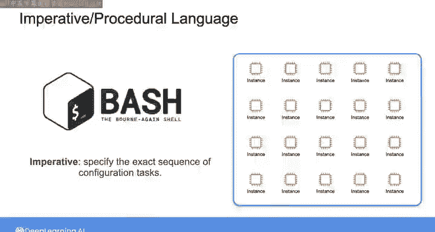

P。