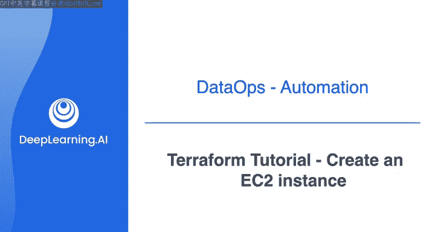
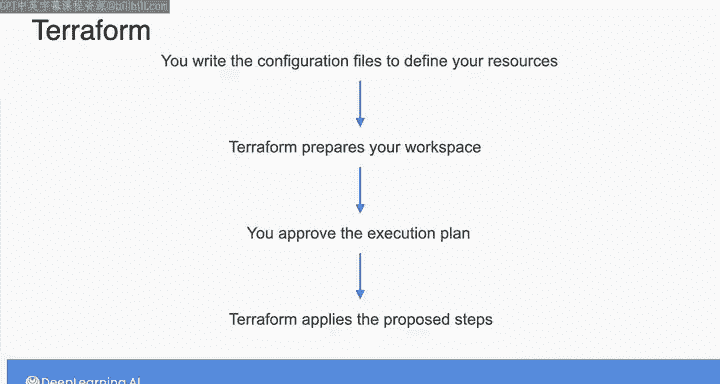
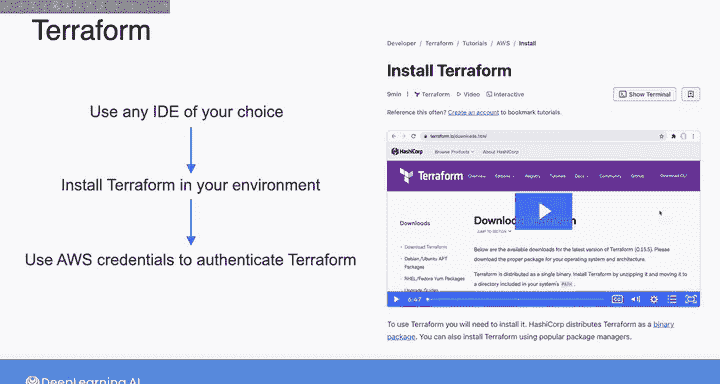
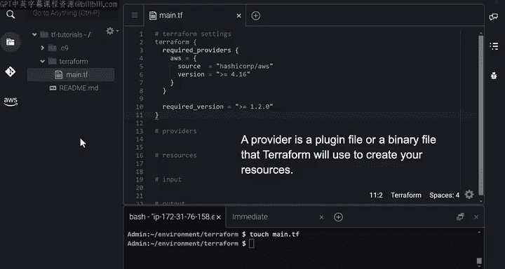
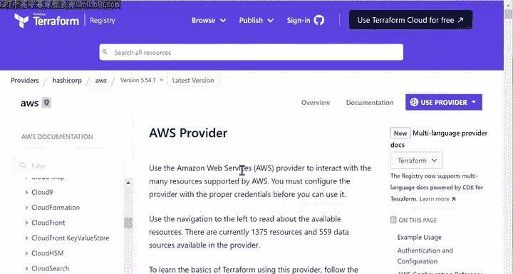
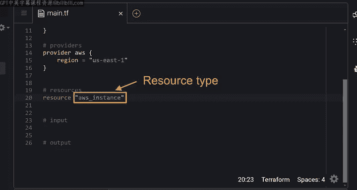
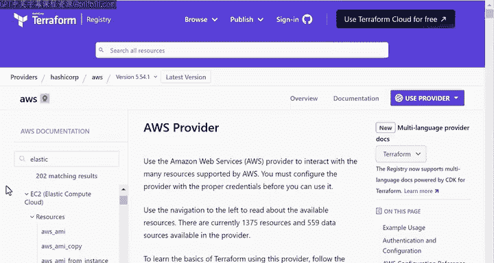
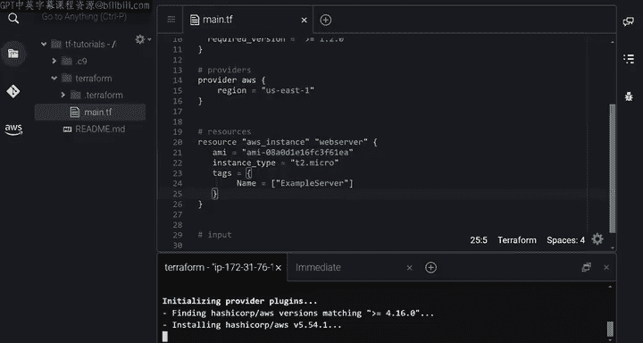
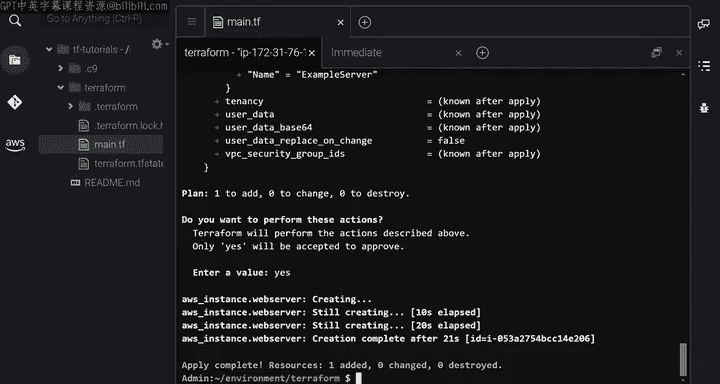

# 吴恩达《数据工程（导论，源系统、数据摄取和管道，数据存储和查询｜1-2-3课）｜DeepLearning.AI Data Engineering》 - P114：36_Terraform：创建EC2实例.zh_en - GPT中英字幕课程资源 - BV1wTtWeeEH5

In some of the previous labs you provisioned and configured some resources by applying  Terraform configuration files that were provided to you to create your resources in terraform。

 there is a consistent workflow that you'll always follow。

 You first write the configuration files to define your resources。

 then ask Terraform to prepare your workspace  Terraform then installs a necessary files that enable communication with the cloud APIs and creates an execution plan describing the resources it will create。

 update or destroy。

Once you approve the plan，  Terraform applies it proposed steps and provisions your infrastructure in the lab this week you'll get a chance to write and run your own terraform code。

 so I prepared a series of tutorials to get you ready for that in this first tutorial well go into the details of how you can prepare your configuration files to create an EC2 instance。

In the process you will learn more about the inner workings of terraform and be ready to create any other resources in terraform and just a little warning before we jump into the details here。

 this is probably going to feel like a fire hose of information but just bear with me。

 you don't need to master all the details the first time through and you'll get a chance to practice all this yourself very soon。

So let's say you want to create an E2 instance and launch it in the default VPC of your selected region。

 as shown in this diagram。 In this example， I'm going to go with the West Virginia region or US East1。

 I'm choosing to launch the E2 instance in a default VPC here for simplicity。

 but recall that in week one of this course。 Morgan said that you typically want to launch resources in your custom VPCs and reserve the default VPC for quick experimentation only。

Let's start with creating the configuration file to define this EC2 instance。

To write your configuration files， you can use any IDE of your choice。

 Inult terraform in your environment and use your AWS credentials to authenticate terraform。

You can find more information about those steps on the Terraform website。

 which is linked in the resources section at the end of this week。In the lab。

 this will all be set up for you。 You will just have the follow the instructions。

 you open cloud 9 and you'll be able to use Tform right away。

Here I'm using Cloud 9 as the ID。 I already installedterraform and created this folder that represents the root directory where I'm going to save the configuration files。

So let's go ahead and create the first configuration file and call it main。tf。

Any file that has dot TF as its extension will be recognized by  Terraform as a configuration file。

You can structure your configuration files as five sections。

You specify the terraform settings and providers in the first two sections。

 then you'll define all the resources you want to set up in the next section。

 and you can optionally define any input variables and output values in the final two sections。

You'll then create blocks of code to represent entities within each section In terraform。

 a code block has a Json like structure that starts with a keyword that tells you what type of block it is。

Then the block can include labels as strings if needed， depending on the type of the block。

 Each block has a body delimited by these curly braces within the body。

 you can define the block arguments for further blocks。Let's start with a first section。

Theterraform block you see here specifies the terraform settings。

 including the required providers that Terraform will use to create your resources。

I'd like to pause for a moment to say a little bit more about providers because I feel this can be a bit confusing the first time you're using Traform。

So in the language of  Terraform， a provider is a plugin file or a binary file that Terraform needs to install in order to interact with external resources。

You can find all the available providers in the Terraform regiiststry as shown here。

Some providers allow  Terraform to interact with cloud platform and others are utilities providers that allow you to use additional functionalities in  Terraform。

 So just to be clear， in terraform， the word provider is not a reference to the cloud provider where you're setting up resources。

 Instead， a provider in this context is that plugin or binary file thatterraform needs in order to interact with external resources。

 Let's click on the AWS provider。 And again， AWS provider here is not referring to AWS as the cloud provider。

 Instead， this is the file that allows terraform to interact with resources on AWS。

 So here you can see the version of the provider， the source code and a link to its documentation。

 If you click on the documentation。 you will see a list of all the resources available by this provider and examples of their usage。

When working with terraform， this documentation can be really helpful because it shows you the arguments that you need to specify in this case for any AWS resource。

 Now， let's go back to the code。 Since we're only using AWs resources in this example。

 you need to declare only the AWS provider as the required provider for each provider。

 you need to specify a local name。 the source location and optionally a version constrained。

 the local name is the unique identifier that you can use everywhere in the configuration file to refer to the provider。

 For example， here， I'm using AWS as a local name for the AWS provider。

 which is the preferred name that is used in the AWS provider documentation， the source。

 which is hashicorp AWs is the global identifier of the AWS provider。

 It specifies where terraform can download this provider when you run this configuration file。

 you can also set a version constraint for terraform itself by specifying the required version within the terraform block In the next section。

 you can create a provider block to configure the provider that you just。

So in this provider block here， I've specified the AWS region。

Note that the name that I use next to the provider keyword is AWS。

 which is the local name I assign for this provider within theterraform settings block I know this feels like a lot of details。

 but don't worry， you can always go to the documentation for your specific provider and copy the code for the terraform settings and provider' blocks。

Next， let's define the EC2 instance in the resource block， you start with the keyword resource。

 Then you specify what is called the resource type。

 which is a string that contains a provider and the resource separated by an underscore。

 So the prefix AWS refers to the AWS provider we specified earlier and the resource type AWS underscore instance refers to the AWS。

E C 2 instances that I want terraform to manage。

You can always search for the resource type in the terraform documentation of the AWS provider to find the name of the desired resource type you want to configure with  Terraform。

The next string here represents the name you chose to give to this resource。Together。

 these two strings form a unique ID which you can use to reference your resource in other blocks of your configuration files。

For example， you can refer to this EC2 instanceense using AWS_insense。web serverver。Now。

 inside the resource block， you need to specify the arguments of the resource。

 and again you can find the list of the arguments for each resource in the documentation。

So for example， for the EC2 instances， you have this long list of arguments。

But just like when you're writing Python code， you don't need to specify every single argument as most of them are optional。

The two required arguments for the EC2 instance are the AMI and the In site。

The AMI is a software template that contains information about the instance's operating environment such as the operating system and system architecture。

AWS provides a long list of AMIs that you can find in the AMI catalog in the AWS console。

In this example， I grabbed the idea of the most recent Linux based am I。For the second argument。

 I'm using T 2 dot micro as the incense type。 I also set the optional tag to give the Insense same example server。

 Note that I did not specify a subnet in which I want to launch the E C2 instancecense。

 And this is because I want to launch it in any subnet of the default A PC。

What you see here in this configuration file is enough to create in easy two instance。

So let's actually create this EC2 instance。In the example here。

 I'm going to start with theterraform init command。 When you run this command。

 terraform installs the providers defined in the configuration file。So in this example。

 Terraform downloads the AWS provider and stores it in a hidden subdirecty named dot Terraform。

Once terraform has been successfully initialized， you can run the terraform plan command。

 When you run this command，  Terraform creates an execution plan that details what terraform is planning to create。

 update or destroy based on your configuration files。So in this case。

 the plus signs mean that terraform plans to create all of these components。In other cases。

 you might see a minus sign， which indicates things that will be destroyed or a tilda symbol。

 which indicates things that will be updated。Finally， you can run the Terraform App command。

Terraform will show you the execution plan again， but then stops to wait for your approval。

 So here I'm going to type yes and wait for the creation of the E2 instances。And there you go。

 Terraform just created the EC2 instance based on these configuration specifications。 If you want。

 you can check the instance in the console。

So in this first tutorial you saw how you can set up your configuration file with the terraform and provider blockss。

 then how you can create an EC2 instance using a resource block。

 join me in the next video to learn more about other blocks in terraform and how you can better organize your terraform directory。

