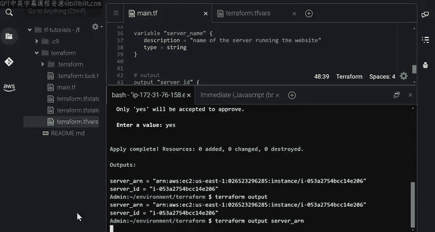
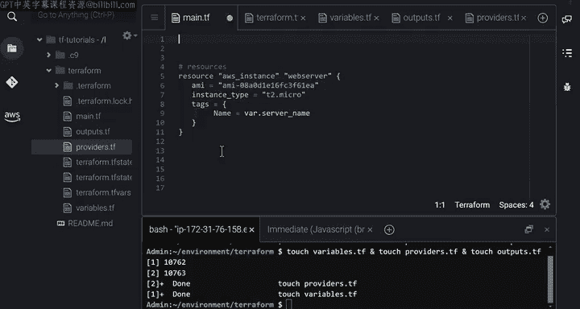

# 吴恩达《数据工程（导论，源系统、数据摄取和管道，数据存储和查询｜1-2-3课）｜DeepLearning.AI Data Engineering》 - P115：37_Terraform：定义变量和输出.zh_en - GPT中英字幕课程资源 - BV1wTtWeeEH5

In this video， I'd like to continue working on the same terraform configuration file we started with in the previous video。

Here we'll look at how to create input variables for your configuration。

 how you can export your resource information using output values。

 and how you can organize your Traform workspace。In the previous video。

 I incorporated some hard coded values inside the configuration file。

 such as the region name and the EC2 instance name instead of hard coded values inside your code blocks。

 you can create input variables to parameterize your configuration These of input variables allows you to customize your infrastructure and specify different values for your variables when you want to create your resources instead of manually editing your configuration files In this example。

 under the input variables section， I'm going to create one variable that represents the region name。

And another one that represents the server's name。You can declare these variables like this using the variable keyword。

Here， the string's region and server name represent the name of each variable。

 which acts as identifiers for the variables inside the terraform configuration file。

Each variable has three optional arguments， a description that documents the purpose of the variable。

 the type of the variable， and a default value assigned to the variable。

If you don't assign a default value for the variable。

 then you'll be prompted to specify its value before terraform applies to configuration。Now。

 to use these variables in other blocks， you can refer to each variable using the syntax var dot variable underscore name。

So here in the provider block， I replace the hard coded value of the AWS region with V dot region。

And in the resource block， I replace the hard coded value of the instance name with Vr。

t server_ name。To automatically assign values to the variables without being prompted。

 you can use the command line flag dash var， as shown here。Or more conveniently。

 you can define the values of the variables in a specific file that has dot T F vrs As its extension。

 So here in the same directory that contains the configuration file。

 I'm going to create the file terraform dot T F vrs。 and inside this file。

 I'm going to assign a value to the variable server underscore name。Now to update the file。

 you can just use the command Terraform apply。Terraform will use the file that ends with dot TFRS to extract the values of the variables and update the configuration with the provided values。

Since I assigned the same name for the E C2 instance。

 Terform did not find any changes that needed to be updated。Now。

 any resource that you create will contain a list of characteristics or attributes。For example。

 you can check the documentation of the E C2 instance。 You can see a list of all its attributes。

 such as the ID Instense， It ARN， which standss for Amazon resource name and its public I address。

 In some cases， you might want to export these attributes。 For example。

 you could print them in the command line， use them in other parts of your infrastructure。

 or reference them in other terraform workspaces。To do this。

 you need to declare them as output values。So I'm going to create two output values to export the ID and ARN of the EZ2 instance。

The strings server underscore ID and server underscore ARN that come after the output keyword represent the names or the identifiers for these output values for each output value。

 you need to specify the value argument by assigning it to the attribute of the EC2 instance。

You can access the attributes by specifying the identifier for the resource。

 which is the resource type dot resource name， then using the dot attributes syntax to get the value of the attribute。

So in this example， to access the ID attribute of the EC2 instance， I'm using Aws_instense。webserver。

id。I did the same for the A R N attribute。Now let's see how you can access the output values in the command line。

 First， let's apply the updates by running theterraform apply command。

Here you can see that Terraform detected the changes to outputs and it's telling you that it's going to create those output values。

 so here I'll type yes。You can see the outputs displayed in the terraform message。

After you create the outputs， you can use a terraform output command to query all of them。

 or you can query an individual output by specifying its name。

Right now， I have several blocks in this configuration file。

 where each block has a different purpose。 But what if you have more than one resource with several input variables and several output values。

 If you declare all the blocks in one file， then at some point。

 managing the file will become very cumbersome。The better practice is to split this configuration file into several files。

 like I'm showing here， you declare all your input variables in variables do Tf。

 all your output values in outputs do Tf， all of your providers and providers do Tf。

 and all of your resources in main do TF。You can also further divide main dot Tf where you declare each resource in a separate T F file。

 Terraform will automatically concatenate all the files that end with dot Tf as if you written all of them in one file。

 So here I'm going to create the three new files， variables do Tf providers do Tf and outputs do Tf。

Then I'm going to move the variables to the variable file。The output values to the output file。

And finally， the terraform settings and provider blocks to the provider's file。

And so creating input variables and organizing your workspace in terraform like this helps you maintain your infrastructure。

And in the next video， I'll show you how to use modules to organize your workspace and how to declare data sources。

I'll see you there。

