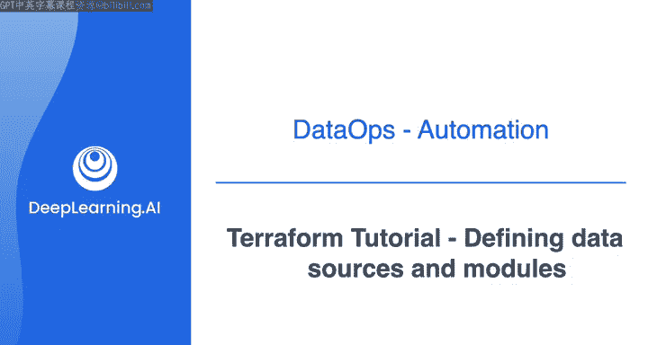
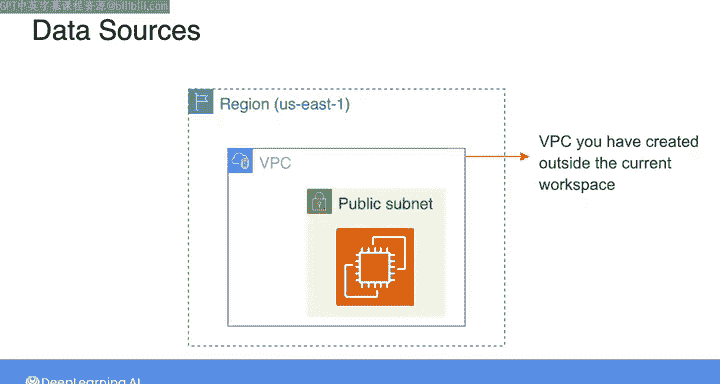
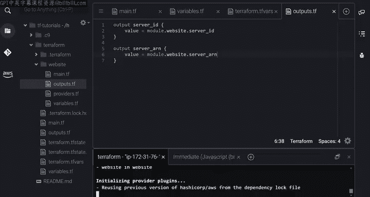

# 吴恩达《数据工程（导论，源系统、数据摄取和管道，数据存储和查询｜1-2-3课）｜DeepLearning.AI Data Engineering》 - P116：38_Terraform：定义数据源和模块.zh_en - GPT中英字幕课程资源 - BV1wTtWeeEH5

In addition to the resource variable and output blocks that you saw in the previous videos。

 you can also declare data blocks and Terraform you can use data blocks in your configuration file to reference resources created outside of  Terraform or in another terraform workspace。

Terraform refers to these resources as data sources。

 You can check the provider documentation and the terraform registry to see how to declare these resources。

 You will notice that for each resource available in the provider。

 you can declare it in terraform either as a resource or as a data source。

 depending on whether you want to create that resource or read from an external resource。

 Let's go over to examples that use the data block。 In a previous video。

 I created a configuration file that launches an E C2 instance inside the default VPC。

 But now let's say you want to launch the E C2 instance inside a subnet of a VPC that you already created outside this current workspace。

 to access a subnet。 I'm going to declare a data block as shown here。

 similar to the resource block Next to the data keyword。 I'm going to specify two strings。

 The first string represents a resource type which you can get from the provider's documentation and the second string is a name you choose to give through the data source。

 You can now refer to this name throughout the configuration file inside the。

You need to specify the arguments that identify the subnet that you want to use。

Make sure to check the documentation in order to know what arguments this data source expects here。

 I am assuming that I know the idea of the subnet， and I'm assigning it to the I argument。

 now that the data source has been declared， you can use its attributes。 So for instance。

 to use the I attribute。 you start with a keyword data。

 then specify the resource type and name for this data source。

 then give it the attribute you want to access。 So in this case。

 you can use data dot Aws underscore subnet dot selected underscore subnet I D to get the I of the desired subnet。

Inside the resource block of the EC C2 instance， there is this subnet underscore I attribute that I can specify using this expression in order to launch the E C2 instance inside the desired subnet。

 Now， since you already know the subnet I D。 you could have， of course。

 just reference it directly in the resource block。 But here I wanted to show an example of how a data block could be used instead。

 because in some cases， you may not directly have the subnet I。 And so in the data block here。

 you may use other arguments to identify the desired subnet。 As another example。

 you could also use a data source to automatically identify the AMI argument of the E C2 instance。

 In the first video， I explained that I grab this AI from the AWs console。

 if I want to automate this process by asking terraform to do the search of my behalf and retrieve the latest Linux AMI。

 I can use the following data block。So here I am asking terraform to find the most recent AMI owned by Amazon that has a specified system architecture。

 and that is Linux based。 And now inside the E C2 instance resource block。

 you can specify the AMI as shown here。 Again， you start with a keyword data。

 Then you use the resource type and name of this data source。And finally。

 you specify that you want to access the ID attribute。

Let's now update the configuration by running the terraform applied command。

 You see that  Terraform is planning to destroy the previous instance to create a new one with the updated network settings。

 You can also see that it performed the search to find the latest AMI。

 and it found the same AM I that I have already specified。

 So now I'm going to type yes and wait for the updates to take place。

The last topic that I'd like to cover in this tutorial is use of modules in terraform。

A module is a subdirecty inside your main directory that you can use to group resources that are used together so you can think of it as a way to package those resources In this example。

 I'm going to create this website module to group together all the resources that are used to create the website so let's move the file main do Tf that contains the definition of the web server into the website module。

 a module is like a regular root directory so it also expects you to declare the providers。

 the input variables and the output values inside of it。

 so I need to move those files into the website module The module acts as a folder that contains the resource。

 the input variables and output values。So you can't directly access this information in the root directory。

 meaning that if you runterraform applied now， it will give you errors because the root directory won't be able to see the values assigned to the input variables。

To solve this， you need to declare a module block to call the module in the root directory As shown here。

 I chose website as a module name and specify the source argument， which is the module directory。

 Now， inside this module block。 I can include the input variables of that module with specific values。

 So here I need to specify a value for the input variable server underscore name。 And for that。

 I'm going to create this variables dot T F file in the main directory。

And declare the server underscore name， underscore root variable。Then back over in the module block。

 I can assign through the module's input variable the value of this server underscore name underscore root variable。

 And then finally， in the Tfs file of the root directory。

 I need to specify the actual value of the server underscore name underscore root variable。

 and finally， if you want to export the modules outputs server ID and server AN Also as outputs in the root directory。

 you need to create an outputs file inside the root directory。In this file。

 you declare the outputs and assign them to the values of the module's outputs using this syntax。

 you start with the word module， then you specify the name of the module that contains these output values。

 and then you specify the name of the output values you want to access。Whenever you add。

 remove or modify module blocks， you need to rerun  Terraform in it to allow  Terraform to install new modules or adjust the installed modules。

 So here I'm going to run  Terraform in it。

Then terraform apply。We'll type yes and wait for the updates to take place。

And that's it for this video series on Terraform， I know that was a lot， but don't worry。

 you can always refer back to these videos to review the details。

I've also included some optional reading materials after this video that contain more terraform configuration examples。

I'll see you in the next video for a quick walkthrough of the upcoming lab。

