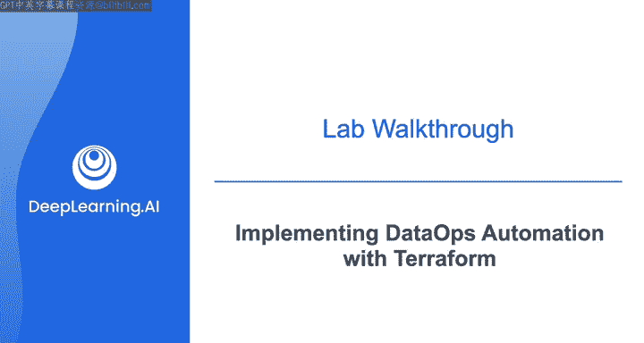
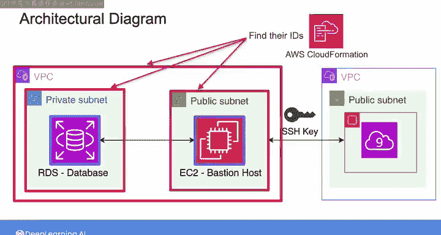
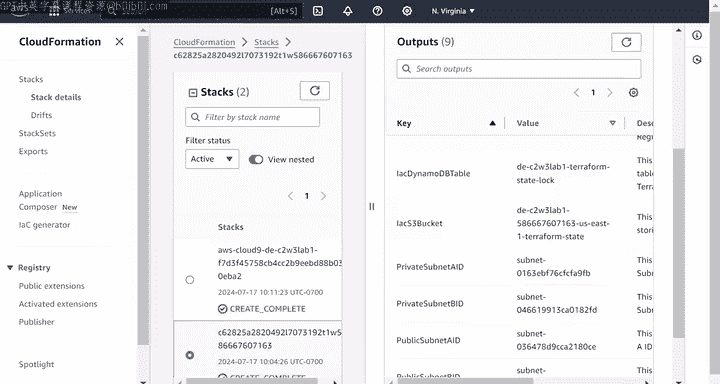
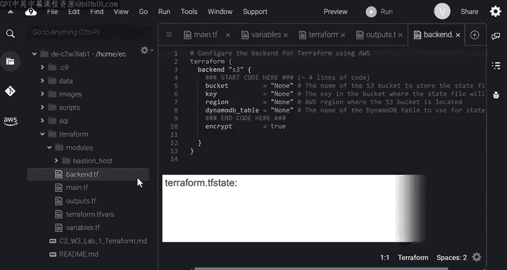
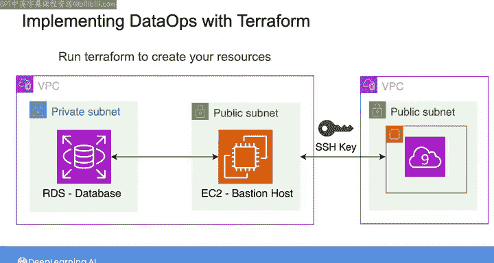
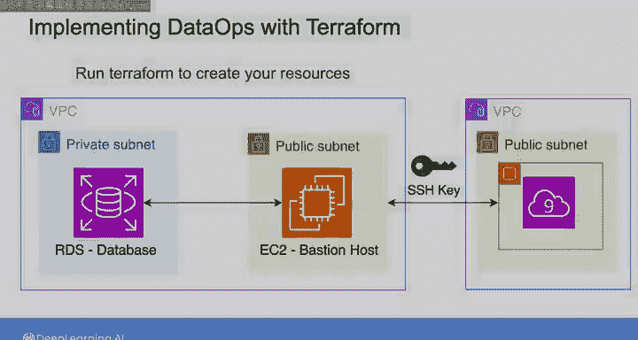

# 吴恩达《数据工程（导论，源系统、数据摄取和管道，数据存储和查询｜1-2-3课）｜DeepLearning.AI Data Engineering》 - P117：39_实验演练：使用Terraform实现DataOps.zh_en - GPT中英字幕课程资源 - BV1wTtWeeEH5

In this video， I'll go through the architectural diagram of the resources you will deploy using  Terraform and give you an overview of the steps you'll follow in the lab using  Terraform。

 you'll create a database instance and deploy it via a bastion host Also known as a jump server。

 This server acts as a bridge that connects authorized users from the public internet to the resources hosted within a private network When an authorized user wants to access the private network。

 they have to establish an S or secure shell connection to the bastion host to securely access the private resources using an SSH key。

 the external users can prove their identity to connect to the bastion host Once users are authenticated。

 the bastionhos can forward the request to the internal network。

 Here's a diagram of the bastionho architecture that you'll implement in this lab it consists of an RDS database instance hosted inside a private subnet of a given VPC and an EC2 instance that acts as a bastion host。

 the EC2 instance resides in a public subnet within the same VPC so that it can receive external traffic from the public internet。

Before relaying the secure traffic to the internal database in this lab。

 the VPC with its private and public subnets are already created and provided for you。

 you will define them as data blocks within your terraform configuration files and then use their information to create the Rds database and the EC2 instances when you create the EC2 instance you will also generate an SSH key pair which consists of a public key that you'll storear in the EC2 instance and a corresponding private key that you'll save in a separate file The pair of public and private keys are used to encrypt and decrypt the messages between the external user and the bastionhos during an SSH connection in order for the external connection to prove its identity in the lab after you create all the resources and terraform youll use a private key to connect to the RDS database via the bastionhos from the cloud 9 terminal to create the database in EC2 instances you' are provided with the terraform files that you'll need to complete for that you'll first need the I of the VPc and its subnets that are provided to these resources。

Created using cloud formation as part of the lab setup to access them。

 you can go to the console and look for cloud formation and the search bar under the stack name。

 click on the stack name that does not start with cloud9 on the right。

 click on the tab outputs here you will see a list of the resources created using cloud formation behind the scenes。

 If you scroll down you can find the I of the Vpc and its subnets under the column value for the other resources that you see here such as the S3 bucket and dynamodb。

 I'll mention the purpose later in the video Now let's do a quick tour for the terraform files that are provided to you the configuration files for the resources of the bastionhost architecture are collected inside a module labeled as bastion hosts theterraform files are organized as shown here into variables outputs providers and a file for each resource E2 Rds and network。

 remember that  Terraform will concatenate all these configuration files together and that splitting them into separate files is just for readability and ease of maintenance。

In the provider file， you will notice that the list of the required providers not only include AWS but also other providers which are local random and TlS These are utility providers that provide functionalities you can use when creating a resources you will use random to generate a random value for the database password TlS to create the SSH key pair and local to create a file to store the private key for the SSH key pair。

 I encourage you to check out the documentation for each of these providers in the towerform registry Now in the AWS block note that the region and project name are specified through the use of variables the network file contains data blocks for the VpC and its subnets in the lab you will complete this part and specify the I of the subnet and VpC using the corresponding variables that are declared in the file variables If you scroll down you will see that the network file also contains the definition for the security groups of the bastionhost and RDS the security groups are configured so that the bastionhost can receive SSH。

Action from a public internet。And the database can receive traffic only from the bastion host it will use these network resources in the RDS and E2 configurations in the RDS file you have three resource blocks。

 The third block contains the arguments that you will need to specify to create an RDS instance such as a server instance type。

 allocated storage， subnet group， security group IDs。

 the type of engine which is Postgres in this case， port number， the database username and password。

 you will fill out the values for some of these arguments。

The first resource block corresponds to the resource random I from the random provider。

 This resource will generate a random number that you will assign to the database password。

 and the second block will create a subnet group which contains the Is of the two private subnets that are provided to you。

 You will use this resource to configure the subnet group for the RDS database。

 Note that you have to specify two private subnets instead of one。

 This is because RDS is designed to expect at least two subnets in case you want to later switch to multiavailability zone deployment。

In the EC2 file， there are also several resource blocks。

 The last block contains a configuration for the EC2 instance。

 you've already seen some of the attributes in the previous video such as the AMI Ins S and subnet ID in this lab you will also need to specify other attributes such as the ID of its security group and key name the key name represents the name of the SSH key pair that you need to associate to the bastion host to do so you will use the first resource block Tls private key to generate the key pair The second resource block local file creates a file for you to store the private key from the pair and the resource AWS key pair block will register the public key with AWS so you can use its key name inside the configuration of the EC2 instance。

These resource files expect some input variables that are declared in the file variables。

 The file contains variables that designate the project name， AWS region。

 the I of the VPC in its subnets and the username for the database。

 The variables that correspond to the VPC and its subnets do not have a default value。

 so you will need to assign values to these variables outside the module and the Tf bars file。

 The module also has some output values that are listed in the file outputs。

 You will be tasked to complete this file to define the output values such as the database host。

 Port， username， password and the DNS of the bastion host。

You will need to export this information in order to connect to the database after you create the resources。

We already discussed that everything in a module is encapsulated and hidden from the root directory。

 So in order to assign values to the module variables and to use its output values。

 you need to declare the module in the root directory。 So here in this main file。

 the module is declared。 and you can see that values are assigned to its input variables and also using variables。

 This is why the root directory also contains a variables file that contains a similar list to the module variables。

 The variables that correspond to the VPC and its subnets do not have default values。

 And so you need to assign values to these variables in the Tf vrs file using the Ids from the cloud formation stack。

The root directory also contains an outputs file that contains a list of the outputs exported from the module。

 The additional file you see here is the backend file。

 which contains a backend block that allows you to define where terraform should store its state data files。

 Every time youre own terraform， the file terraform Tf state is created or updated to keep track of the state of your underlying architecture and its configuration。

 This file contains information that maps a resource instances declared in your configuration to the actual Aws objects。

 The state file is by default stored locally。 But if you're working with a team on the same collection of resources。

 You would need to share the state file with a team by storing it in a remote repo like an S3 bucket and terraform。

 you can define an S3 backend as you can see in this block。

 The S3 bucket is already provided to you and you can find its information in the cloudform stack from the console you can also specify in this block the name of the dynamo Db table。

 you would need to use a table when you want to ensure that the state file is not accessed or modified by two persons at the same time。

The Dynamo Db table locks the state file while it being updated。

 preventing other users from concurrently modifying the file。

 The Dynamo Db instance is also provided to you through the cloud formation stack。

 So now it's your turn to practice working with terraform on this architectural example after you complete the configuration files。

 you will run terraform to create your resources。 At the end。

 you will experiment connecting to the database via the bastion hosts After you finish the lab join in the next lesson to go over the second pillar of data ops Data observability and monitoring。

