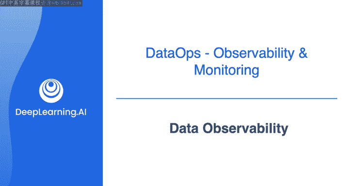
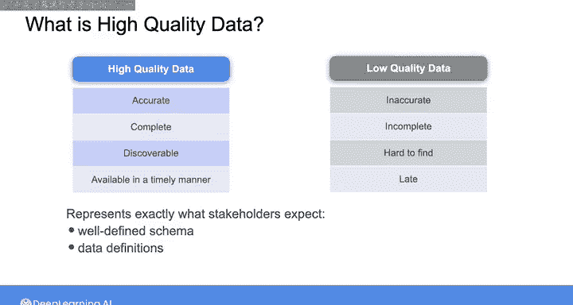
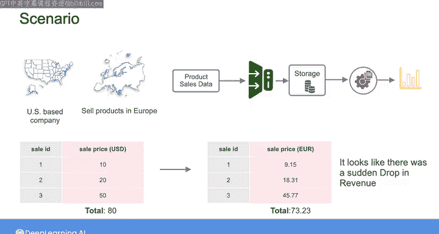

# 吴恩达《数据工程（导论，源系统、数据摄取和管道，数据存储和查询｜1-2-3课）｜DeepLearning.AI Data Engineering》 - P118：40_数据可观察性.zh_en - GPT中英字幕课程资源 - BV1wTtWeeEH5

In addition to the principles of automation that data engineers borrow and build on from DevOs。

 the principles and practices of observability and monitoring are a key pillar of data ops that also has its origins in software development over the past decade or so with the advent of the cloud and the move toward distributed systems software engineers have develop observability tools that help their teams gain visibility into the health of their systems with these observability tools teams are able to monitor metrics such as CPU and RAM usage and response time which helps to quickly detect anomalies。

 identify problems prevent downtime and ensure reliable software products when it comes to data observability and monitoring the health of your data systems。

 some of the same tools that software teams rely on can also be helpful to as a data engineer with that being said in addition to monitoring for things like CPU usage or system response times。

As a data engineer， you also need visibility into the health or in other words。

 equality quality of your data as a reminder in the previous course。

 we defined high quality data as data that is accurate， complete。

 discoverable and available in a timely manner and beyond that high- qualityality data represents exactly what stakeholders expected to represent in terms of a well-defined schema and data definitions low quality data is the opposite and it might be inaccurate incomplete or otherwise unusable so when you' are able to provide high quality data to stakeholders in your organization you're providing value for those stakeholders but believe it or not。

 providing low quality data is actually worse than providing no data at all when business decisions get made based on low quality data it can be extremely costly for an organization and it can leave stakeholders second guessing the value of the data team to complicatedate。

FurtherData systems that provide poor quality data might look perfectly healthy on the outside。

 For example， let's say you have a software application like a mobile app or a website if the app crashes or if you get a 404 error when trying to load a web page it's pretty obvious that something has gone wrong and those are the kinds of things that can trigger an alert to a software engineer so they can go fix the problem with a data system if your system simply stops working and you're able to recognize immediately that it's not working that's actually your best case scenario in terms of potential failure modes in this case you can debug the problem and get your system up and running again on the other hand。

 your data suffers a breaking change such that your system still works but is no longer providing high quality output that's when things can get really ugly to better understand what I mean let's look at a hypothetical scenario So imagine for example that you're a data engineer at a USbased company that sells certain product。

In Europe and suppose that you're ingesting product sales data and serving data for downstream analytical use cases now suppose for some reason the team that manages the transactional database where product sales are recorded。

 they decide to start recording the sales price in euros instead of dollars。

So your system still works and you're still serving data thats being used of popular analytics dashboards and the numbers in those dashboards might even look plausible。

 but now it looks like there was a sudden drop in revenue of maybe like 10 or 20% depending on the conversion rate from dollars to euros that day across all sales in Europe。

 this triggers an emergency meeting of the leadership team which leads to an all handson deck effort to resolve the issue okay so maybe that sounds like a silly story but I can tell you that some version of the story and some cases a much uglier version has played out across countless organizations worldwide。

And so in terms of data quality， this would be an example of where in the  blinkak of an eye。

 your system went from serving high quality data to serving data that was no longer accurate。

 or at least was not what stakeholders expected it to be。

Now， of course， you could argue that this was not your fault。

That the source system owners shouldn't do such things。

 or at least that they should have alerted you to such a change that would affect your data。

 but as I've said throughout these courses， upstream changes that disrupt or break your data systems should be expected and mitigated really no matter where it comes from once the data is in your hands it's your responsibility to ensure its quality So when there's a disruption to your data system how do you make sure you know what happened as soon as possible Well。

 that's where data observability and monitoring comes in Next up。

 you're going to hear from a true expert in this field my friend Bar Moses。

This next video is optional so feel free to skip ahead。

 otherwise join me in the next video for a conversation with Bar Moses on the topic of data observability and monitoring。

