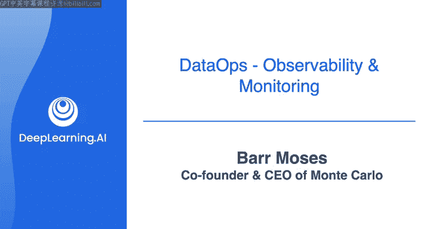

# 吴恩达《数据工程（导论，源系统、数据摄取和管道，数据存储和查询｜1-2-3课）｜DeepLearning.AI Data Engineering》 - P119：41_可选：与Barr Moses的对话.zh_en - GPT中英字幕课程资源 - BV1wTtWeeEH5

Hi Bar， how are you I'm doing great， Great to see you， Joe。 Yeah good to see you again。

 Yeah So we're gonna talk about data observability and related topics。

 maybe some data quality stuff as well。 but for the learners of this course who don't know who you are would like to give a quick intro。

 happy to My name is Bar Moses and the CEO and cofounder of Monty Carlo a company that we created that actually is credited as the leader and creator of the data observability category and just for sort of quick background about myself。

 I've been working with data and analytics for a long time。

 I studied math and stats earlier on and when I started working with organizations I noticed that oftentimes the data that they were working with was wrong and was really frustrating and it was not clear to me why there isn't a good solution out there for it。

 and so started Mon Carllo started this category with the goal of helping data teams and data people。

😊，Around the world actually be able to use data， but this time use trusted and reliable data That's awesome。

That's a good motivation too， but I guess to back up。

 if you were to explain data observability to somebody who doesn't know what it is。

 how would you explain it？Great question So data observability。

 I think the best way to understand is sort of a corollary to software observability。

 But before I even get into that， let me just talk about the pain point that it solves so for anyone who's worked with data I don't know if this has happened to you but you sort wake up on a Monday morning or maybe this is Friday afternoon right before you're heading out to your weekend and you're looking at some data product could be a data dashboard could be a machine learning algorithm。

 whatever it is you're looking at it and suddenly the data looks wrong and you're like you're squinting and you're like why does data look wrong here something here is off maybe Joe calls you and says WTf the data looks wrong and you're like。

 oh man， I just started my day but I'm kidding in all of these instances is a sort of reality for data teams get inundated with questions about why the data is wrong and that is a problem that plagues data teams of all sizes sorts maturity curves etc and。

So we set out you know to sort of solve that problem or that you in the nutshell is what data observability is meant to help with。

 it's meant to help data teams regain the confidence in their data。

 it's really hard to have data that's 100% accurate， I don't think that's a realistic goal。

 but being able to understand the health of your data。

As a result of sort of the output of the data by observing the data is what gives confidence and an understanding of the health of the data and so if you sort of go back to this corollary of software engineering software engineering I've been building you know software products for many decades now。

And the up time and reliability of those products is really important you know maybe the best example here is you know if your website is down for a little bit。

 that's a big deal I don't know you know it's companies can't operate if their websites are down and so imagine if your products are down because the data is wrong in fact Netflix was down for 45 minutes in 2016 because of bad data 45 minutes of Netflix is a full episode of survivor or whatever it is your favorite show and that's impactful on revenue on reputation on your brand be it could be risk operational risk and so in all of those instances the way to sort of deal with making sure that you handle what we call data downtime periods of time and data is inaccurate or wrong re is by having strong data observability so data observability is the ability to understand the health。

of your data systems be able to improve it over time That's super useful too when I got started。

 I had exactly what you described earlier happen where numbers were wrong and the CEO calls me into the office and says you have about five minutes to fix this。

That's stressful or bad things happen to you， so because you had a very important meeting and you know。

 it's it's the， sos it's really bad when the when executives end up debugging your reports for you。😊。

um。100% and the thing is you can't get away from it right because this problem actually is getting a lot worse because if you think about it like five。

 10 years ago you had a very small number of people working with data today you have a lot more data sources。

 a lot more a lot more people working with data you know I like to think that you know our the data state has evolved quite a bit。

But the way that we manage the data hasn't evolved as well。

 and if you think about what actually makes up your data state today， there's three core components。

 the first is the data itself， so what's actually ingested into the system。The second is the code。

 the code transforms the data and is often written by engineers and the third part of your data state is actually the system themselves。

 so you know the infrastructure that basically sort of running the jobs and data can go wrong in each of those three parts oftentime there's actually a problem in multiple areas so someone might make a change in the code or job might fail。

where there might be an nu value in each of those instances there could be downstream repercussions where someone might be calling you and say hey。

 you have five minutes to fix the data and now go figure out you know where exactly was a problem and what happened Yeah。

 that's a lot to keep track of what are some key metrics that you suggest people pay attention to when they're observing their data。

Great question I mean that you know this sort of transformation if you will has really followed I think software engineering transformation as we mentioned and if you see sort of you know this journey that software has gone through gone through monitoring and silo and focusing only on monitoring and only different pockets systems and then today there's this widely accepted understanding of software observability and recognizing that's the only way to build scalable reliable software products as part of that you know you look at uptime the most sort of popular metric is sort of you know how many nines right so 99。

999% of uptime of your software。The same thing， the same rigor in the same sort of methodology and principles should be applied to data and so instead of you know maybe having a couple of you know some people have just a couple of tests or a couple rules or monitoring in silo。

 you actually need to think about your system holistically or your data state holistically have observability across that。

And look at data up time so like how much you know how many hours of di times you have that would be the universe of that so that's sort of you know one KPI。

That's a difficult APII to start out with because data teams you know oftentimes have very little visibility and so one of the things that we start out with is simply how many data incidents do you have do you have one a day。

 10 a day， 50 a day where are you a number of incidents。

 the second KPI that data teams look at or time to detection so how long did it take you to realize that there's a problem did you have to wait five weeks until your CEO told you or were you aware of it you the minute or within the hour？

That the data issue happened。And then the third sort of key metric there is time to resolution。

So you know， I think there's been lots of advancements in detection。In the last few years。

 especially around AI and ML and detection has become a lot easier。

 but really sort of the core next challenge for the industry， if you will。

 is helping to figure out not only what happened but also why it happened so when there's a data issue what is a reason that that happened what is an upstream data source that caused that was it a problem in the data in the code in the system or all of the above。

So making that sort of transition is really really important in order to do that we measure time to resolution so how long can it take you to resolve an incident it take you weeks。

 months， maybe years， sometimes maybe be able better to resolve it same day。So those three metrics。

 number of incidents， time to detection， time to resolution。

 have been really helpful in guiding teams to make sure that they are improving their operations over time。

And what are some of the success stories you've seen from data teams and companies that have implemented data observability Yeah definitely have seen。

 you know today we support hundreds of customers， we support some of the world's largest organizations。

 including companies like Cisco Intuit Fox。Many others。

 I'll tell a story about Jetbl so Jetbl you know if folks know you know a great airline。

 get if you get on a plane， there's a couple of things that you're probably worried about or that you're thinking about the first thing you're thinking about is that you know is your suitcase going to arrive on time and you know how's the experience in terms of the support。

And so the Jetbllu team uses data to drive both of those areas， both internal operations。

But also sort of the support system and so， you know Jetbl team has you know tons of flights。

Every single day and needs to make sure that your suitcase is arriving on time to the right place and so you know the Jetblluue team has a really cool story of adopting observability to make sure that their data is trusted and reliable and one of the ways that they measure this is by internal team NPps So they actually sort of asked their internal customers how happy are you with the data that they have because you think about it they're serving data to their operations team。

 their support team etc and they've been able to drastically improve their internal team N by improving observability because at the end of the day if there's a stronger relationship then teams trust the data more and can use the data more So at the end of the day the biggest one of the biggest barrier to actually using the data is being able to trust it and the Jetbllu team has been really impressive and how diligent in operation focused they've been in using their data That's super cool N is a new one for me。

heard of that applied to data before， that's really cool。Yeah。

 I think data leaders you know at the end of the day just like all of us care about what their peers think about and you know simply asking how happy are you with the services that we're offering how you know how reliable is data from your perspective and sort of getting an understanding of how your internal stakeholders think about using data I think is pretty important to get an understanding of where you stand and so for the learners of this course too one of the things we're trying to emphasize the that is getting out there and talking to stakeholders understanding what they want to build I think all too often engineers especially they just want to engineer things sort of in a vacuum but that's not how the world works。

 what are some suggestions you have for the learners who need to get out and talk to stakeholders about the。

Things related to observability， for example。This is like the most important advice that anyone has given me Joe。

 so you've like nailed it in terms of， you know what's critical to get right， you know。

 I think before we started the company and the category actually spoke to several hundred data people data leaders across the industry。

To understand whether this is something that's。So this problem of data downtime is that an issue that only I'm experiencing or other people are experiencing as well and in those conversations have learned that this is an imminent。

 urgent and painfulful problem， but I would never learn that if I didn't actually speak to those people。

😊，And then the second thing is when we first built our initial product。

 I sort of had a specific you know， idea of what I wanted to build based on my experiences as a data leader and what I learned is actually oftentimes customers don't really know they know they can speak to their pain。

 but they don't are not always able to articulate their solution。

And so actually spending a lot of time with customers and testing solutions with them。

 meaning building some sort of MVP and having a customer actually try it is invaluable feedback so it's not enough to just speak with customers you also have to try out your ideas with them to get that feedback firsthand I've been wrong so many times about what I think we should build when ultimately like the customer is always right so I think your're spot on there's sort of no other way than to learn that I think we're also a very interesting inflection point with generative AI now。

Lots of data teams and data people are asking themselves what are the best practices that I should adopt for generative AI。

 what are the first use cases that I should build， what are the POCs that I should work with。

 who should I hire to do this and so I think there's a lot of hunger out there to understand best practices and so for folks out there who are learners。

I think kind of getting educated on that on those spaces and sort of having conversations with data leaders or trying to figure this out themselves as we speak instead of a great great tactic Yeah definitely an inflection point for sure I guess what advice do you have for the learners in terms of staying flexible and continuously learning in their career it seems like you've had some evolutions yourself in your thinking in your learning yeah so what some advice for the learners here Yeah my primary advice is to actually not listen to advice at all？

I you know， I think advice is so skewed by the person giving you their advice and you know their background and you know what I've learned throughout you know this journey is that for any question that you have you can probably get like five people will say something and five people who will say the exact opposite and so at the end of the day。

 it's actually really important to be centered in what you believe and to talk to your customers and hear what they think and I think you know continue to stay learn to stay curious about where your customers are at and what is a journey that they're going through you I speak with between 10 to 15 customers every single week for the last five years since we started the company and I think that's critical you're really understanding not only where your customers are but also where the market is and where the market is going。

I think in data， you know， it's sort of it's like's where all the cool kids are。

 but the industry changes so often we're kind of like Taylor Swift we're like reinventing ourselves every couple of years and so it's actually really difficult to stay up to speed on everything like it's really hard but I think leaning into a your curiosity。

Um， and what excites you and what you're passionate about is sort of my my best advice。

That's awesome。 for learners， listen to her advice。

 even the emotions coach you not to listen to advice。Awesome well thanks for your time bar。

 it's been a wonderful conversation I think the learners will gain a lot of knowledge from this so yeah absolutely happy to help I'm jealous of you all I should probably listen to take the class myself。

Also， maybe you should feel like it。That's it。