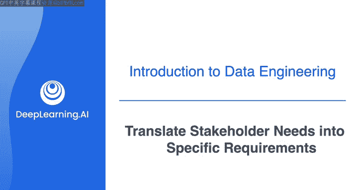
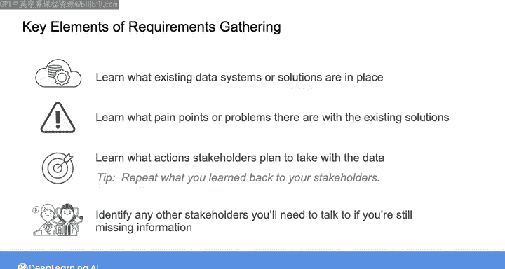
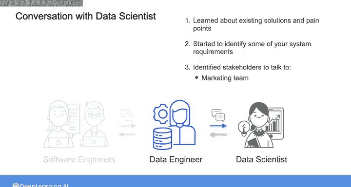

# 吴恩达《数据工程（导论，源系统、数据摄取和管道，数据存储和查询｜1-2-3课）｜DeepLearning.AI Data Engineering》 - P11：10_将利益相关者需求转化为具体要求.zh_en - GPT中英字幕课程资源 - BV1wTtWeeEH5

In the previous video you saw an example of what an initial requirements gathering conversation might look like between you。

 the data engineer， and one of your key stakeholders， a data scientist in this case。

 now I deliberately didn't give you a whole lot of direction on what exactly to be looking for in terms of takeaways from that conversation but that's what we're going to do here in this video we'll take a closer look at each of the things the data scientist said as well as the questions I asked them。

And the goal here is a layout and approach you can use for conversations like these to extract the requirements for your data systems。

As well as identify other stakeholders you'll need to talk to in short。

 the key elements of any requirements gathering effort will be the following first。

 learn what existing systems or solutions are in place to deliver the data your stakeholders need to accomplish their tasks and also what the pain points or problems are with those systems Next learn what action stakeholders plan to take based on the data you serve them and after that repeat what you learn back to your stakeholders to confirm that you understood everything correctly and finally identify any other stakeholders you'll need to talk to if you're still missing information on existing systems or planned actions and so here I'd like to take a look at how each of these key elements of requirements gathering came into play in our conversation with the data scientists the first thing the data scientists said was that the marketing team needs real-time analysis of product sales by region but they are only getting a daily data dump from the software team to avoid compromising the production。

Daabase， this is clearly a suboptimal solution， but as it happens。

 not using your production database for analytics or other projects is generally considered good practice This is because if you're running complex queries against the production database at the same time you're writing new information to that database to record actual customer activity it's possible to bring the whole system down and that's not good the data scientists also mentioned that sometimes they experience problems due to schema changes or other anomalies in the data when it comes to data schema changes or other disruptions to your source system you could be thinking about how to build in automatic checks on the data you're ingesting to ensure that it looks like everything meets expectations but ideally you would like to know about these changes or disruptions before they happen you should communicate directly with the source system owners who are serving that data and so at this point after confirming what you learned about the existing solutions and pain points。

You've also identified the need for further stakeholder conversations specifically this is another part of the conversation you'll need to have the software engineers who maintain the So system and database you'll be ingesting data from and those conversations you'll aim to understand what an ingestion solution might look like that is better than the daily data dumps as well as what kind of disruptions or changes you can expect and how you might be given advanced notice of when to anticipate those changes the next thing on the data scientist' mind was a cumbersome nature of data cleaning and processing in some sense the stakeholder need is clear right from the startA and it's really just for someone else that someone else is you the data engineer to automate the ingestion and transformation of data into the format that require so in this case you have identified a functional requirement and that the system needs to ingest。

 transform and serve the data in the format your data scientist needs the nonfunctional requirements for this aspect of your system might include things like a latency requirement about how fasta data needs to be。

made available relative to when it was recorded in the source system and that brings us to another key piece of information that came up in a conversation On several occasions。

 the data scientist stated that the marketing team needs the data in real time what you'll tend to find out in the real world is that people use terms like real time rather loosely I've had clients who claim they needed realtime information when they actually just needed a particular report on a monthly basis In other cases。

 real-time might imply daily， hourly or actual subsecond latency in the system so I want to highlight a key tactic in requirements gathering。

 which is to ask your stakeholders what action they plan to take based on the data you serve them and I want to point out that asking what action they plan to take is not the same as asking what they need oftentimes stakeholders will be inclined to tell you what they need directly and sometimes having done their own translation of their needs in the functional requirements of the system Now it's possible they did a fine job of this and have identified the right。

functional requirements， but it's critical that you first understand exactly what your stakeholder hopes to do with the data product you provide you can then map their plans to their needs in many cases once you've understood their needs。

 you'll discover there are different or additional functional requirements they haven't yet identified and getting aligned on those will be the next step and so in this case。

 asking what action the marketing team plans to take help get clarity on the end use cases of making decisions about marketing campaigns based on the analyticsly dashboards and serving product recommendations in the platform for the recommender system and it's clear that the product recommendations will need to be provided in near real time meaning probably seconds or less to customers browsing the platform and so you can start thinking about functional and non-functional requirements for that system for the dashboards on the other hand it's not yet clear exactly what action the marketing team plans to take。

And so talking to the marketing team to learn more about what they're hoping to do will be required to clarify what real time means to them in that case。

 so there was a lot packed into that brief conversation we have the data scientists and at this point you've learned about existing solutions and pain points it started to identify some of your system requirements and identify additional stakeholders you'll need to talk to。

 including the marketing team and the software engineering team。

And so to recap， the key elements of any requirements gathered in conversation are going to identify existing systems and pain points。

Ask what actions your stakeholders plan to take with the data， confirm what you've learned。

 and identify any additional stakeholders to talk to。

You'll see more examples of each of these aspects of requirements gathering in the fourth and final week of this course where we have those followup conversations with additional stakeholders and then once you have all your requirements in hand。

 it's time to choose the tools and technologies that will allow you to meet those requirements join me in the next video to take a closer look at how these pieces fit together within a framework that you can use to approach any data engineering project you work on。

