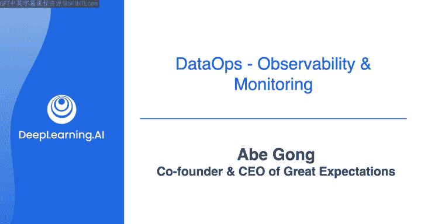
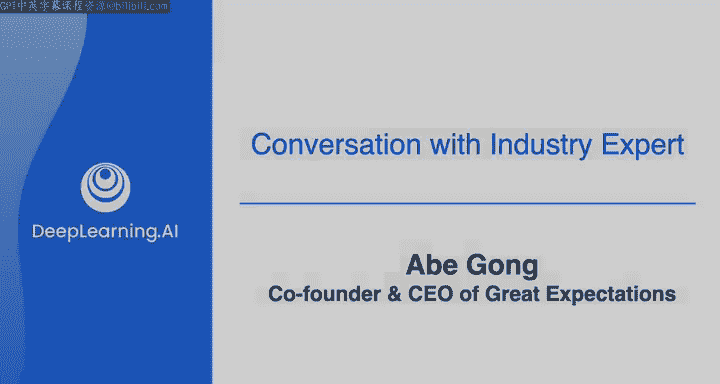

# 吴恩达《数据工程（导论，源系统、数据摄取和管道，数据存储和查询｜1-2-3课）｜DeepLearning.AI Data Engineering》 - P121：43_可选：与Abe Gong的对话.zh_en - GPT中英字幕课程资源 - BV1wTtWeeEH5

So yeah， here with Abe Gng， you're the founder of great expectations， cofounder and CEO。

 cofounder and CEO， awesome， so here's my dog too， camemy appearance， so walk me through this end。

We'll talk about data quality in a bit but I'm also interested in great expectations as a project where did this inspiration come from it came from a lot of long nights dealing with data quality issues more specifically I've been a part of a like data science。

I don't even know what to called like data science Friends Group with a few people including James Campbell who's the other cofounder of great Exp and there was one month where I came and said hey I've got this idea for open source project you should really be able to test data pipelines the same way youd test software and James said。

 you know it's funny because I came to this meeting thinking I would pitch a project where you could test data pipelines the same so we came to the this meeting with exactly the same idea Oh interesting and actually when we started off had like very simpler sensibilities about like what is the right way to design this tool so that it will be deployable in lots of places and kind of easily integrated with data exploration interesting because I recall that you were running a healthcare data consulting company。

 is that right that's right okay and healthcare data for the learners in this course healthcare data I think is notoriously gnarly and hard to work with I think all data。

All data work with in healthcare stakes are high like there's regulatory issues and depending on the data。

 you know there might be actual health issues on the line so for the learner then you knowve you created this tool and this approach sort of out of necessity but。

I guess to back up what is data quality how do you know that your data is of quote quality I think that's an awesome like philosophical question Yeah if you go out and look you can find like 20 different things that all have the 10 dimensions of data quality and they're all different that it's it's all over the place fundamentally I think data quality is it has to be grounded in some notion of fit for purpose so you're going to do something with the data you're going try ask certain questions of it or build a machine learning model or whatever it is。

Data quality is whatever it takes to make it so that that thing works reliably consistently and you know what that you know the results are trustable depending on the data system it could be pretty different right if you have a dashboard that's reporting routine metrics it's going to be important to make sure that the upstream data is being logged appropriately it's being kind of cascaded through an aggregated in the right way that you don't have too much time lag like those are the sorts of concerns that'll show up there if you're training a machine learning model you're going to think much more about distributions and bias and and so on so I think you have to。

But there are these sort of open ended discussions of data quality。

 And I think you can get good things from that， but ultimately it's whatever makes it so that you can really build a reliable product or process on top of the data That makes a lot of sense。

 I think what was it there was。In the 90s or whatever there was a paper that came out of the was a 20 dimensions of data quality or something like that I't remember and did and I think some people would like to think of that as sort of gospel truth but I like what you're saying a lot more which is just fit for purposee。

 can I use the data in a believable useful way or not so how does something like great expectation help I guess alleviate a lot of data problems I mean it's basically the same philosophy as software testing with a few twists that do specific to data okay so yeah？

I don't think this is controversial at this point if you went back 20 years it might have been。

 but big part of the DevOs movement is you need to have reliable tests for anything that you're building and software。

 if it's more than a prototype， you you can't guarantee that it's going to continue to work unless you have the right infrastructure around to do automated testing。

So we did the same thing for data each expectation makes it so that you can assert something about the data that should be true at a specific moment in a specific place in a pipeline for the learners in this course we're going to be having a lab on great expectations what are some of the main things you feel that a learner should know。

how to properly use great expectations I'm not totally sure where to begin there because it it goes to the fit for purpose Yeah it depends so actually maybe this is a useful a useful thing to say great expectations is super flexible you can deploy it in lots of different places it's actually a thing that has been challenging for us as the project has grown is providing documentation that will help people kind of find their use case quickly and do the right thing with it interesting are there yeah are there any anti patternss I suppose maybe to flip the question things that you would suggest people avoid or not do。

Not so much an anti kind but just like questions to ask yourself as you're getting started okay so we were just talking about different stakeholders who are going to need to see or like need to work with data requirements right that's actually a really useful segmenting question so I would ask yourself who is going to need to work with these expectations these requirements if it's just you and just your team then very likely you want to like have that very tightly combined with the other tools that you have you can you know store things that get and so on。

On the other hand， if you're going to need to collaborate with other stakeholders if they're going to need video input and update things and you know business process is going to change and you don't want to be a middleman for keeping the expectations in sync with that you need to find some other way to do that Go it so sometimes teams have done that with notebooks。

I don't know how promotional I'm allowed to be here but we're we're launching great expectations cloud soon and it awesome with a lot of those things that's cool so that's cool itll make a lot easier to for teams to use it than totally well because you know asking somebody who might be fluent in Excel and really understand a business process but who doesn't speak Python or SQL or asking them to review things and get like the kind of a nonstarter right but they still need input of the data a lot of the time makes sense anything else learners should know about data quality or good expectations。

Im going to say if you are starting off in the data world and you haven't yet built a system and had to maintain it。

 you probably just just wait like data quality is really really important it will bite you at some point if you don't get ahead of it so is one of these things that you can neglect upfront but like you don't want to yeah so for the learners out there data quality take it seriously look forward to seeing how you like great expectations in in the lab so awesome well thanks Dave it's good to chat with you and yeah thanks for everything thanks Jack is is awesome yeah thank you thank you。

