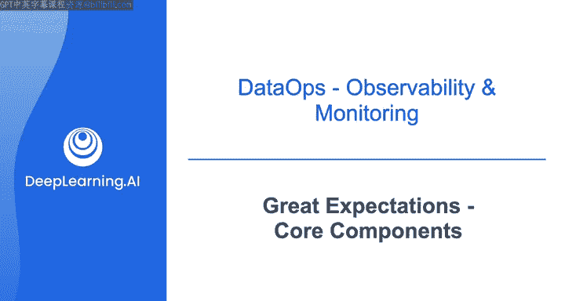
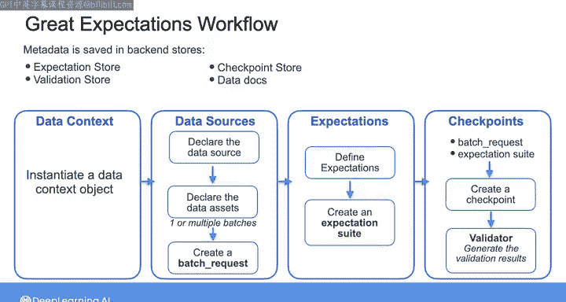

# 吴恩达《数据工程（导论，源系统、数据摄取和管道，数据存储和查询｜1-2-3课）｜DeepLearning.AI Data Engineering》 - P122：44_Great Expectations核心组件.zh_en - GPT中英字幕课程资源 - BV1wTtWeeEH5

In the next lab， you'll use great expectations to apply data quality tests， but before we go there。

 I'd like to give you an overview of the core components of great expectations with an example workflow When working with great expectations you typically start your workflow by specifying the data that you wish to test then you define the expectations or the tests that you want to perform on the data and finally you validate your data against your expectations to implement such a workflow。

 you need to interact with the core components of great expectations which consist of data context。

 data sources expectations and checkpoints you use these components to access SOA and manage the objects and processes that are needed in your workflow to start your workflow。

 you first instantiate a data context object and data context serves as the entry point for the great expectations API which consists of classes and methods that allow you to create objects to connect your data sources create expectations and validate your data using the data context。

You can configure and access the properties such as objects as well as the metadata of your great Exp project After you instantiate your data context object。

 you need to declare your data source object which tells great expectations from where to get the data that you want to validate the source of data could be a SQL database。

 a local file system and S3 bucket or even a panda's data frame after you connect to the data source。

 you need to tell great expectations which part of the data you need to focus on you do that by declaring from the data source your data assets。

A data asset is a collection of records within a data source。

 It could be a table in a SQL database or a file in a file system。

 It could also be a query asset that joins data from more than one table。

 or it could be a collection of files matching a particular regular expressions pattern。

 You can further partition the data in your asset to batches。 For example。

 if your data asset represents the records that correspond to the sales of a given year in a table。

 you could partition the records into monthly batches and validate each batch。

 or you could partition your data with respect to the store Is。

 You could also work with all the records of your data asset as one batch for you to retrieve the batches of your data asset。

 whether it's one batch or multiple batches。 you need to create from your asset a batch request object。

 batch requests are the primary way to retrieve data from the data asset。

 and it's what you need to provide for the rest of great expectations components。 Next。

 you need to define your expectations。 An expectation is a statement that you can use to verify if your data meets a certain。

For example， you can define an expectation to check if a column does not contain null values。

 You can define your own expectation or use one of the available statements from the expectation gallery。

 For example， expect column min to be between expect column values to be unique and expect column values to be null are all examples of tests that you can directly use。

 You'll see how you can call them in the workflow example that will work on。

 You can also define more than one expectation for your data asset and collect them in an expectation suite object。

 Now to validate your data。 You need to create a validator object。

 which expects a batch request and its corresponding expectation suite。

 you can manually validate your data by interacting directly with the validator or you can streamline the valid process by using a checkpoint object。

 A checkpoint takes a batch request and an expectation suite and automatically provides them to a validator。

 which generates the valid results Through this process metadata about your project will be generated and great expectation。

Will save it in some backend stores Great expectation supports different types of stores。

 The most common stores are the expectation store where you can find your expectation suites。

 the validation store where you can find information about the objects generated when you validate data against the expectation suite。

 the checkpoint store where you can find your checkpoint configurations and a data docs store where you can find reports on expectations checkpoints and validation results you can access these stores and their settings to the data context object So here are the steps of a typical great expectations workflow in the next video will apply these steps on an example data set。

