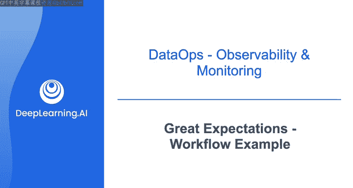
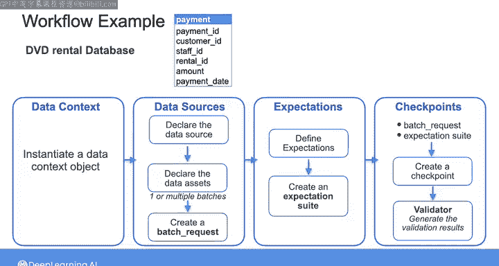
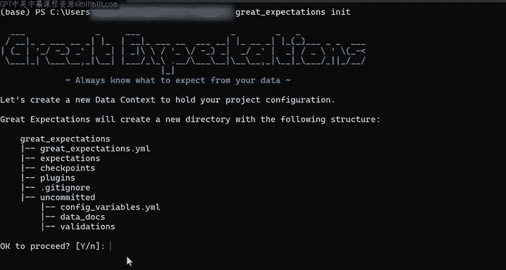
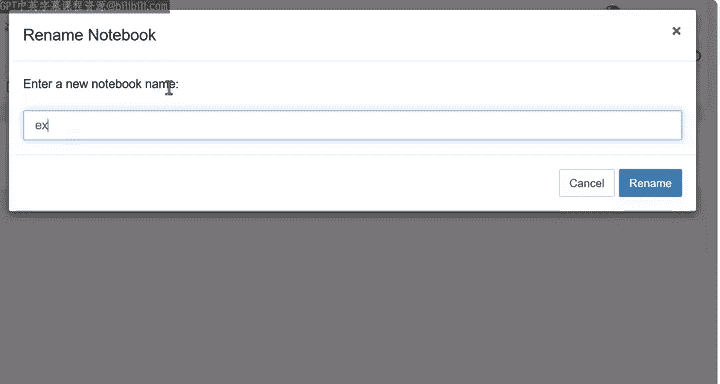
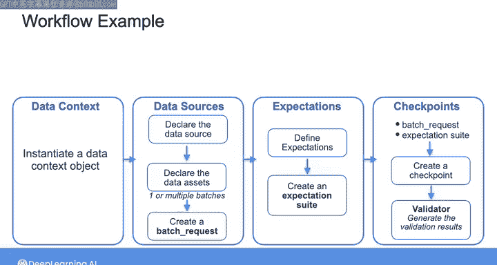

# 吴恩达《数据工程（导论，源系统、数据摄取和管道，数据存储和查询｜1-2-3课）｜DeepLearning.AI Data Engineering》 - P123：45_Great Expectations工作流示例.zh_en - GPT中英字幕课程资源 - BV1wTtWeeEH5

In the previous video you've learned about the core components of great expectations and what a typical validation workflow looks like let's now apply these steps on an example data。

 which is the DVD rental database you've seen in one of the labs of week one of this course We'll just focus on checking the columns of the payment table in particular we'll check if the payment ID column contains unique Is。

 the customer ID column does not contain null values and all values in the amount column are non-neative I already set up a PostgressQL database locally in my machine and loaded the data into the database in the terminal all Pip ands great expectations。

Then to start the great Exp project， I'll type great Exp in it。

 This command will initialize the data context object。

 Se up the structure of your project folder as shown here。

 and create your backend stores such as the checkpoints， expectations。

 data docs and validation stores as local directories。 I'll type why to proceed。

 you can always change the location of your backend stores。 So for example， in the lab。

 you will configure your stores as as three buckets。 In this video。

 I'll keep these as local directories。 Now， to interact with the components of great expectations。

 all'll launch a Jupyter notebook in the same route directory and create this notebook file example。

😊。

Here in the notebook file， I'll first import the great Exp package and then call the method Get context to get the context object of the project using this object。

 you can connect to the data source。 Def your expectations。

 create a validator and then run your checkpoints。 So let's use this context to first create the data source object。

 Great Exp provides different methods that allow you to connect to your different data sources to connect to my local SQL database。

 I'll call the method context sources add SQL。 and then choose my data source as the name for the data source。

 This method also expects a connection string that includes the information needed to connect to the database such as the username。

 password host name， port number and the name of the database。

 Here's the format of the string that you can use to connect to a Postgres SQL database。

 using this format I'll create the connection string to my database。

 using the information of my local database。 Next from the data source。

 I'll create the data asset by calling the method。😊。

Add table asset Since we're only focusing on the payment table。

 I'll choose the name for the asset as payment TB and then specify the name of the table within the source database。

 which is payment in this case。 Now， if you want to create batches on your asset。

 great expectations provides a set of methods that allows you to split your data asset based on the date or a column value。

 So for example， I'll call here the method add splitter date time part on the asset that I just created and then indicate the name of the column that contains the date which is payment date and specify month for the second argument datetime parts。

And finally， I'll create the batch request object by calling the method build batch request on the asset object。

 Before we proceed with the workflow， let's take a quick look at the batches using the asset object。

 I'll call the method get batch list from batch request and pass in the batch request object I just created and then iterate over the batches to check the specification of each batch。

 You can see the data contains four batches where each batch corresponds to one month。

 Now that we have the batch request object created。 Let's define the expectations。

 I'll do that interactively by directly working with a validator。 First。

 I'll create the expectation suite， which will contain all the expectations that it will define on the context object。

 I'll call the method add or update expectations suite and choose the name my suite。Now。

 to create the validator， I'll use a context object to call the method get validator and pass in the batch request object and the name of the expectation suite。

 Now， using the validator， you can call any of the expectation methods from the expectation gallery。

 So here， I'll call expect column values to be unique to check the uniqueness of values within the column payment I D。

 The results are shown here correspond to the last batch。 However， all batches were tested。

 And since we reached the last batch， it means the test ran successfully on all the other batches。

I'll now define two more expectations。 Exp column values to not be null on the column custom ID to check that the column does not contain any null values and expect column min to be between on the column amount to check that all values in the column are non-neg。

 You can see that both tests run successfully。 Now。

 these three expectations that I created interactively while working with the validator are just available for this session in order to use these expectations in other sessions。

 you need to save them using the validator I'll call the method。

 save Exp suite and specify for great expectations to not discard failed expectations。

This method saves the expectation suite， My suite containing the three expectations in the expectation store。

 Now， let's automate the process of the validation using the checkpoint object to create the checkpoint object。

 I'll call the method add or update checkpoint on the context object and assign the name My checkpoint to it。

 This method expects validations as a second argument。

 which consists of a list of pairs of a data batch and its corresponding expectation suite to specify these validations。

 I iterated through the batches and for each batch。

 I extracted the batch request and use the name of the expectation suite。

 I'll now run the checkpoint by calling the method run。

 The test on the four batches past to get more detailed information about each result。

 you can check the data docs by calling the method， build data docs using the context object。

 This method returns a link that'll open to check out the data docs。😊。

Here you can find the results of the validations performed on each batch。

You can see that all tests were successful if you click on any row。

 you can find statistics about the evaluated expectations as well as the successful and unsuccessful expectations you can also find the expectations performed on each column and the corresponding result。

So let's click on show more info here you'll find some metadata about the checkpoint execution and the batches used now let's go back to the homeage and click on the Exp Suites tab here you can find information about the expectation suite My suiteite。

And there you have it， you now know how to interact with the core components of great expectations now it's your turn to practice using great expectations and validate some data in the lab。

