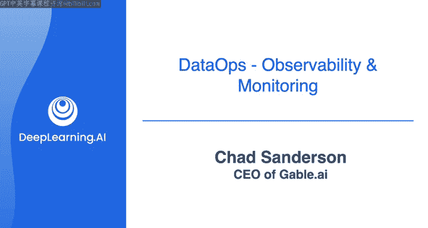

# 吴恩达《数据工程（导论，源系统、数据摄取和管道，数据存储和查询｜1-2-3课）｜DeepLearning.AI Data Engineering》 - P124：46_可选：与Chad Sanderson的对话.zh_en - GPT中英字幕课程资源 - BV1wTtWeeEH5

In the previous lab exercise， you implemented testing to confirm that your expectations for data quality were met within your data pipelines。

There are also other ways to maintain data quality expectations with your upstream stakeholders。

 including using what's called a data contract， let's go up a conversation with my friend Chad Sanderserson about how data contracts can help ensure that the quality of the data from its source remains high This is another optional video to give you a chance to hear from an industry expert but you can also feel free to skip ahead to the last part of the week we hear from Morgan about Amazon CloudWatch。

 the observability tool you'll use in the last lab this week。

Let's go on， Chad。Hey， Joe it's going well good to see you Likewise good to see you now Yeah。

 so we're here to talk about data contracts today and it's a topic that we're covering in the course and I figured you're leading the way in terms of。

😊，Making data contracts exposing the visibility to these things to the greater community。

 so I definitely appreciate that and I think you're a great person to talk to about data contracts so for the learners of this course and don't know who you already want to give a quick intro about yourself。

Sure， my name is Chad Sanderserson， currently I'm the CEO of a data infrastructure startup called Gable。

AI。Prior to this， I led the data platform team at a few different companies like Microsoft， Convoy。

 Sephora， I've been an analyst， a data scientist。Da engineering manager。

 so lots of time around data and all the problems that。Happen。

Lo yeah lots of problems here let's get into it I mean so what is a data contract So a data contract in its most simple form is an interface for data it's an API for data and the idea is that if you're a software engineer and someone else is accessing your service in some way you provide an interface you don't want them just to have raw access into the code that you've written you have documentation expectations around that interface。

 SLAs and so on and so forth。But in the data world， that concept doesn't really exist。

 We extract data from data producers who generate it from their applications or from Excel spreadsheets or from Salesforce or SAP we load that data into you know analytical databases and notebooks and we take hard dependencies on these producers and so when things change there is no contract between the producer and the consumer that dictates what can change and how it can change and what the expectations are and this violation of expectations is ultimately what causes the majority of data quality issues Yep exactly and so walk me through life before data contracts what was that like and walk me through your experience of setting data contracts up。

In your work。So what I've seen happen at most companies is that well I think there's a couple of different types of companies。

 I think company One is more of your old school centralized data organization where you've got data architects leading the way they're thinking about data modeling and you ERDs and working with the DBA team all the way down to the actual analyst team and they're kind of like this center of excellence and they're responsible for setting up all the ETL。

 setting up the architect and in that world data contracts are a little bit less necessary because the entire infrastructure has been really built and overseen from the ground up to serve a particular function。

But in the sort of modern world of data in the cloud。

Where we have data lakes and you know all these new ideas we have more of a federated approach to data ingestion where software engineers can build whatever services they want those services am tons of data we throw all the data into a data lake somewhere and then we have a data engineering team that goes in and build out you know processes of extraction and loading that data into other systems and this is what actually creates the problem You now have two groups of people which is the producers that are producing all this data and the consumers that are consuming all the data and doing something with it and these two sides are not communicating with each other and when the lack of communication is present。

And the services are still changing all the time， the only option is sort of chaos and and this is what happens and so downstream data teams have to build so much validation into their machine learning models and their pipelines because they expect change and they expect breaking issues constantly and when a data quality issue does emerge the data engineering team kind of has to go down this like root causing path that takes a really long time like oh someone who owns a dashboard is complaining that a metric looks off。

 throw it over the fence of the data engineering team。

 data engineering has to look at that query and say okay well what could all the potential causes be they have to trace all the way back up to the source they have to understand what change they have to ask the producer to fix it and then once that fix happens then they have to go in and do a whole backfilling process and。

basically just become the data engineering job like I think a lot of people would associate data engineering with those set of steps that I that I just said and I don't actually think that's what the ideal data engineering job is right yeah it definitely seems to be like that where you're sort of and sort been my experience here at the mercy of the producers。

Typically， and and oftentimes。You're at the mercy of their whims and changes and when things break you get to go clean it up and that's about it has been but long data contracts and I'm sure one question the learners of this course will have is what does this interface of a data contract look like like how do I？

How do I work with the data contract， what exactly does it feel like to use this？

So the interface is what we call the spec of the data contract and I think at a high level there's a couple different components to a contract itself。

 one is the spec which is very similar to an API spec it like swagger if you've done any work with actually creating APIs and then on the other side you have your mechanism of enforcement so how do we ensure that that spec is followed and that if violations happen。

 you have some way of actually recording and tracking that。But in terms of what the spec looks like。

 it's generally composed of two main categories， you could extend it as infinitely long。

 but the primary categories are the structure of the data object and the contents of the data and on the structural side you have the schema and the business logic that ultimately composes the schema So those are things like column names and the number of columns that exist and the actual logic composing the columns and then on the data content side that's where you have your data quality rules SLs PII like these sorts of things and you might layer on additional policies like compliance like this is the way we expect the data to always be used or if someone is writing a query against this data it should follow a certain format so that's what goes into into the contract that's really infinitely extensible but my recommendation is always to make sure that all of the constraints within the。

Ontract。Are actionable and are enforceable， otherwise it kind of just becomes a paper handshake agreement。

嗯哼。😊，And。I think Handshake agreement for example right so I think implicit to the word contract is maybe some interpretation that this data contract might be sort of some legally binding agreement or a handshake deal with the teams how do you respond to things like that is it。

I guess the follow on to this how much how much of a data contract is communication versus technology Yeah I think that's a great question So I definitely think it's not a legal contract it could be you in fact I have heard examples of teams that want to have legally binding data contracts with vendors so if you're agreeing to a a certain amount of money for data that's always supposed to be a certain way and then it isn't and that has a material impact on your company that is maybe something you want to get a lawyer for but if you're operating within a company there's really no you know it wouldn't even be a good idea to take legal action against another team internally so oftentimes is that the contract enforcement is more about the programmatic nature of that enforcement integration tests as an example are form of enforcement or alerts and monitors that are sent to the people。

who are consuming the data to make them aware that a contract breach has occurred is another form of enforcement。

And then on the the question of。How much of this is collaboration in people。

 I think it's primarily it's primarily people。 The technology part really is all about making the process of adopting the contract agreeing to the contract and then taking action on the contract very very easy one of the common patterns that I've seen a lot is that data engineers will attempt to solve this problem by asking the application developers to own data engineering processes so here's a set of tables that youve now own as the software engineering team or we would like for you to own DBT and generally this doesn't go very well because application developers don't know anything about snowflake or DBT and it's seen as a cost and a burden on their time and it slows them down no software engineer wants to be slowing down and so the way that you that technology helps in this problem is it allows the data contract to be implemented。

and enforced in the workflow that the developer is already using and it makes the honoring of that contract trivial and and this is something that we've actually seen in other industries so security has followed a very similar pattern where you had a very small team of security engineers。

 not very many of them in an organization they had a lot of surface area to think about and they were kind of at the mercy of the application developers to do the right thing and Devsops is this emerging pattern where instead of hoping that everyone in the company follows security best practices you have a layer of technology that is sitting in the Devops workflow that's doing the check against the code and saying hey are the is the code that we're shipping following these best practices and if not there are there's communication that needs to go out to the right people What else should the learner know about data contracts and also I think a follow long question is if they wanted to implement data contracts。

How could they get started with that in terms of what's to know。

 I I think there's a lot of different。Ways you can implement the contract some of these will be more more likely to succeed than others。

 So I think going in with the idea that we're gonna to create a massive contract and it will have all of these you a million different constraints and will give this to the software engineer and they won't have any technology that actually allows them to own the contract is a very good way for people to not take you seriously。

 it will seem like a lot of work and it will be very scary and it won't be clear how they will incorporate this into their existing processes。

 So I think you need to have a good answer to that before you go to the producer and have the conversation the other thing I think is important is software engineers like working on things that matter and really anybody does。

 I think like you don't want to do random work that is irrelevant and I've seen some teams that will go to their engineering counterparts and say。

 hey guys， you need to own all of the data that you're emitting from your service。

Even if only 10% of that data is useful to the analytics team right that becomes a weird question like well。

 why are you asking me to own 100% of this if you're only using 10% of that right you're slowing me down。

 making me think about schema evolution and all these other things and I don't really gain anything in return I'm not doing anything for you So I think being selective about where you start with contracts and making sure you're focusing on the most important pipelines where there is a clear impact if data quality were to go bad is a really great starting point in beginning with in terms of where you actually begin with an implementation honestly paper contracts and just having the conversation is a really good start most of the data producers that I talk to will say things like I have no idea where my data is even being used in the company and it's hard for me to want to take ownership of that data if I don't know what's happening to it so just sort of overcoming that bridge。

saying hey， engineering team A， did you know that your data is being used in machine learning Model X and dashboard Y that the CFO looks at every single morning is a good way to start making them aware of how data that's kind of a byproduct to them is impacting the broader business？

That's awesome， such awesome advice。Well， Chad， thank you for your time。

 I'm sure learns we'll get a lot out of this discussion， so thank you。Thanks， Jo。Ethics。

