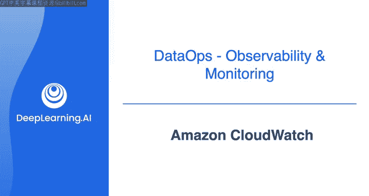
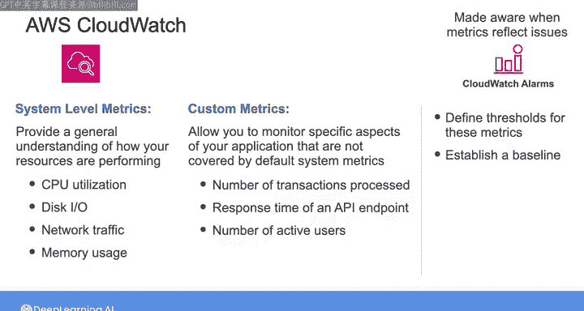
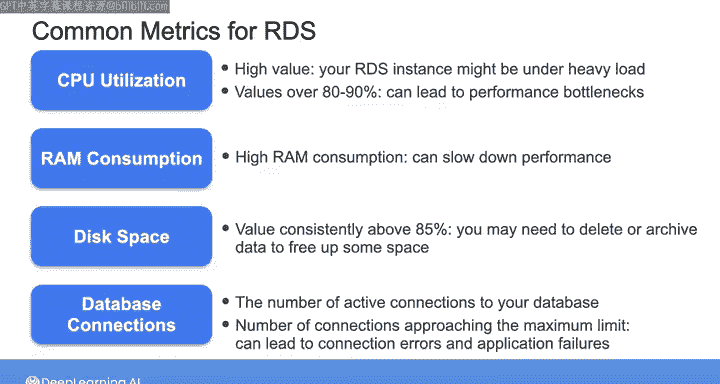

# 吴恩达《数据工程（导论，源系统、数据摄取和管道，数据存储和查询｜1-2-3课）｜DeepLearning.AI Data Engineering》 - P125：47_Amazon CloudWatch.zh_en - GPT中英字幕课程资源 - BV1wTtWeeEH5

You've been learning from Joe and others this week about the importance of monitoring and observability when it comes to the health of your data systems。

In the upcoming lab， you'll be using Amazon CloudWatch to monitor a database on AWS。

So here I want to show you some of the details of how CloudWatch works。

 so you'll be ready for the lab。Monitoring the health of your data systems means ensuring that the various components within your data system are operating as expected。

If some component of your system is having issues， successful monitoring means that you are made aware of any problems as soon as they arise or even anticipate and correct issues before they happen。

 when you're working with resources on AWs。 a lot of them automatically start posting metrics to Cloudwatch without you needing to do any sort of setup。

 Most of the time， these are system level metrics like CPU utilization， disk I O。

 network traffic or memory usage。 These metrics can provide a general understanding of how your resources are performing and can help you identify potential issues before they become critical identifying issues before your end users do is important and having robust monitoring in place can help you do that While many AWs services automatically send metrics to Cloudwatch。

 there are cases where you might want to send custom metrics。

 Custom metrics allow you to monitor specific aspects of your application that are not covered by。

Default system metrics， for instance， you might want to track application specific data。

 such as the number of transactions processed the response time of an API endpoint or the number of active users you can use Cloudwatch dashboards to visualize and monitor the metrics that you deem as the most important and you can aggregate metrics from multiple components of your system into one unified view This view will help you identify and diagnose issues as they arise but dashboards can show you data over time as well so you can more easily identify patterns and anomalies Now you likely won't be sitting around watching your dashboards all of the time instead you want a way to be made aware of problems as the metrics begin to reflect any issues you can create Cloudwatch alarms for specific metrics to do this and you can define thresholds for these metrics so that when the threshold is breached。

 you can be alerted or other actions。Can automatically be taken before you determine what reasonable thresholds are to set for your metrics。

 you need to establish a baseline。To do this， you would want to measure performance of your system under different loads and conditions at various times and determine what is normal。

 Cloudwatch is configured to retain metric data for up to 15 months。

 So you can collect metrics for a while before determining what the baseline is for your system。

 In general， acceptable values for metrics depend on what your application is doing relative to your baseline。

 In the upcoming lab， you will be monitoring the RDS instance that you've set up in the first lab of this week。

 So let's explore some of the common metrics that you might be monitoring for RDS。

 First is CPU utilization。 A high value for CPU utilization might indicate that your RDS instance is under heavy load and needs to be scaled up or that queries need to be optimized。

 consistentlyly high CPU utilization such as values over 80 to 90% can lead to performance bottlenecks slowing down your database operations。

 Next， Ram consumption。

Another common metric to monitor closely for RDS highRA consumption can also slow down performance and may indicate that you need to scale up to an instance type with more RA。

 Another metric to keep an eye on is disk space。 If disk space is consistently above 85%。

 then you may need to look at deleting or archiving data to a different system to free up some space。

 Data connections are also important to monitor。 This metric shows the number of active connections to your database。

 If the number of connections approaches the maximum limit。

 It can lead to connection errors and application failures。

 keeping an eye on this metric helps you manage connection pooling and scale your database to handle more connections if needed。

 So these are a few simple examples of metrics RDS posts to Cloudwatch and why you would want to monitor thempart from Cloudwatch。

 there are other popular thirdpart monitoring services as well， like Datadog or Splunk。

 which you could also use to monitor your systems。

When it comes to monitoring other AWS services， keep in mind that each AWS service posts different metrics and which metrics are important to you is use case dependent have fun in the upcoming lab and I'll see you again in the next week。

