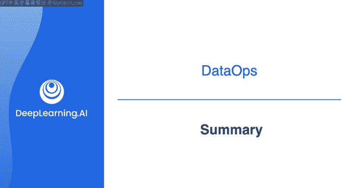
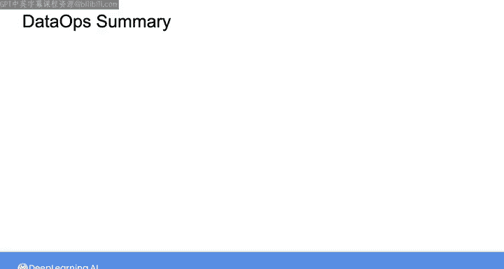
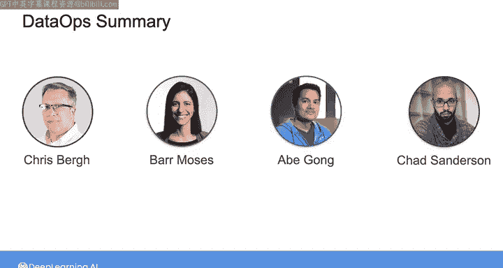
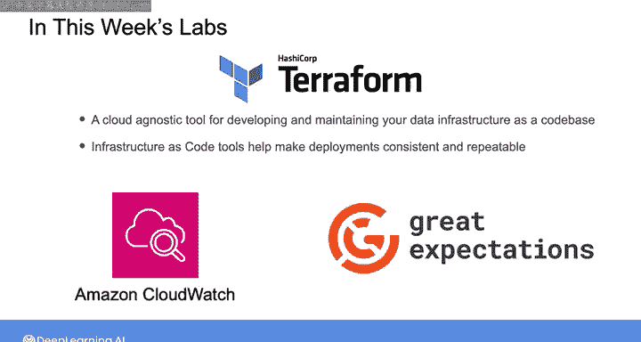

# 吴恩达《数据工程（导论，源系统、数据摄取和管道，数据存储和查询｜1-2-3课）｜DeepLearning.AI Data Engineering》 - P126：48_第3周总结.zh_en - GPT中英字幕课程资源 - BV1wTtWeeEH5

This week has been all about data ops with a focus on automation using infrastructure as code and the observability and monitoring of your data and data pipelines to ensure that you're delivering value to your stakeholders。

 you've learned about the key pillars of data observability from Bar Moses how you can test quality of your data from Abegong and how you can establish agreement with your upstream stakeholders using data contracts with Chad Sanderserson。

 you also saw a conversation I had with Chris about data ops in the first lab this week you worked with terraform。

 which is a cloud agnostic tool for developing and maintaining your data infrastructure as a codebase when you configure and maintain your data infrastructure using a tool like terraform。

 your deployments can be made consistent and repeatable。

 unlike the alternative of manually deploying your cloud resources you also got a chance to use CloudWatch to monitor the health of your RDS instance and great expectations to monitor your data quality with tools like these。

 you can set up your dashboards。

to let you know how things are going at each stage of your data pipeline and alerts to let you know when you might have a problem next week we're going to build in everything you learned this week as we step into orchestration with orchestration you are essentially adding more tools to your toolkit when it comes to the automation monitoring observability and versioning of your data pipelines I'll see you there。

