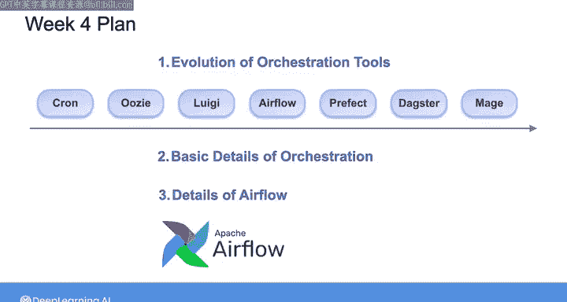

# 吴恩达《数据工程（导论，源系统、数据摄取和管道，数据存储和查询｜1-2-3课）｜DeepLearning.AI Data Engineering》 - P127：49_第4周概览.zh_en - GPT中英字幕课程资源 - BV1wTtWeeEH5

Welcome to the fourth and final week of this course。 This week is all about orchestration。

 but really orchestration is closely intertwined with many of the concepts you've already been exploring in the previous week's materials we focus on the data ops。

 pillars of automation and observability and monitoring。

 you got some practice using the infrastructure as code framework terraform and you set up data quality checks and monitoring of your data pipelines using great expectations in Cloudwach with orchestration。

 you'll be doing more work within each of these areas of data ops you'll automate individual tasks in your data pipeline and move from the concept of infrastructure as code to the concept of pipelines as code using the airflow orchestration platform with airflow。

 you'll build in data quality checks and additional monitoring as well。

 you could say that orchestration is really a part of data ops and the sense that orchestration has everything to do with at least two of the。

Three key pillars of data ops orchestration is also closely related to other undercurrents of the data engineering lifecycle like data management and software engineering however。

 when my co-author Matt Husley and I were thinking about the data engineering lifecycl。

 we decided that orchestration was important enough to be called out as a separate undercurrent of the data engineering lifecycl。

 given how central it is to your work as a data engineer。

So this week we're going to take what you learned about data ops in the previous week and build on it。

 We'll start by taking a look at how pipelines were set up before orchestration tools existed。

 then we'll cover the evolution of orchestration tools that led us to where we are today and where that evolution might lead to in the future after that we'll dig into the details of orchestration and discuss at a basic level how to implement orchestration in your data pipelines There are a number of different orchestration tools on the market today and many of the concepts we'll be covering this week our tool agnostic however the number one tool being used in industry today is airflow so after we get through the basics we're going to focus on the details of orchestration using airflow since that's what you're most likely going to be using on the job today as a data engineer Airflow is also what you'll be using in this week's lab Join me in the next video to get started。

