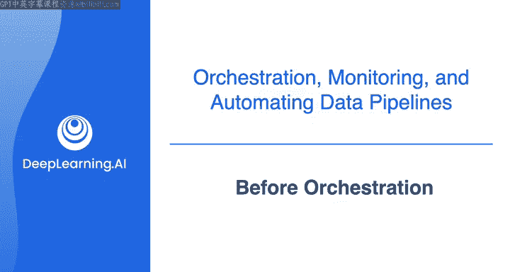
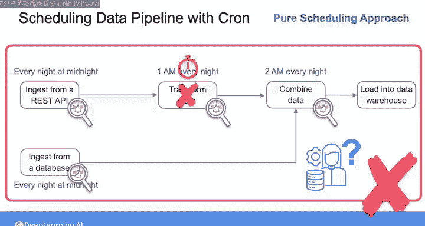
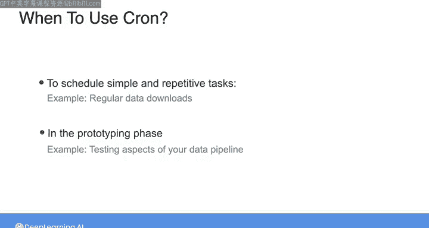

# 吴恩达《数据工程（导论，源系统、数据摄取和管道，数据存储和查询｜1-2-3课）｜DeepLearning.AI Data Engineering》 - P128：50_编排之前.zh_en - GPT中英字幕课程资源 - BV1wTtWeeEH5

Before talking about how you might use an orchestration tool to define and run your data pipelines。

 I'd like to back up and just spend a moment describing how you might have set up your data pipelines before orchestration tools。

Before orchestration， the simplest way to automate a data pipeline or any set of software tasks for that matter was to set up a series of Chron jobs。

 so Crron is a command line utility that was first introduced in the 1970s to execute a particular command at a specified date and time to schedule a job with Crron。

 you simply write a command or entry known as a Chon job where you specify five numbers separated by spaces and followed by the command you want to schedule。

 so the structure of a Cron job looks like this。Or you have the command you want to execute over here on the right。

And then from right to left， these five numbers indicate the day of the week。

 zero to6 for Sunday to Saturday， the month of the year from  one to 12。

 the day of the month from 1 to 31， the hour of the day from  zero to 23。

And the minute of the hour from0 to 59， you can also include an asterisk or star in place of any of these five numbers to indicate no restriction on that value so for example。

 this Chon job that says0011 star Echo happyappy New Year will print happy New Year to the terminal of the computer that is running on every year at midnight on January 1t。

 these first two zeros indicate these zeroth minute of the zeroth hour of the day， which is midnight。

And the next two ones indicate the first day of the first month。

 which is January 1 and then the star in the day of the week position just says you don't care what day of the week it is when the other conditions are met So how would you have scheduled the tasks in your data pipeline Well。

 for example， suppose you had a data pipeline where you were ingesting data from a rest API and suppose you wanted to ingest data from the API every night at midnight and you had a Python script called ingest from rest API pi to do the ingestion step in that case you could have written a Chron job like this00 star star star Python ingest from Python rest APIpi pi So here the first two zeros say that you want this command to be executed at midnight and the asterisks in the other positions just indicate that you want to do this no matter what day month or day of the week it is then maybe you wanted to do some inf。

Cleaning or processing to the API data。And let's suppose you had another Python script written to perform that step。

 and maybe you knew that it always took less than an hour to ingest all the new data from the API。

 then you could have set up the next step the inflight transformations to take place at 1 a every morning that would look like this as a Chron job。

0ero1 star star star Pythontrans API data。pi， and then maybe you were also ingesting data from a database every night at midnight。

 so you would have written another Chon job that says00 star star star Python ingest from database。

 pi and maybe you wanted to combine the transform API data with the data from the database and so you would have written yet another Chon job。

 maybe one that kicks off at 2 am every morning so that it happens after the other jobs are complete。

So that would look like02 star star star Python combine API and database。

pi and so you get the idea and you could have written all the Ch jobs you needed to get the pipeline implemented carefully timed to execute in a sequential manner this is what's known as a peer scheduling approach and this is how many data pipelines were automated before orchestration tools were available In fact this is still how many simple data pipelines are automated today just to be clear I'm not suggesting you forgo orchestration and set up your data pipelines as Chon jobs the problem with the setup like this is that there are many ways in which it can fail For example。

 if one task fails to run or takes longer than expected or produces some unexpected results。

 your entire pipeline can fail and you would have essentially no way of knowing exactly how or why it failed without implementing tests and debugging to determine what went wrong。

even worse since you don't have any built in monitoring or alerts to tell you how things are going。

 you might not learn about the failure until your downstream stakeholders come to you asking why the data looks funny。

And so why am I talking about scheduling with Crron if I'm not recommending it Well， first off。

 it can be a nice intuitive way of wrapping your head around what it means to automate your data pipelines and a Crron job can work great for some simple tasks like a data download that needs to happen on a regular basis and doesn't have any downstream dependencies or if you're in the prototyping phase and testing various aspects of your data pipelines using CRron can be a quick and easy way to get started in the next video。

 I'll talk a little bit about orchestration tools in general and how they have evolved in recent years and after that you'll get into orchestrating your data pipelines with airflow I'll see you in the next video。

