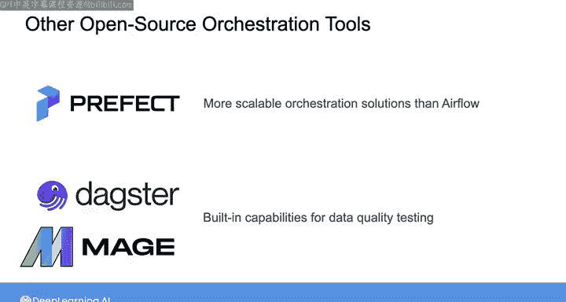

# 吴恩达《数据工程（导论，源系统、数据摄取和管道，数据存储和查询｜1-2-3课）｜DeepLearning.AI Data Engineering》 - P129：51_编排工具的演变.zh_en - GPT中英字幕课程资源 - BV1wTtWeeEH5

Orchestion has long been a key capability for data processing， but until the past decade or so。

 orchestration was really only accessible to the largest companies and this is because open source or managed orchestration tools did not exist yet and it was complicated and expensive to build your own in-house solutions in the late 200s。

 things began to change Facebook developed a tool called Dataswarm for internal use。

 which they still use today another tool called Apache Uzy became extremely popular in the 2010s。

 but it's designed to work within a Hadoop cluster and was more difficult to use in a more heterogeneous environment。

 inspired by these earlier tools， particularly dataswarm Airbnb introduced airflow in 2014 which has become the industry standard orchestration tool today there are many other orchestration tools under development and the landscape of orchestration will no doubt continue to evolve in the future now。

Throughout these courses we have， for the most part。

 actively avoided discussing any particular tool or technology too extensively。Instead。

 I have been aiming to focus on the skills and the knowledge that will be broadly applicable and no matter where you work as a data engineer。

 in certain cases， however， I'm going to make an exception for a tool or technology that you will very likely use in your job as a data engineer and one such tool is airflow so right now when it comes to orchestration more teams are using airflow than any other tool。

 and so it's a skill set that recruiters are looking for。With that being said。

 Airflow is not without its shortcomings and I'm excited about some of the other newer open source tools that are emerging in the orchestration space and so I mentioned a few of those too Airflow was developed by Maxine Buheman and other collaborators at Airbnb they were primarily interested in serving their own internal data orchestration needs。

 however from the very beginning they built airflow as a non-commercial open source project with the vision that the tools they were developing to serve Airbnb's internal needs would also be useful to other teams solving similar challenges The framework quickly grew significant mindshare outside of Airbnb becoming an Apache incubator project in 2016 and a full Apache sponsored project in 2019 Today Airflow offers many advantages as an orchestration platform largely because of its dominant position and the open source Market Airflow was written in Python making it extensible to almost any use case imaginable beyond that。

The airflow Open source project is very active with a high rate of commits and a quick response time for bugs and security issues as if many open source tools and data engineering。

 airflow is also available as a managed service through a number of vendors including AWS GCP and astronomero for anyone who is looking for more comprehensive support With all that being said Airflow is certainly not the only orchestration tool out there and in terms of things like scalability。

 ensuring data integrity and streaming pipelines， airflow either does not solve for these issues or their significant room for improvement many other interesting open source orchestration projects exist such as Luigi and conductor and newer tools like prefect。

 Dgsster and Mae have been getting traction as they aim to mimic the best elements of airflow's core design while improving on it in key areas So for example。

 Prefect provides more scalable orchestration solutions in airflow while Dgsster and Maj。

Provide built in capabilities for data quality testing and data transformations， among other things。

 Still other tools are focused on providing better orchestration support for streaming pipelines。

I think it's entirely possible that one or more of these newer orchestration tools will become widely used in the coming years as alternatives to airflow it's also possible that one of these alternative tools could serve your needs better depending on what kind of pipelines you're setting up with that being said。

 my recommendation is to learn airflow for now because airflow is what many people are using today but also keep learning about other tools and keep up on new developments in the field of orchestration so you can stay current as things continue to evolve。

 join me in the next video to dive into the details of orchestration and practice。

