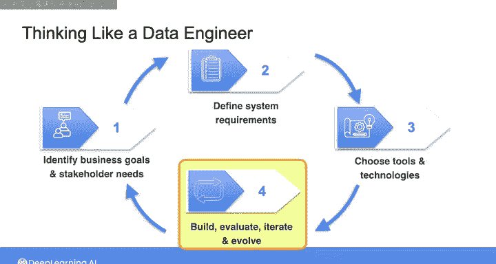

# 吴恩达《数据工程（导论，源系统、数据摄取和管道，数据存储和查询｜1-2-3课）｜DeepLearning.AI Data Engineering》 - P12：11_像数据工程师一样思考.zh_en - GPT中英字幕课程资源 - BV1wTtWeeEH5

Allright， so in the previous videos， we walked through one example of a requirements gathering conversation and what the takeaways from that conversation were in terms of the functional and non-functional requirements for your data system。

 as well as other stakeholders to talk to requirements gathering as a process is not unique to data engineering in fact it's something that you might run into in various product development or product management scenarios depending on the application the approach to requirements gathering might look a little different。

 but in general， the next step after requirements gathering is to decide on the details of how you'll actually build your product or system to meet the requirements with data engineering。

 your work will include everything from requirements gathering to implementation at your data systems。

In this video I'd like to share a framework for what I call thinking like a data engineer that you can use for whatever project you're working on in this first stage your main objective is to determine what the business goals and stakeholders needs are that will be driving a project in this stage you'll first need to get clear on the highlevel business goals for the company then you'll identify who all the stakeholders are that have needs related to your project and how their needs tie into those higherleve business goals you'll need to have conversations with individual stakeholders learn what systems are currently in place that you'll either be building or replacing and what needs stakeholders have beyond what the current systems are providing It's also important at the stage to ask your stakeholders what action they plan to take what the data products you provide them this can help you zero in on the actual functional requirements of the system you'll build in the second stage your objective is the turn stakeholder needs and the functional and nonfunctional requirements for your system。

In short， this means describing what the system must be able to do to meet the needs of stakeholders these are the functional requirements and then describing the technical specifications of how the system will do what it needs to do the non-functional requirements once you've arrived at a set of functional and non-functional requirements you'll document your conclusions and confirm a stakeholders that a system designed to do what you have described in these requirements will meet their needs in the third stage you'll choose the tools and technologies to build your system this stage begins with identifying the tools and technologies that can meet the requirements of your system in general there will be multiple tools and technologies that can meet any individual requirements and you'll have to evaluate the tradeoffs between them and so you'll look at a costbene analysis to choose the best components among these tools and this analysis you may consider things like licensing fees estimates of spending on cloud resources as well as other resources needed to build and maintain a system with these components。

Finally， having chosen what you believe to be the best set of tools and technologies。

 you'll stand up a prototype of your system to test whether it meets your expectations and looks like it can deliver value for your stakeholders。

 This last step of standing up a prototype and testing it is very important before investing the time and energy into building out the full data system you need to test whether the system you've designed will actually be able to meet the needs of your stakeholders At this stage you'll check back with stakeholders and let them evaluate whether the system you've designed will deliver value for them And I would definitely recommend that you spend as much time as it takes iterating on your prototype to be sure your system is going to be successful once you move into production as the last step in this final stage you'll build and deploy your data system Once a have been running。

 youll continuously monitor and evaluate your system's performance and iterate on it to keep improving it where you can and any data system you build will need to evolve over time。

 this can be。Due to changing stakeholder needs or in some cases。

 the emergence of a new tool or technology that can improve your systems' performance。

 reduce your costs or provide some other advantage and so while I presented this framework as a sequence of four stages that happen one after another in reality this will be an ongoing and sort of cyclical process as business goals and stakeholder needs evolve。

 your data systems will need to evolve with them so you can think of this as something where as a data engineer。

 you're always communicating with stakeholders about their needs and expectations evaluating those needs in terms of requirements for your data systems and updating your systems as needed to meet the needs of your stakeholders I realize this framework might feel a little abstract like I'm just throwinging a lot of words at you because we haven't actually done most of the stuff yet but I wanted to introduce these ideas right here in this first week of this course because I'd like you to keep them in mind as we move through these courses and revisit each of these。

In this first week， we spent most of our time talking about the first two stages of identifying business schools and stakeholder needs and defining requirements。

And week four of this course we will pick up the conversation with the data scientists from the previous videos and continue it through to completion。

 having conversations with all the other stakeholders as well。

 we'll define requirements and then turn those into technology specifications and tooling choices for your system then in the lab exercise。

 you'll complete the process and implement a data architecture that meets the requirements For now。

 though， let's take a quick look at some of the practicalities of data engineering on the cloud I'll see you in the next lesson。

