# 吴恩达《数据工程（导论，源系统、数据摄取和管道，数据存储和查询｜1-2-3课）｜DeepLearning.AI Data Engineering》 - P130：52_编排基础.zh_en - GPT中英字幕课程资源 - BV1wTtWeeEH5

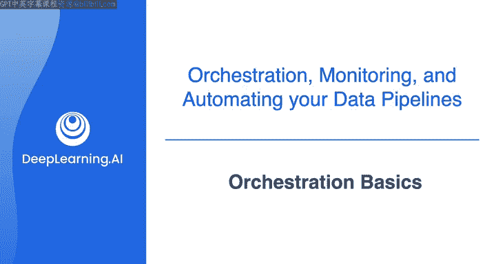

When it comes to orchestration， there are a number of concepts and components that are common to whatever set of tools you're using for implementation and that's what I'd like to discuss in this video。

 while setting up proper orchestration of your data pipelines does come with more operational overhead than civil Ch scheduling it also comes with the option to set up dependencies one of tasks get alerts and create fallback plans if something doesn't go as expected when we looked at Chron scheduling in a previous video we had a data pipeline that look like this with data flowing in from two sources going through some transformations and eventually making its way to a data warehouse As we've mentioned a couple times already in these courses。

 this sort of visual representation of a data pipelines referred to as a directed acyclic graph or dag for short。

 you can think of each task as a node in the graph and then in graph terminology。

 you can call these arrows edges between the nodes you can see that data flows only in one。

Between the nodes or tasks in the graph。 So there's an overall sense of direction to your data pipeline。

 there are no circles or cycles。 and so this is what it means for the graph to be directed and ascyclic。

 remember with Chron scheduling we could set up a pipeline like this。

 but if one task took longer to run than expected and the next task kicked off before the previous one finished it could break everything downstream。

 Now with orchestration， this is where the idea of dependencies comes in。 You could， for example。

 build in dependencies between tasks in this pipeline that require the previous task to finish before the next task starts。

 Most orchestration frameworks allow you to and in fact require you to define your data pipelines as daAgs。

 and in many cases， they include a user interface where you can visualize your Dg as well as debug troubleshoot and monitor your data pipelines in airflow。

 you will define your dags programmatically by writing Python code。

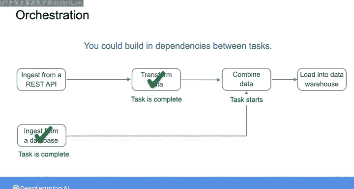

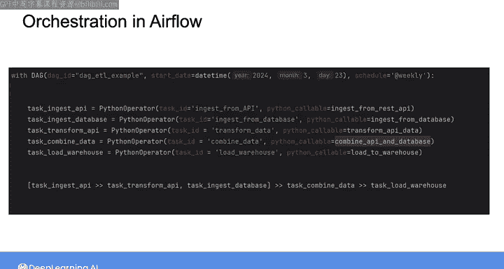

That looks like this to define all the tasks and dependencies in your data pipeline。

 you can visualize a pipeline you've defined using the airflow UI， which looks like this。

So here you can trigger the daAg to run。

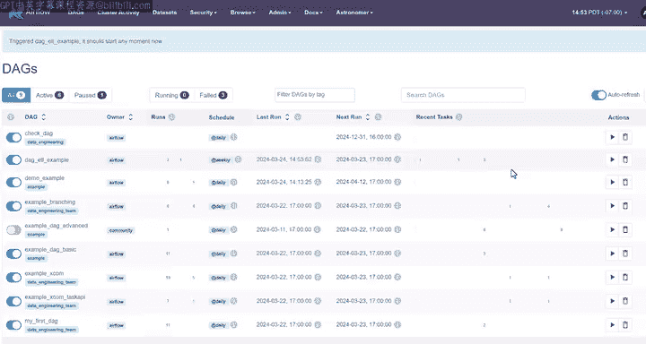

Monitorsure the progress of tasks。Visualize the DAg you define previously in code。

And troubleshoot any issues。When you have defined your pipeline as a dag。

 you can set up the dependencies or conditions on which the Dg should run These conditions could be timebased if you want to run the dag on a particular schedule or eventbased if you want to trigger the Dg based on an event。

 So for example， here's how you could define a Dg in airflow that should run every day at midnight by setting the parameter schedule to daily to make your Dg eventbased。

 you can use the same parameter schedule， but define it differently more specifically by defining the name of a data you can schedule your Dg to run when the data is updated you could also make a portion of your Dg wait for some external process to complete So for example。

 some external process is going to upload a CSV file to an S3 bucket then you could set your dag to wait for the present so that file in the S3 bucket。

 So here's how you could define a task and airflow called a sensor that listens for a file upload event the portion of the dag that starts with this task won。

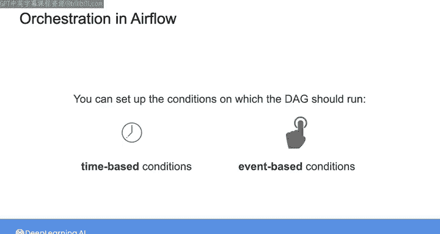

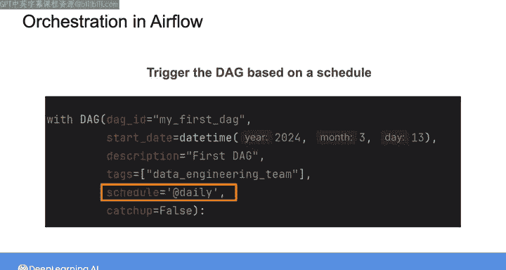

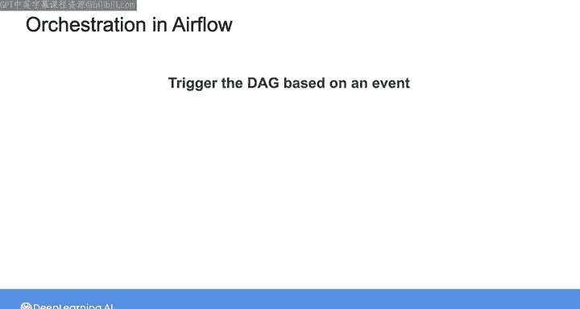

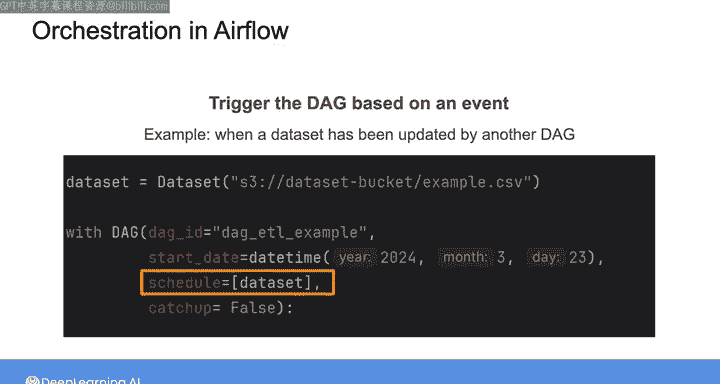

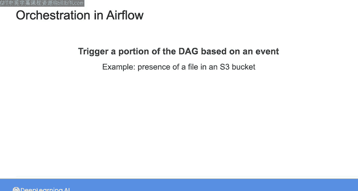

unUntil the myfiile。csV is available in the S3 bucket you can also set up monitoring and logging as well as alerts for the tasks in your D so for example。

 you might want to get an alert if a particular task fails or monitor how long a task takes to run you can also set up data quality checks along the way to ensure that the data flowing through your data pipeline meets your expectations and so that might include checking for things like the kind of null values or the range of some set of values or just verifying that the schema of the data you're ingesting is what you expect。

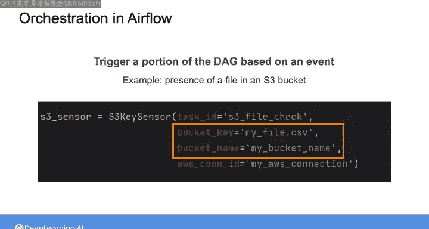

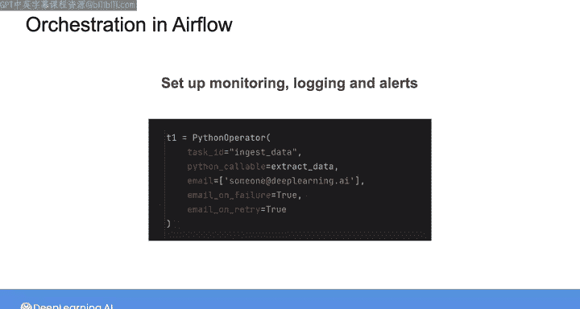

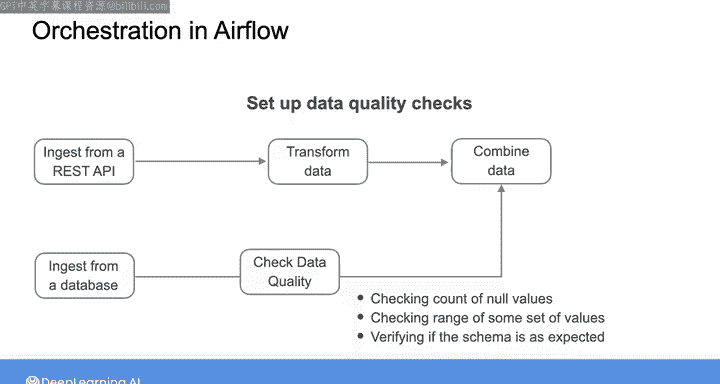

Again I'm showing all this right now in airflow， but the concepts I'm demonstrating are the kinds of things you can expect from any orchestration platform through the next several videos。

 I'm going to walk you through the steps of setting up orchestration of your data pipelines and airflow I'll see you there。

