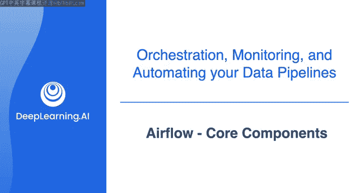
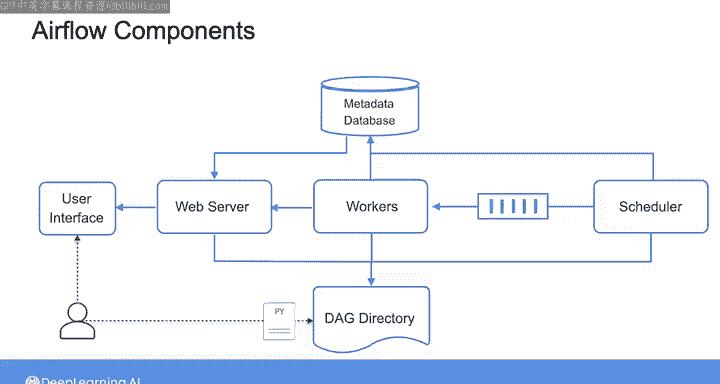
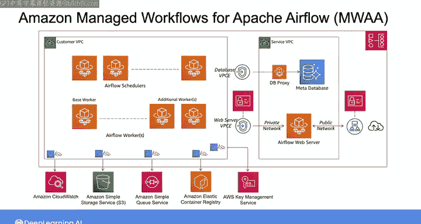
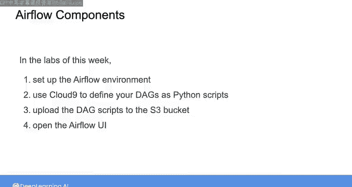

# 吴恩达《数据工程（导论，源系统、数据摄取和管道，数据存储和查询｜1-2-3课）｜DeepLearning.AI Data Engineering》 - P131：53_Airflow核心组件.zh_en - GPT中英字幕课程资源 - BV1wTtWeeEH5

Before you head to the first lab this week I'd like to spend some time introducing you to airflow by the end of this series of videos。

 you will know how to build a simple Dg in airflow and be ready for the first lab。

So in this first video， we will start with the underlying architecture of Airflow When you write your DAGs in Airflow。

 there are several components that work together behind the scenes to automatically run your DAGs。

 check that the dependencies between tasks are met and transfer the status of your DAGs to the airflow user interface this figure shows the main components of airflow and these include a web server where the airflow user interface runs a scheduler workers。

 a metadata database and finally a DAG directory。

When you create your airflow environment， whether by directly installing airflow or by using an airflow managed service。

 all of these components will be present in your setup。

 You'll mainly interact with the Dg directory and the user interface or UI for short。

 The remaining components will be running behind the scenes。

The DAg directory is a folder in which you store the Python scripts that define your DAs and this Dg directory is connected to the web server on which the airflow UI runs。

 So for any DAg that you create and add to the DAg directory。

 you will automatically be able to visualize it in the UI and not only that。

 you can also use the UI to monitor manually trigger and troubleshoot the behavior of your DAgs and the tasks within each Dg。

 but you don't always need to manually trigger your daAs from the UI。

 you can also trigger them based on a schedule or with an event or rather you can do so with the help of the scheduler component of airflow。

The scheduler constantly monitors all the dags you defined in the Dg directory and the corresponding tasks at once per minute by default。

 The scheduler checks whether any task should be triggered。

 given a particular schedule or by checking if their dependencies are complete。

 Once the scheduler identifies a task that is ready to be triggered。

 It pushes the task to a queue and uses an executor to manage the execution of tasks。 The executor。

 which is part of the scheduler extracts a task from the queue。

 and sends them to the workers that run the tasks。 As the scheduler triggers a given task。

 you will see the status of the task changes from scheduled to queued。

 Then once the workers execute the task， you will see the status change to running and finally success or failed。

 The scheduler and the workers store the status of the task as well as a state of the daAgs in the metadata database。

Then the web server extracts those states from the database and displays them to you in the UI。

And so that was a quick tour of the core components of airflow When you choose a managed service for airflow like Amazon managed workflows for Apache Airflow or MWAA for short。

 all these components will be automatically created and managed for you。

 You can see this in the architectural diagram， how Amazon MWAA organized as a core components of airflow on the cloud。

For instance， it uses an Amazon S3 bucket as a DAG directory and an Aurora PostgresSQL database as a metadata database。

 The other components are AWS networking components and additional AWS services that support securing your data as well as logging and monitoring your environment。

In the labs this week， you will first be guided to set up the airflow environment。

 You will then use the cloud 9 ID to write your Dgs as Python scripts， upload them to the S3 bucket。

 and finally open the UI to review the created dags。

Understanding the airflow environment and how components interact with each other will help you troubleshoot issues when they occur。

Join me in the next video to go through some of the features of the airflow UI。

