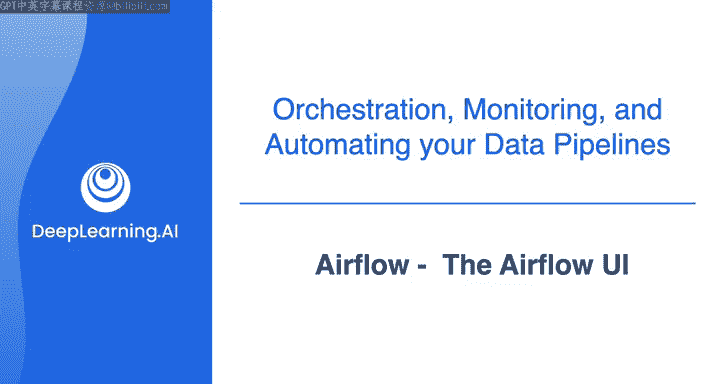
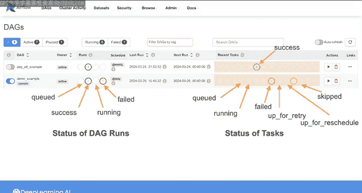
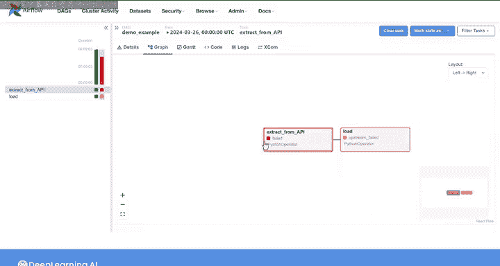
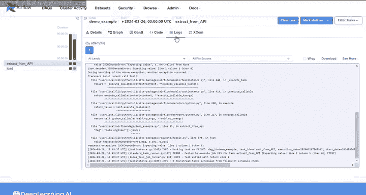
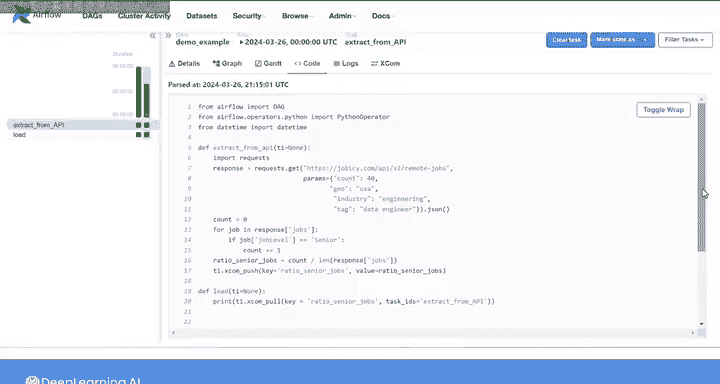

# 吴恩达《数据工程（导论，源系统、数据摄取和管道，数据存储和查询｜1-2-3课）｜DeepLearning.AI Data Engineering》 - P132：54_Airflow：Airflow UI.zh_en - GPT中英字幕课程资源 - BV1wTtWeeEH5

One of the main features you'll interact with when using Airflow is the user interface or UI。

This is where you can monitor the status of your DgGs and their individual tasks。

Get insights into your historical dag runs and troubleshoot issues with your pipelines。

So let's take a look at some of the basic features of the Airflow UI When you open the UI。

 you will first land on this page， which is called the DAG view here you can find a list of all the daAs that you've created in your DG directory for each Dg you can see some basic metadata like the DG ID the tag the owner and the schedule you can also check when the DAg was last run as well as the status of the DAg runs how many daAs are currently queued or currently running and how many were completed successfully or have failed there's also a more granular review for each DAg where you can check the status of all tasks including how many tasks are queued or running or successfully executed or failed and also how many were skipped up for retry up for reschedule and so on and let me show you how you can interact with the DAgs in this DAg view here on the left you can see the toggle to pause or unpause a Dg and here on the right you can manually trigger a daAg or delete it from the view and finally you can filter the DAGs you see。

On this page by the status or by custom tags you assign them you can click on the Dg ID to get more detailed information about that Dg Let's take a closer look at this Dg this new view is called the grid view and it gives you more detailed insights and each dag run and its corresponding task instances on the left side you see a bar chart of all the previous runs of this dag so here the chart shows two dag runs In other words the daAg was run twice you can see the duration of each run which is represented by the height of the bar and the status of each run is color coded where red represents the failed status and green represents the success status for each run you can also check the outcome of all individual task instances so here the dag consists of two tasks for the dag run that failed you can see that the first task had failed and the second one is orange coded which means it did not start because the upstream task had failed you can always refer to the color legend here at the top of the page to check what each color means。

On the right side of the grid view you can find four tabs。

 details graph Gant and code the details tab displays detailed information about the historical DAg runs such as the total number of times the daAg was run the total number of successful runs the total number of failed runs and the minimum mean and max duration of the DAg runs you can use all of these metrics as indicators for the health of your pipeline to access the details of a specific Dg run let's say the one that has failed you can select it here in the bar and then check its specific information on the right let's check out the graph tab here you can see a visualization of your DAG which helps you explore your DA structure and ensure that you have correctly configure the dependencies between your tasks the DAg visualization you're seeing now does not correspond to any specific Dg run if you'd like to visualize the status of a specific dag run let's say the one that has failed you can click on it on the left side Each task is now color coded based on its status within this run。

And so suppose you want to understand why the first task extract from API has failed Let's click on this task a new tab labeled logs has just appeared on the top and you can find all the error messages in this tab based on these messages you can try to fix the code for this DAg and when you're done fixing it and ready to retry this task you can also click on the clear task which will rerun the task if it runs and is completed successfully then all the remaining tasks in the pipeline will run as well Next the Gantt chart tab shows you the cute duration in gray and the run duration for each task of a specific Dg run you may find this chart helpful whenever you need to identify any bottlenecks in your pipeline and finally the code tab shows the code that corresponds to the given Dg this is not where you will interact or edit your DG code but you can use a tab to ensure the code in the UI is in sync with your code in the DAG directory there are many more features in the airflow UI and more things you can do to interact with your DAGs but in this video we covered the basic。

UI features that you will use most of the time in the next video we'll go through these steps to build a simple dag。

' see there。