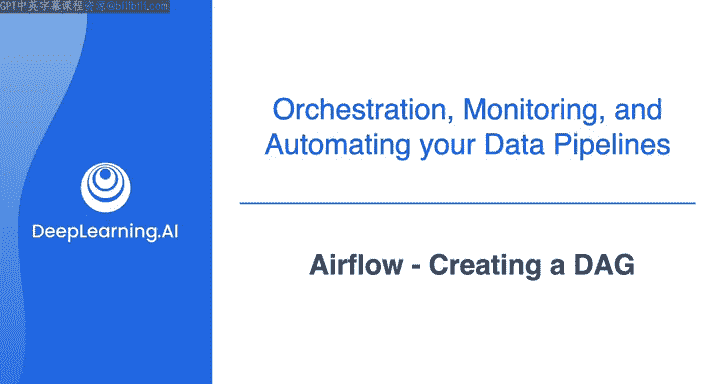
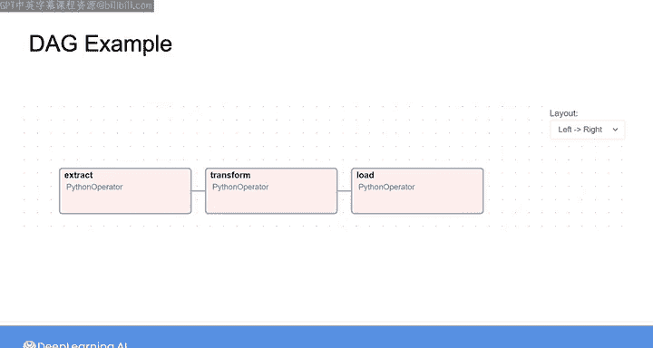
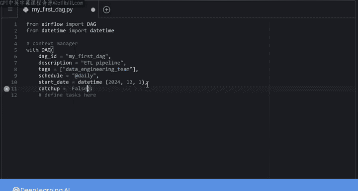
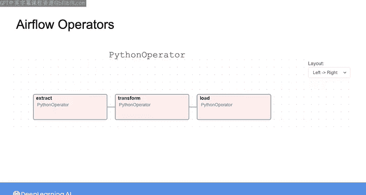
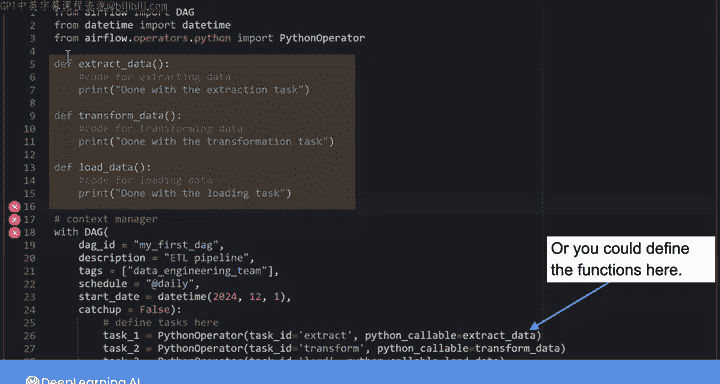
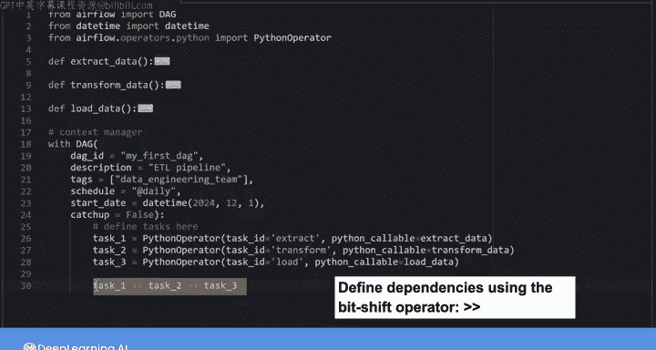

# 吴恩达《数据工程（导论，源系统、数据摄取和管道，数据存储和查询｜1-2-3课）｜DeepLearning.AI Data Engineering》 - P133：55_Airflow：创建DAG.zh_en - GPT中英字幕课程资源 - BV1wTtWeeEH5

In this video we'll go through the details of building a simple dag using some core airflow concepts such as a Dg and operator classes。

 Let's take the example of an ETL process The following diagram shows a Dg representation of such a process which consists of free tasks。

 extract， transform and load So here I'm not going to get into the specific details of each task but rather I'll focus on showing you how to set up a Dg that has the structure So here I'm working with AWS cloud9 I have already created this folder in which I'm going to save the Python scripts of the Dg let's start with creating an empty Python script in this folder and let's call it my underscore first underscoreg in this script you need to import some packages starting with a Dg class and the date time module you're going to use both of them to create the Dg instance which is the next thing that we' do to create the Dg instance you will use the with statement known as the context manager which will help you group and define all the tasks that belong belong。

This dag here Now you need to specify the parameters of the Dg The first parameter is the DAg underscore ID This is the name that you will use to identify your DAg in the DAg view in the airflow UI So when you choose to use your Dg underscore ID make sure it's unique for this example I've chosen to use my underscore first underscore Dg as the Dg ID you can also specify a Dg description if you wish to provide more details related to the Dg the DAg description will appear when you hover your mouse over the Dg name and the airflow Ui and on the other hand。

 you can also set the tags parameter to be a list of tags that you can use to filter daAs in the UI So for instance。

 one of the tags can be data underscore engineering underscore team and the next important parameter is schedule which you can use to define when the DAg will run you can assign the schedule parameter a Chron expressions just zero8 star star star which means the dag will run every day at 8am or you can use Ch presets such。

As at daily， at monthly， at hourly at weekly， etc where you can pass a time Delta object from the datetime package for example。

 this time delta object means that the dag will run every three days and in this example I'm going to set the schedule to at daily besides the schedule you need to also specify the start underscored date which is the first date your dag will be executed on here I'm using a date time object to specify the year month and day of the start date the last parameter that I'm going to specify here is catchup this is a boolean parameter that is set by default to true how is this parameter useful let's say that you pause your dag for a period of time and then unpause a dag to make it active again if you set catch up to true the scheduler will kick off a dag run for any missed interval when the daAg was pause Additionally it will trigger a dag run upon the first time you run the dag the start date of the dag precedes as creation date and this example I'm going to set catch up to false。

So that was the first step where you define the DAG instance and all of its parameters。

Let's now move into defining the task for the Dg。 You need to use airflow operators to define each task。

 Operas are python classes that are used to encapsulate the logic of the task or how data should be processed in your pipeline operators are provided by airflow which you can import your code and create each task as an instance of an airflow operator there are several operator that you can choose from you can use a python operator if you want to execute a python script that contains the logic of your task you can choose a bash operator if you want to execute bash commands you can use an empty operator if you want to organize your daAs such as marking the start an end of the pipeline and finally you can choose an email operator if you want airflow to send you a notification via email there's also a special type of operator known as sensors which you can use to make your DAg's event driven in the example here I'm going to use the python operator to define each of the three tasks First you need to import the class Python operator like you see here then you'll go。

ID context manager to define the first task which is the extraction step to do so。

 you will create an instance of Python operator which needs two parameters The first parameter is task underscore ID which you can use to specify the name of the task and this name will be used to reference the task in the Fflow UI I've chosen to use extract as the ID for the first task and the second parameter is Python underscore callable which expects a python function that contains what needs to be done in the extract step you can define this function here in the same file or you could define it in another file and import it into the code here in a moment you'll define a function called extract underscore data but for now let's assume that this function exists that we can set it as a second parameter Python underscore callable then we can repeat the same steps to define the second and third tasks assuming that the two Python functions transform underscore data and load underscore data already exists Now we need to go back and create these python functions in this file。

You can define these functions before the DAg definition as shown here or as you will see in the next lab。

 you can place each function definition next to the corresponding task within your Dg note that to keep things simple in this first Dg example the task just contains a simple print statement So now you have the DAg in the task defined you just need to specify the dependencies between the task or the order in which the task need to be executed here's how you can define the dependencies using the bitshift operator this statement means that task1 should be executed and completed before task2 starts and task2 should be completed before task 3 starts note how in this statement I use the variables that represent the task instances and that's it you now know how to build a simple Dg and airflow in the lab you'll get a chance to build another dag on your own and once you're done you'll be guided to upload your Python script to the airflow S3 bucket which acts as a DAg directory and then open the。

UI to check and monitor this stag。After that， I'll see you in the next video to look at the airflow concepts you'll encounter in the second lab。

 XCO and variables。