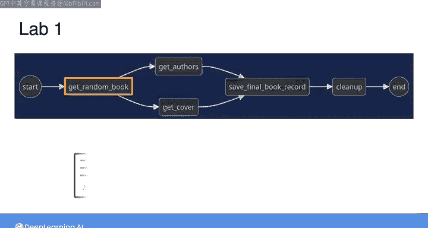
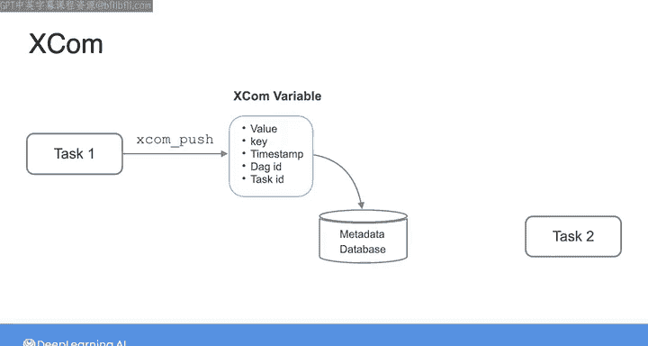
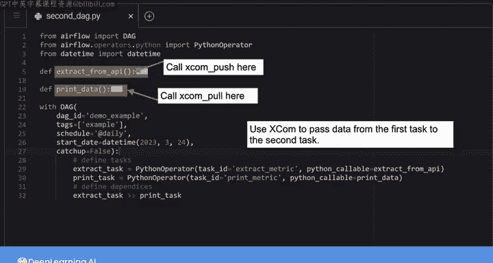
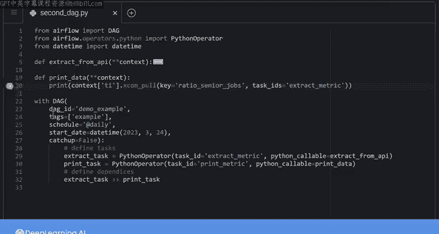
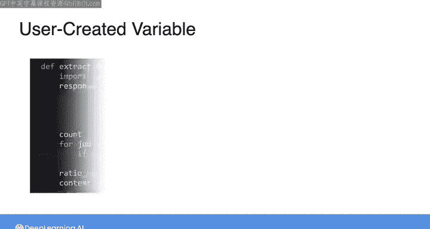
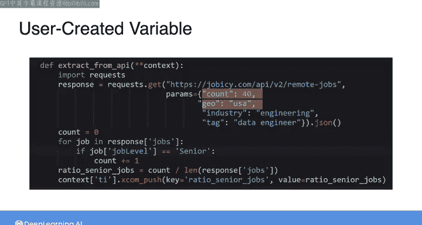
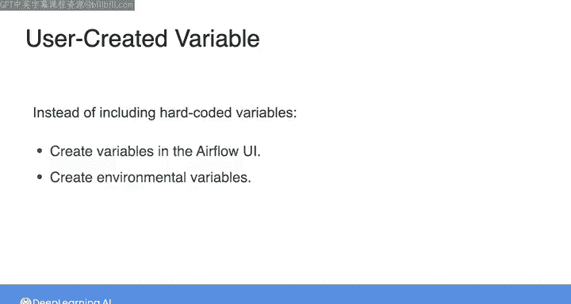
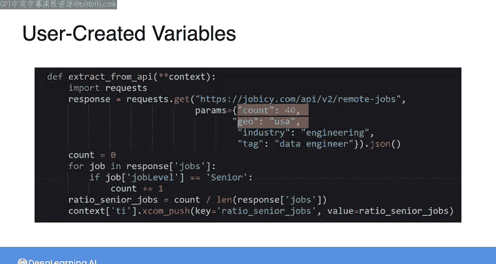
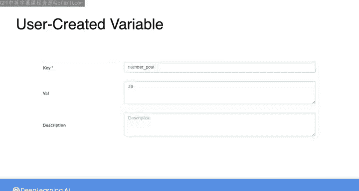
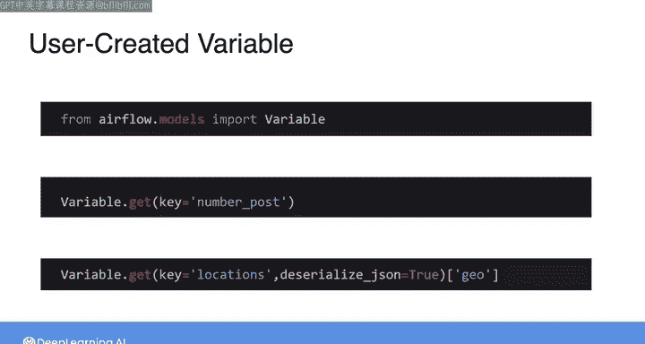

# 吴恩达《数据工程（导论，源系统、数据摄取和管道，数据存储和查询｜1-2-3课）｜DeepLearning.AI Data Engineering》 - P134：56_Airflow：XCom和变量.zh_en - GPT中英字幕课程资源 - BV1wTtWeeEH5

In the first lab you got some experience building dagGs。

 interacting with the airflow UI and troubleshooting issues in your DG now you're ready to explore additional airflow features and look at some best practices for implementing orchestration with airflow。

In this video you'll learn how to pass data from one task to another using airflow Xcom and how to create global variables in the airflow UI Let's get started Here's a Dg you implemented in the previous lab and the task get random book you requested the data of a randomly chosen book from a book API and then sort that data in an S3 bucket to be used in subsequent tasks so you essentially pass data from one task to another using an intermediate storage in this case the S3 bucket this method is appropriate when you want to pass large data sets between tasks but for small amounts of data there's another method called Xcom that you can use Xcom。

 which is short for crosscomic is a key airflow feature for sharing data among tasks it's designed to pass information like metadata dates。

 single value metrics or simple computation between tasks in a given task if there's a value that you'd like to use in another task。

can sort in an Xcom variable by calling the Xcom underscore push method the Xcom variable is then pushed to the metadata database Each Xcom contains the following information key which is the name of the Xcom variable the stored value the timestamp at which the variable was created as well as a Dg ID and the task ID from which the Xcom variable originated to extract the value stored in an Xcom variable in any given task you can call the method Xcom underscore poll Let's go over an example the DAG you see here consists of two tasks the extract metric task connects to an API sends a request or a certain data and then computes a metric based on the return data the second task prints the metric computed by the first task Since you need to pass some data between the first and second task you can use the Xcom feature here the first task uses the function extract from API and this is where you need to call Xcom underscore push and the second task uses。

Function print data this is where you need to call Xcom underscore pull Let's take a closer look at each function This is the code for the extract from API function here I called the rest API and a job site to get the latest 40 remote job postings for data engineering in the US then I computed the ratio of those jobs that ask for a senior data engineer now you want to pass this value for the second task So you need to first store the obtained value in an Xcom variable by calling the method Xcom underscore push this method expects two parameters the key of the variable and the computed value Xcom push is a method associated with a task instance This means that you need a task instance here on the left in order to call the method and by task instance I mean the object that represents the currently running task airflow has a set of built in variables that contain information about the task that is currently running including the task instance this information is stored in a dictionary called airflow context that you。

Pass to the extract from API function as an argument like you see here to get the task instance object from a context sectionctionary you can use context in then brackets you'll see TI where TiI stands for task instance then you can call Xcom push on the task instance object you got then to access the computed ratio of the Xcom variable in the second task you need to call Xcom underscore pull like this and pass in the key of a variable and the task ID where the Xcom variable was created similar to what you did in the extract from API function you also need a task instance in order to call Xcom poll so let's pass the context sectionctionary as an argument to the print data function and then use context in in brackets T again to get the task instance and finally call the method Xcom Po on this object When you run your DG you can check your Xcoms in the Rflow Ui by clicking on admin and then navigating to Xcoms Here's the Xcom variable that we just created along with its corresponding value。

I want to offer you a word of caution about using Xcoms。

 they are not designed to pass large data sets like data frames between tasks as they degrade the performance of your DAGs and the metadata database。

If you need to share large dataset sets between tasks。

 you should follow what you did in the previous lab and use an intermediate storage like S3 Now let's discuss another airflow feature using the same DAg as an example。

 if you examine the API request of the first task you see that the value of certain parameters such as count and geo or hardcoded。

 which means they are directly included in the code。

 but what if you don't want those values to be fixed because you may need to change them in future Dg runs or maybe you want to experiment with more than one value。

 you can update the values in the code， but this approach might be errorprone and not the most efficient especially if the values are repeated many times in your code。

 instead of including hardcoded values within your DAG or task definitions you can create global variables in the airflow UI or create environmental variables in your development environment and use these variables inside your code。

Let's create two variables in the airflow UI one for the number of posts and another for the location If you click on the advent tab and then select the variables option you will see your list of variables for a new variable you can click on this plus sign and then specify the key and value of a variable for the location variable I specify the list of countries I'm interested in gathering job postings from as a JSON object and for the number of post variable I'll assign it the value of 20 to use those variables inside your code you need to import the variable module and then inside your code you use the variable。

ge method to retrieve the total number of posts and the list of locations here you set the parameter decsialized JSON to true if you want this method to return the JSON object as a dictionary instead of a string。

In the next lab， you'll practice creating variables in the airflow UI as well as using airflow built in variables。

 you'll also use Xcom variables to pass data between tasks before you go to the next lab make sure you check out the reading materials after this video that list some of the best practices for writing daAgs to ensure that your code is efficient。

 readable and reproducible。