# 吴恩达《数据工程（导论，源系统、数据摄取和管道，数据存储和查询｜1-2-3课）｜DeepLearning.AI Data Engineering》 - P135：57_Airflow：TaskFlow API.zh_en - GPT中英字幕课程资源 - BV1wTtWeeEH5

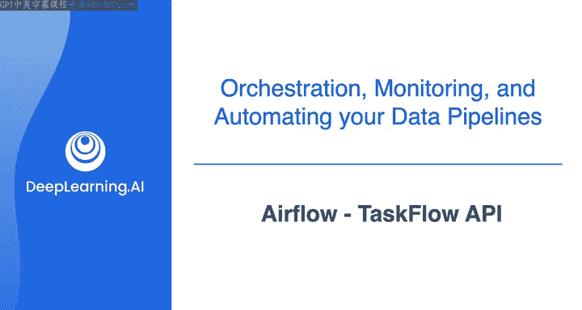

I hope you're now starting to feel comfortable with airflow in the upcoming lab you will build a pipeline using airflow that incorporates data quality tests into your DG using great expectations。

And you'll use other airflow features such as branching and the taskflow API to write your DAg in a more concise way。

 but before you start the last lab， let me introduce Tflow API and show you an example that follows this paradigm up until now to define your DAg you in satiateated a DAg object and to create your task instances you use Python operators this is known as the traditional paradigm Airflow 2。

0 introduce another paradigm known as taskflow API The goal of this new paradigm is not to replace a traditional one but to make writing daAs easier and more concise especially when the DAg uses lots of Python functions This new paradigm relies on the use of decorators that help with the creation of a DAg and its tasks and simplifies a writing of code at the same time but before I show an example of how to write a DAg using this new paradigm I'd like to clarify that the API in Tflow API is not related to rest API you can think of taskflow API as an。

face it provides you with a more user friendlyly programming experience Let's go back to the first DAg example you saw in a previous video tutorial and we'll read write it using the Taskflow API paradigm to define your DAg you use the context manager as shown here with a taskflow API instead of explicitly calling the DAg constructor you can use the decorator at DG pass in the DAg parameters to the decorator and then define the content of your D as a Python function correctly after the decorator In this case the function name will be used as the Dg ID to identify the Dg in the airflow UI inside this function you define the tasks in their dependencies and what you done you need to call the DAg function as shown here otherwise your Dg won't show up in the airflow UI the role of the DAg decorator is to explicitlylicitly call the Dg constructor to create the DAG instance note that to use the Dg decorator you need to import it as shown here so far you may not have notice a big difference between these two。

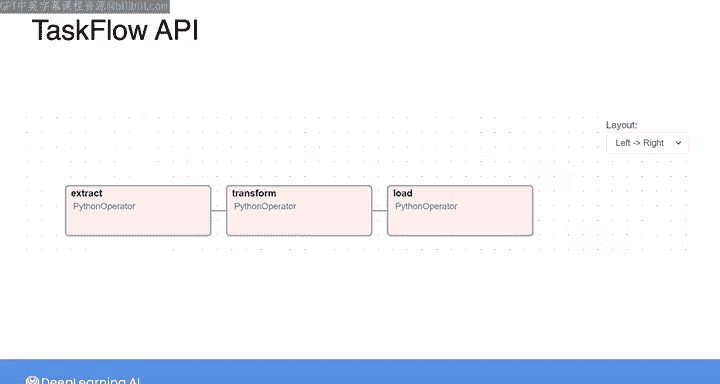

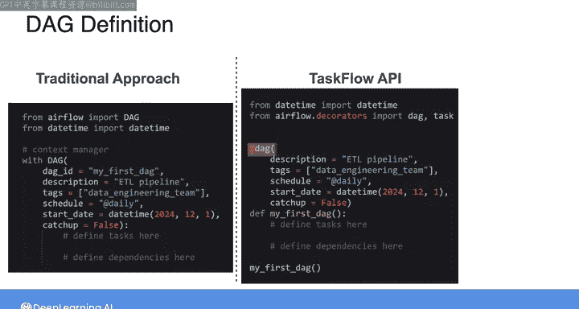

when it comes to defining the DAg， but let's see how creating the task is different with the taskflow API in the traditional paradigm you use a Python operator to create your task shown here and in doing so you needed to keep track of the task ID the name of the Python function and the name of the variable that represents the task with a taskflow API you'll keep track of fewer names so instead of explicitly calling the Python operator you use the app task of decorator to define your task and so here inside your Dg function you can use the app task of decorator to create the first task which is the extraction step and then you define the extract data function directly after the decorator similar to before the function name will be used as the task ID to identify the task in the airflow UI and the job of the decorator is to implicitly call the Python operator which simplifies your code and to define the remaining task you just repeat the same steps similar to the DAg decorator to use。

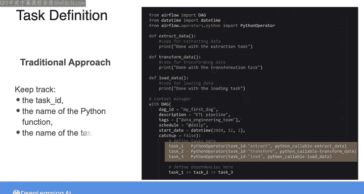

Deator you need to import it as shown here and finally， to define the dependencies between the tasks。

 you will still use the same bitshift operator but this time you will call the functions that represent each task as follows So this is how you can use Tflow API to define a Dg this is equivalent to how you define yourg previously using the traditional paradigm in terms of arriving at the same result but Tflow API makes your code simpler let's take a look at one more example to see how you can use Xcom with Tflow API in the traditional approach you called Xcom push to store the data you want to pass other tasks and then you called Xcom poll in the function for the task that uses the data with Tflow API you can simply include a rege statement as shown here and this extract from API function to store the data you want to share in an Xcom variable and then for the task that uses the data you can specify that the function expects an input representing the data shared by a previous task and finally when you want。

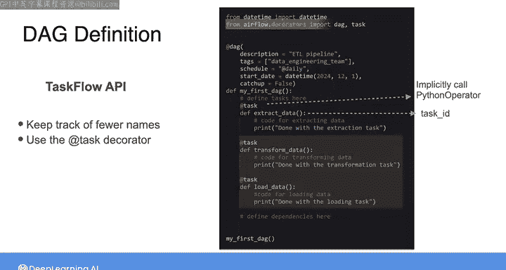

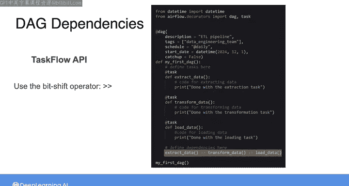

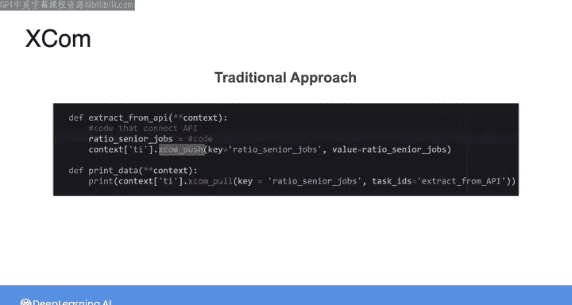

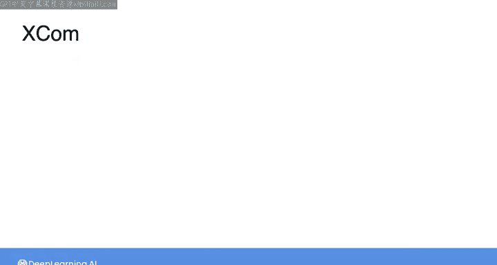

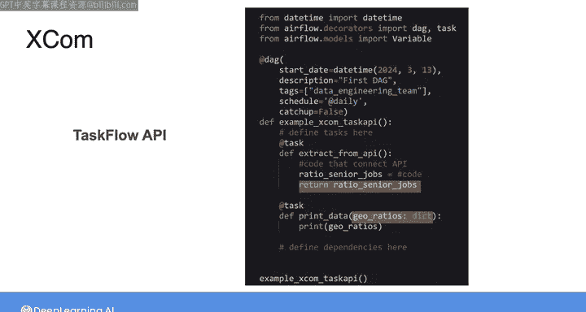

define the dependencies between two tasks that you call the function of the first task and assign the value it returns to a variable then you can pass this variable to a second task as shown here or you can combine both statements into one statement like this you can still use Xcom Po and Xcom push with taskflow So for example in the second task you can pass in the airflow context to the function and use it to explicitly call Xcom Po inside the function and then to define the dependencies you can use a regular operator as shown here note that the decorator does not replace all operators This is why you may still need to use both paradigms and maybe combine both of them in the same code depending on your use case before you jump into the last lab make sure you check out the reading material on branching that's provided after this video it will prepare you for creating a dynamic pipeline in the lab。

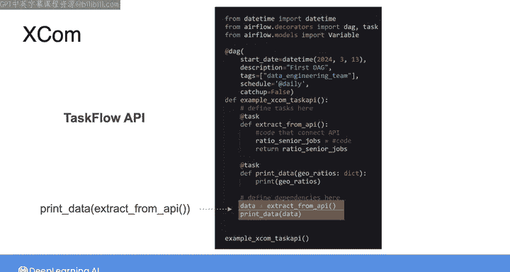

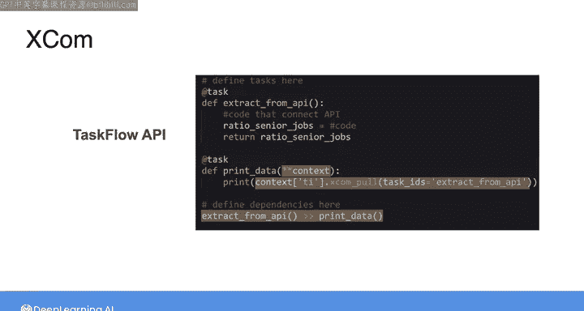

Then after you finish a lab， Morgan will walk you through some options you have for orchestrating data engineering tasks on AWS。

