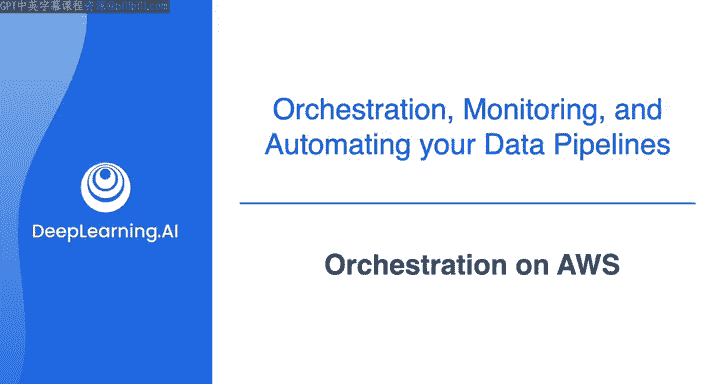
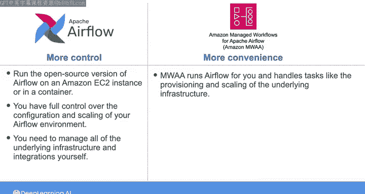
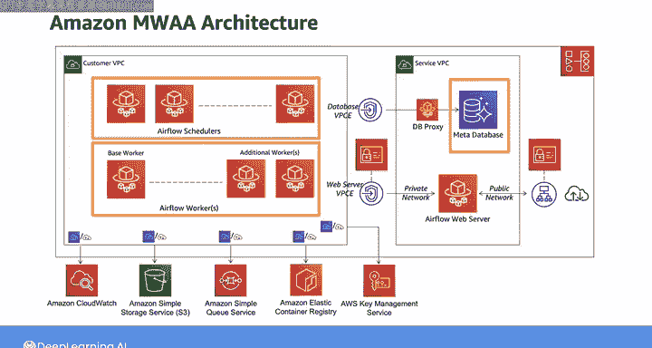
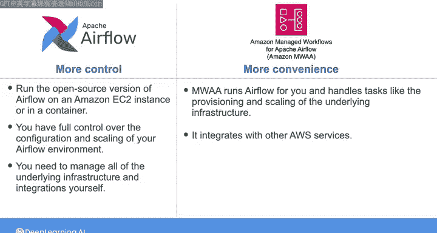
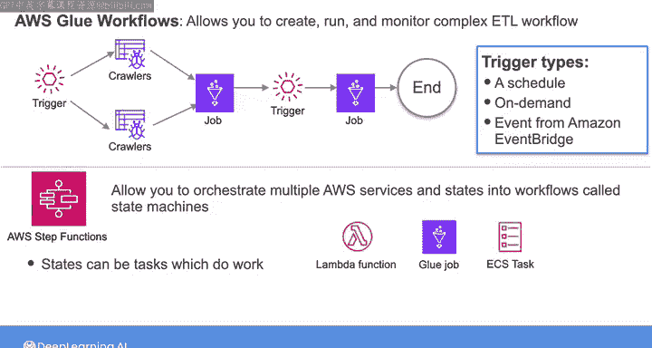
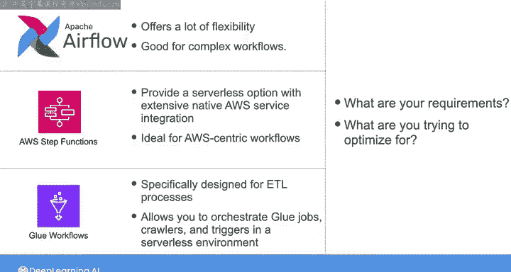

# 吴恩达《数据工程（导论，源系统、数据摄取和管道，数据存储和查询｜1-2-3课）｜DeepLearning.AI Data Engineering》 - P136：58_AWS上的编排.zh_en - GPT中英字幕课程资源 - BV1wTtWeeEH5

Now that you've gotten some practice using airflow to orchestrate your data pipelines。

 those skills are going to help you with your orchestration work going forward。

 whether you're using airflow or another orchestration tool。 In this video。

 I'd like to briefly introduce you to some of the other options you have when orchestrating data engineering tasks on AWS First off。

 with airflow itself， there are multiple ways you can host and run your workflows on AWS the most handson way is that you can run the open source version of airflow on an Amazon E C2 instance or in a container in the labs this week。

 you were using open source airflow in a set of containers that were running on an E C2 instance。

 by using this approach you have full control over the configuration and scaling of your airflow environment。

 But this also comes with more responsibility as you need to manage all of the underlying infrastructure and integrations yourself。

 As I've said before when it comes。To choosing tools and services to build your data pipelines。

 it often comes down to evaluating the tradeoffs between convenience versus control and the requirements for your particular use case if instead of control you are aiming to optimize for convenience when running airflow on AWS you could choose to use Amazon managed workflows for Apache airflow or MWAA which is a managed service that runs airflow for you and handles tasks like the provisioning and scaling of the underlying infrastructure when you use MWAA it sets up an Apache airflow environment for you using the same airflow user interface and open source code that you can download from the internet this is a diagram showing how MWAA is architected the scheduler and worker components that you're now familiar with are hosted in containers on AWS Fargate and they can access an airflow metadata database which is hosted on Amazon Aurora。

To store the status of tasks and the state of the DAGs MWAA also integrates with other AWS services For example。

 MWAA posts airflow logs and metrics to Amazon Cloudwatch。

 uses Amazon S3 as the DAg directory where you place your Python scripts。

 and it uses AWS key management service to encrypt data at RE， apart from MWAA。

 there are other orchestration services on AWS that supports similar functionality。

AWS glue workflows is similar to airflow in that it allows you to create。

 run and monitor complex ETL workflows， where multiple glue jobs and crawlers may be dependent on each other a glue workflow contains jobs。

 crawlers and triggers。You would build out these components before building your workflow and then you can use the AWS gluelu console to visually build out and see the structure of your workflow graph you can then run these glue workflows based on triggers which could be on a schedule on demand or an event coming from Amazon event bridge Another option for orchestration on AWS is AWS step functions step functions allow you to orchestrate multiple AWS services and states into workflows called state machines The states in a state machine can do various things states can be tasks which do work like a Lambda function that processes data。

 a glue job that transforms a data set or an ECS test that runs a containerized application just to name a few examples states can also make decisions based on their input perform actions from those inputs and then pass output to other states and so like airflow step functions。

Are designed to coordinate tasks and manage dependencies between them。

 allowing you to define complex workflows involving multiple steps or states when it comes to choosing between airflow either managed or open source versus step functions or glue workflows or some other orchestration tool entirely just like anything else it's going to come down to your requirements and what you're trying to optimize for airflow with its pythonbased dags and plug an ecosystem offers a lot of flexibility and is good for complex workflows step functions provide a serverless option with extensive native AWS service integration。

 which can be ideal for AWS centric workflows and AWS glue workflows are specifically designed for ETL processes allowing you to orchestrate glue jobs。

 crawlers and triggers in a serverless environment As Joe mentioned earlier。

 the landscape of orchestration tools is evolving rapidly。

So your best bet， in addition to getting practice with popular tools like airflow is to stay up to date on alternative and emerging tools so you can make the best choices in your own data architectures going forward Now I'll pass back to Joe to wrap up this week。

