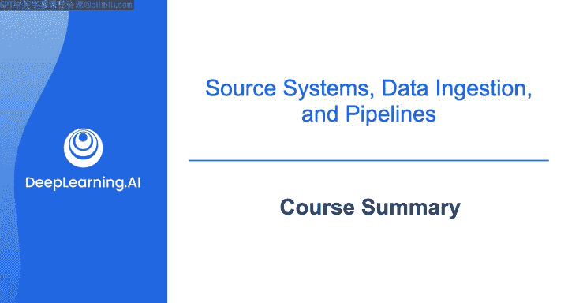
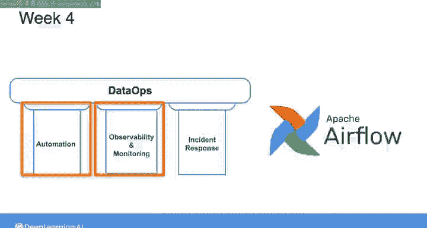

# 吴恩达《数据工程（导论，源系统、数据摄取和管道，数据存储和查询｜1-2-3课）｜DeepLearning.AI Data Engineering》 - P137：59_第2课程总结.zh_en - GPT中英字幕课程资源 - BV1wTtWeeEH5

Congratulations on finishing the second course in the data engineering specialization。

So that's two courses down and two courses go。Really。

 though I would say you're more than halfway done because you've covered a lot of ground already everything from the high-level mental framework for the data engineering lifecycle。

 data architecture， and thinking like a data engineer that you saw in course1 on through to the work you've done in this course covering source systems ingestion。

 data ops and orchestration so nice work in week one of this course we looked at a range of different source systems that you'll work with as a data engineer and you got some practice working with relational and non-relational databases as well as object storage in week two we dug into the details of batch versus streaming ingestion architectures and you set up batch ingestion from a RE API and streaming ingestion using Amazon's kinesis in the third week of this course we looked at automation observability and monitoring in the context of data ops and developed infrastructure as code using  Terraform we also covered data quality checks using great expectations。

using Cloudwach and in the fourth and final week of this course。

 you took further steps in the direction of automation， observability and monitoring。

 using airflow to implement orchestration for your data pipelines。 So like I said。

 you've covered a lot of ground and you're well on your way to developing the core skills to be a successful data engineer。

 And there's more to look forward to。 In the next course。

 you'll focus on how you can use modern storage systems and storage abstractions in your data pipelines。

 I'll see you there。😊。

