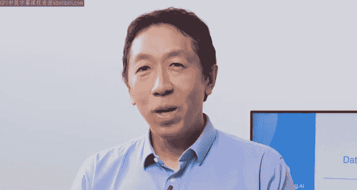
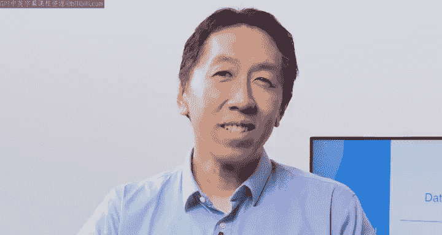

# 吴恩达《数据工程（导论，源系统、数据摄取和管道，数据存储和查询｜1-2-3课）｜DeepLearning.AI Data Engineering》 - P138：0_欢迎来到第3课程.zh_en - GPT中英字幕课程资源 - BV1wTtWeeEH5

Welcome to this third course of the data Engine specialization in completing the previous two courses you've already accomplished a lot in the first course you' got a high level overview of the field of data engineering including the data engineering lifecycl。

 a framework for thinking about your work as a data engineer and also practice building data engineering solutions。

In the second course， you took a deep dive into source systems， ingestion， datas and orchestration。

With these two first courses you've already built up a powerful twocode of knowledge and skills for your work as a data engineer here again with Jovies。

 your instructor for these courses is great to be review you again and maybe you can say a bit about what learners will see N in discourse Sure thing thanks Andrew So the first two weeks of this course are all about data storage then in the third week will talk about queries At that point I can imagine you might be wondering a whole course on storage and queries well is this really necessary believe me while storage inquiries might seem straightforward at first glance they are anything but straightforward would you agree with this Andrew what do you think about storage inquiries I think storage inquiries are not straightforward at all。

 There are many decisions in how to slow your data that will affect how you can use the data efficiently after with for example what type of storage from longterm storage that's cheap but is practical to access only inmittent。

To data storage using a relational database or a keyvalue store to storing it in memory and then also the design of the database schema and maybe even deciding which data centers that is in what parts of the world you decide to store your data All this can drive both performance as well as impact how you have to effect with refuge concerns such as data sovereignty。

 For example， was recently just working on a project with a semiconductorduct company that couldn't let the data leave their country So we had to architect system that we wrote here in the United States that ran only in that country and shared only every results with US team and that's just one example。

 but the needs of different companies are so varied this has led to a wide range of tools and frameworks that have been developed to handle these very different needs That's right So lots of complexity with storage inquiries So as you've seen in previous courses。

Think of data storage as a sort of hierarchy where you have the raw ingredients of storage at the bottom。

 including the physical elements of storage like magnetic disks， solid state drives and RAM。

 as well as the less tangible elements of storage， things like CPU， compression。

 networking and sterilization。On top of that you have storage systems built from these raw ingredients。

 things like databases and object storage， and on top of that you have storage abstractions built from these storage systems。

 so things like data warehouses， data lakes and data lake houses then when it comes to querying the data you have in storage there are a wide range of tools and techniques you need to be aware of as a data engineer to ensure your systems are working efficiently That sounds great I'm excited about all this that you cover in this course and I think you find it in your work as a data engineer having deep expertise in storage solutions and queries will help you be more successful at every stage of the lifecycl Great let's get started。

