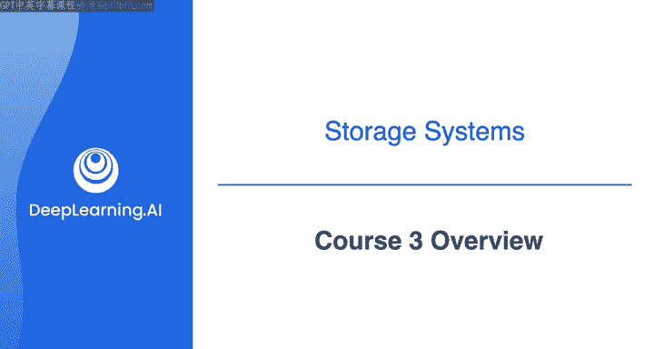
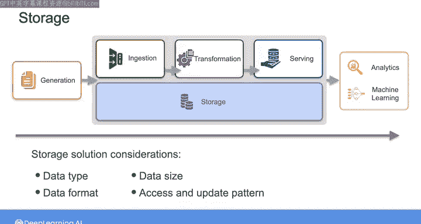
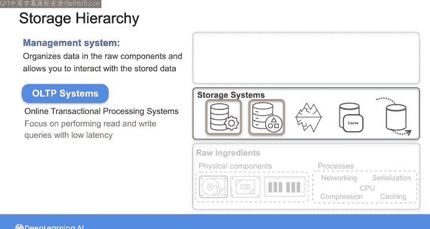
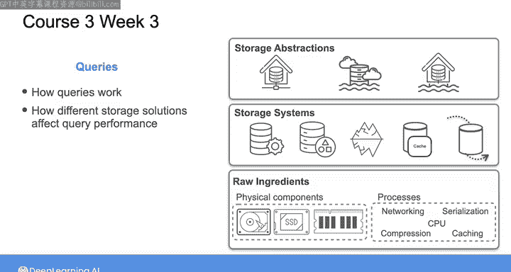

# 吴恩达《数据工程（导论，源系统、数据摄取和管道，数据存储和查询｜1-2-3课）｜DeepLearning.AI Data Engineering》 - P139：1_第3课程概览.zh_en - GPT中英字幕课程资源 - BV1wTtWeeEH5

Storage is arguably the most complicated component of the data engineering lifecycle and that's because you'll store data many times as it moves through the lifecycle and the storage solutions you choose will impact everything from the cost to the performance to the end user experience of your data systems So data storage really spans all the stages of the lifecycle from the source systems that are out of your domain of control as a data engineer to ingestion。

 transformation and finally serving data to your end users in this course will focus on the storage you'll directly handle as a data engineer from ingesting data on through to serving to choose the proper storage solutions for your data architecture you mean to know the characteristics of your data including things like its type format。

 size and how it will be access and updated by various stakeholders at different points in time recall that you can think of storage as a sort of hierarchy。

At the bottom layer you have the raw ingredients that comprise any storage system these are components like the magnetic disks。

 solidate drives and memory that use a physically stored data along with the processes needed to store and transmit data such as networking serialerilization and compression You typically don't interact directly with these physical storage components or processes instead you interact with the storage systems that are built from these raw ingredients a storage system consists of an internal management system that organizes your data and allows you to interact with the storage data you already learned about some of these storage systems such as databases and object storage in the context of storage systems in course2 back then we mainly discuss OLTP systems for processing transactions which focus on performing read and write queries with low latency However。

 storage systems that support transactional processing are different from those needed to support online analytical processing or OAP systems These are systems that focus on applying。

Alytical activities on data like aggregation and summarization to make business decisions and nowadays we have storage systems like graph and vector databases that are more specialized and can support machine learning analytical use cases at the top of the storage hierarchy storage systems are assembled into storage abstractions including cloud data warehouses。

 data lakes and data lake houses So in week one of this course we will focus on these first two layers。

 the raw ingredients and storage systems we will dive deeper into the characteristics of physical storage technologies and look at the technical details of serialerization and compression algorithms。

 then we'll explore the cloud storage paradigms of block object and file storage we'll also cover distributed storage systems and finally we'll discuss the details of data storage in various types of databases you will compare the performance between row and columnoriented databases to understand their use cases and OLTP and OAP systems then you will explore how data。

😊，d in NosQL Graph and vector databasesSimilar to what you did in course2 when exploring relational and NosQL databases as So systems。

 in lesson two of this week， you'll gain handson practice using the cipher language to query a Ne4j database。

 which is a graph database with vector search capabilities The theme of this first week is to assess the tradeoffs between storage costs and performance at the raw ingredient and storage system levels so that you can start to make informed storage decisions when designing your data architectures。

In week two， we'll focus on the top layer， storage abstractions and you'll learn to choose the appropriate abstractions for storing the data your stakeholders need through the ingestion。

 transformation and serving stages in the last week of this course。

 we'll look at how queries work to retrieve stored data。

 how the different storage solutions affect query performance as well as techniques for improving query performance so even though this course has only three weeks we have a lot to cover join me in the next video to get started with the raw ingredients of data storage。

