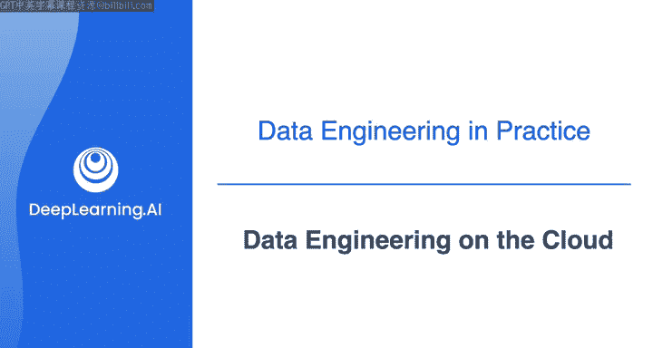
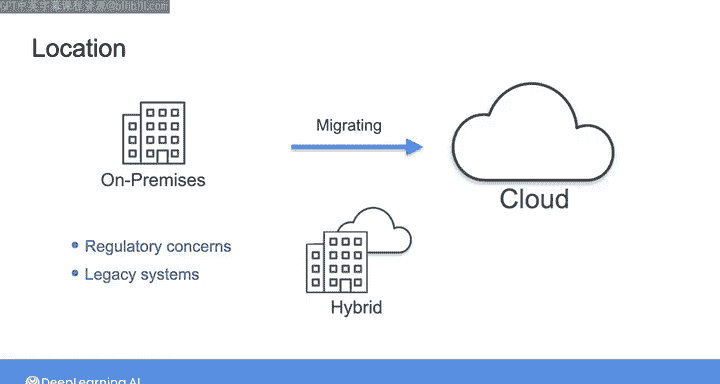
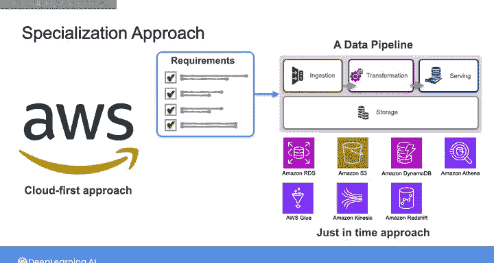

# 吴恩达《数据工程（导论，源系统、数据摄取和管道，数据存储和查询｜1-2-3课）｜DeepLearning.AI Data Engineering》 - P13：12_云上的数据工程.zh_en - GPT中英字幕课程资源 - BV1wTtWeeEH5

This specialization is all about data engineering。 And so far in this first week of materials。

 we've stayed pretty high level。 we've looked at the overall data engineering life cycle and undercurrents。

 some of the history of data engineering as well as what it means to work with stakeholders and deliver value for your organization。

 Now， like I said， right up at the top of this week。

 I realized this might not have been exactly what you expected when you signed up for these courses。

 but like I said before， that high level mental framework and way of thinking like a data engineer is important for everything that follows is something will be revisiting throughout these courses as a data engineer。

 the actual set of tools and technologies you work with。

 could be quite different from one company to the next。😊。

As I talked about in the video on the history of data engineering with the advent of the public cloud and a proliferation of open source and proprietary tools available companies of all sizes and across all industries。

 now have access to the same set of highperance tools and technologies。

 many companies today are choosing to build their data systems entirely on the cloud。

 but not that long ago， the only option was for companies to build and to maintain their own data infrastructure in house。

 otherwise known as on premises systems， today， there are still companies that maintain some or all of their data infrastructure on premises and in certain cases that could be due to regulatory constraints or just that the company has some legacy systems。

 they prefer to maintain on premises， and so as a data engineer out in the wild today。

 it's possible that you could be at a company that has some on premise systems or you may even be tasked with migrating and on- premisem system to the cloud。

It's becoming increasingly likely， however， that your work as a data engineer will take place exclusively on the cloud。

 Although AWS was the first popular public cloud and remains the most widely used today。

 you may encounter other cloud providers depending on where you work such as Google Cloud platformform。

 Microsoft's Azure among others in the specialization we won't dwell on the nuances or considerations you might encounter if you need to work with an on-prem system or migrate from on-pres to a cloud instead we'll be taking a cloud first approach to prepare you for the scenarios you're most likely to encounter as a data engineer we've partnered with AWS in the development of these courses and so in the lab exercise。

 you'll be building data pipelines and architectures on the AWS cloud using the same tools and technologies that are being used by thousands of companies worldwide in their own data infrastructure by the end of this first course you'll be able to take a set of technical requirements for your system like we talked about。

In the last lesson and stand up a data pipeline with the appropriate set of cloudbased tools and technologies to meet those requirements the AWS cloud comprises an expansive set of resources and tools in this specialization my aim is not teaching you all the is to know about data engineering on AWS instead we'll be taking a just in time approach where you'll learn how to use specific tools for each lab directly as you encounter them in this way there's no prerequisite knowledge of cloud computing required to be successful in these courses with that being said however。

 having some broader familiarity with cloud computing basics and terminology will help you build context as you proceed through these courses to introduce the tools and resources of AWS I'll be joined by Morgan Willis who is a principal cloud technologists specializing in teaching people how to be successful on the AWS cloud join me in the next video to meet Morgan。

