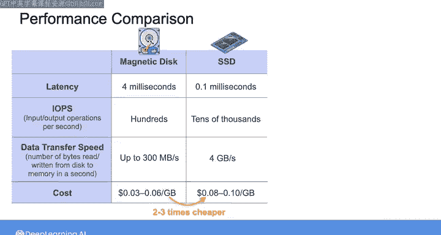
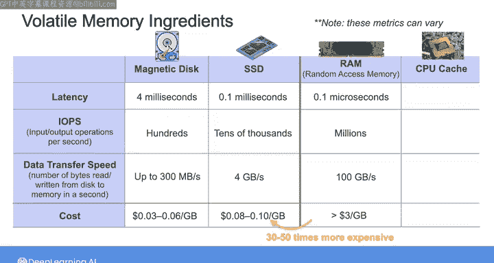

# 吴恩达《数据工程（导论，源系统、数据摄取和管道，数据存储和查询｜1-2-3课）｜DeepLearning.AI Data Engineering》 - P140：2_存储原材料：数据存储的物理组件.zh_en - GPT中英字幕课程资源 - BV1wTtWeeEH5

Like I said before， the raw ingredients used to physically store data are at the heart of all data storage systems So as a data engineer。

 you need to be aware of the characteristics performance data durability and costs of these raw ingredients in order to select the storage system that is appropriate for your end use case as data works its way through the data pipeline。

 It frequently passes through persistent storage mediums or disk like magnetic disk drives or solid state drives。

 It also passes through volatile memory like RA and CPU cache and so in this video I'd like to compare these different raw ingredients to help you understand the differences between them Mag disks often referred to as hard disk drives or HDs use rotating platters coded in magnetic film to store data magnetic disks sort of work like old record players where you need to move the stylus or needle back and forth to locate the right track on the record and as the record spins the stylus read Z vibrations from the grooves to generate。

With magnetic disks， each platter contains circular tracks that are broken up into stores units called sectors。

Together the track and sector number create a unique address to organize and locate data when you perform a right operation。

 a read righthead magnetizes the film to physically encode binary data at a particular address by changing the magnetic field to point in one direction to store a bit representing a one and in the opposite direction to store a bit representing a zero and when you read the data。

 that same read righthead detects the magnetic field at the specified address and outputs a bit stream。

 solid state drives or SSDs， on the other hand， store data as electrical charges in flash memory cells。

A charged cell represents a one bit and an uncharged cell represents a zero bit since they eliminate the mechanical parts of magnetic disks。

 SSDs can read and write data much faster through purely electronic means so how do magnetic discs compare to SSDs in terms of performance the latency or total time it takes a fetch data on a magnetic disk depends on the seek time。

 which is the time it takes for the read right head to physically locate the appropriate track and the rotational latency。

 the time it takes for the right sector to rotate under the read right head。

 both of these mechanical operations have physical limitations。At the time of this recording。

 a typical commercial magnetic disk drive rotates at around 7200 revolutions per minute。

 which implies an average of four milliseconds of latency when fetching data。

And so a magnetic disk drive can only perform a maximum of several hundred iOs or input output operations per second。

 it's much faster to read data through electrical charges in an SSD。

Newer SSDs can typically perform up to tens of thousands of biops with a data fetch latency of about 0。

1 milliseconds。This makes SSDs better for random access。

 meaning they can read or update data from any location very quickly in terms of the actual data transfer speed。

 magnetic disks can read and write up to 300 megabytes of data from disk to memory or RA in a second while SSDs can be more than 10 times faster than that you can achieve even better read and write performance through distributed storage systems and parallel processing For example。

 you can distribute data across many magnetic disks and clusters and read from these clusters simultaneously。

In this case， your transfer speed will primarily be limited by the network performance and less so by the physical limitations of the disk itself。

 where you can scale SSDs by slicing storage into partitions with numerous storage controllers running in parallel to handle more data transactions simultaneously with a parallel processing approach SSDs can reach a transfer speed of many gigabytes per second we'll dive into distributed storage and parallel processing later this week now that we've compared magnetic disks and SSDs in terms of their performance。

 let's consider the costs commercial magnetic disks are typically two to three times cheaper than SSDs for storing the same amount of data。

 that's why even with slower data transfer speeds and higher latency。

 magnetic disks still form the backbone of the bulk of data storage systems So when considering the choice between these two storage mediums my advice is to choose magnetic disks as a more cost efficientic option if you require infrequent data access in blocks of one mebyte or more at a time and where your applications。

Don't need super fast read and write speeds On the other hand。

 SSDs are commonly used in commercial deployments of OLTP systems because they allow relational databases to handle thousands of transactions per second however SSDs are not always the best option for analytical storage because of their higher costs。

Let's switch gears to take a look at the volatile memory ingredients。

 namely random access memory or RAM and CPU cache in order for the CPU to process data。

 you need to transfer the data from persistent disk storage such as SSDs and magnetic disks to RAM RA is typically attached to a CPU so it's very fast and can better match the processing speed of CPU than that of disk storage。

 Now the exact performance metrics for RAM move fast。

 no pun intended and they can change very quickly but at the time of this recording RAM offers a data transfer speed of about 100 gigabytes per second and a very low data fetch latency of about 0。

1 microseconds which allows it to perform millions of iOs。

Now these metrics can vary significantly based on hardware and configuration specifications。

 but RA is not all powerful because it's attached to a CPU。

 it's more expensive as a VRAM is usually 30 to 50 times more expensive than SSD per unit of stored data it's also volatile。

 meaning that if you were to lose power， the data stored in RA could be lost in less than a second so you usually only use RAM to store the code that the CPUs execute and the data that's code directly processes。

 nothing that needs to persist over time This makes RAM good for caching data processing or indexing which will discuss later in this course。

Several databases treat RAM as a primary storage layer because it allows very fast read and write performance。

In these applications you should always keep in mind the volatility of RAM。

 even if data sort of memory is replicated across a cluster。

 a power outage that brings down several nodes could cause data loss。

 another type of memory that's even faster than RAM is CPU cache which is located directly on the CPU processing chip you want to use CPU cache to store frequently accessed data for ultrafat retrieval during processing because of its location it has a data fetchch latency of about one nanosecond and a super high data transfer speed of about one terabyte per second caches are not only used for CPU caching you can also use them in multiple applications to store frequently and recently accessed data and a fast access layer。

For example， you can use a browser cache to store downloaded web resources so that you can load a web page faster you can also use a database cache to store the results of frequently used queries with that we cover the performance and cost tradeoffs between the different ingredients that physically store data as a data engineer having a solid understanding of these tradeoffs can help you evaluate different storage technologies to ensure that they meet the performance requirements of your data processing workloads join me in next video where we'll take a look at other components and processes like serialization and compression that are critical for storing data and modern data systems。

