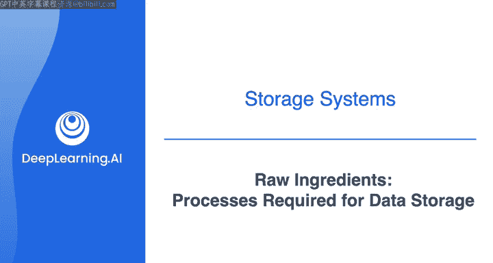
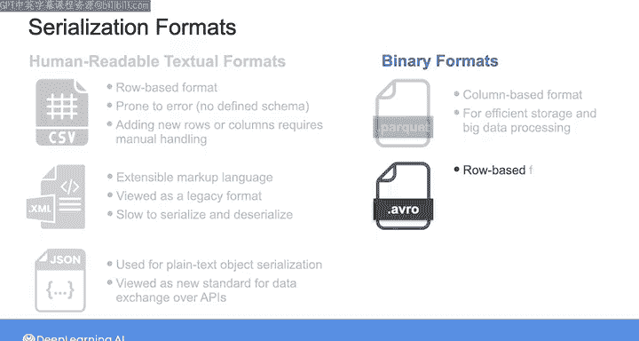
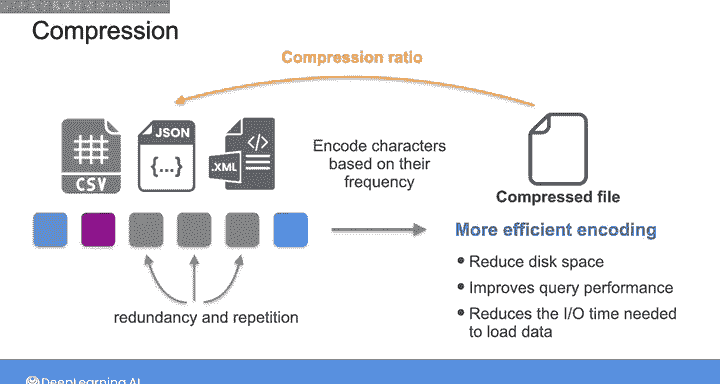

# 吴恩达《数据工程（导论，源系统、数据摄取和管道，数据存储和查询｜1-2-3课）｜DeepLearning.AI Data Engineering》 - P141：3_存储原材料：数据存储所需的过程.zh_en - GPT中英字幕课程资源 - BV1wTtWeeEH5

So far when talking about the storage hierarchy， we've been focusing on the bottom layer。

 the raw storage ingredients that are used to physically store data。

 but the bottom layer also consists of other components and processes that are required for storing and transmitting data in modern data systems and so in this video I'd like to take a moment to go over how networking。

 CPU， serialerization and compression play a part in your storage systems in the cloud era。

 storage systems are increasingly distributed。

This means that your data can be split up， replicated and spread out across many connected servers to enhance read and write performance。

 data durability and availability， so you can consider networking and the CPU required to handle the details of servicing read and write requests。

 things like aggregating read results and distributing rights across many servers as part of the raw ingredients of storage solutions you'll learn more about distributed storage systems later on。

 regardless of whether you're storing data on a single server or across a distributed storage system。

When you store data in a file or database or send it over a network you need to transform it into a different format that's because data stored in memory has different representation than the data that's stored in disk in system memory you will store data in data structures that are optimized to be efficiently accessed and manipulated by the CPU but that format is not suitable for persistent storage and disk or transmission over a network so you need to use a process known as serialization to translate the data into a standard format。

 usually a sequence of bytes that can be efficiently stored or shared over a network and when you want to read the data。

 you'll use a process known as deseialization to reconstruct the original data structures from the serialized format you can serialize data using a row or a columnbasedase approach in rowbased serialization you encode and store tabular data record by record so that a consecutive sequence of bytes represents one row of data If you're encoding semistructure。

You encode the data object by object or document by document so that data represented a single object or document is represented as a consecutive sequence of bytes on disk This is ideal for transactional operations where you need to access data from an entire row and columnbased serialerilization you encode and store data column by column so that a consecutive sequence of bytes in a serialized format represents a column and if you're encoding columnoriented semistructured data。

 the values for a single key across all the objects is stored as a consecutive sequence of bytes This is perfect for analytical queries where you need to perform operations on specific columns as a data engineer you'll likely encounter a wide range of data serialization formats from human readable text formats like CSv XMl and JSO that are widely used to exchange data between systems and applications to binary formats like Avro and parquet that are even more efficient for storing and querying data CSV is a popular row。

b format that's actually quite prone to error because it doesn't support a defined schema so it's up to the application to define the meaning of each row and column If an application adds a new row or column to its data。

 you have to handle that change manually So if possible you should avoid using this format in your data pipelines XMl or atenible markup language was popular when HTMLm and the internet were new but it's now viewed as a legacy format because it's generally slow to serialize and deseialize for data engineering applications。

 Xml has largely been replaced by the JON format for plain text object serialization nowadays JON is viewed as a new standard for data change over APIs and it's a very popular format for data storage in terms of binary format。

 Parquet is a columnbased format that's designed for efficient storage and big data processing an aro is a rowbased format that uses a schema to define its data structure and it support schema evolution youll learn more about row versus columnbased storage in databases and about the popular。

format later this week the decisions you make as a data engineer around serialization and how you store data and files and databases can impact overall query performance recently as I was working with a data team。

 we discovered that by simply switching the serialization format from CSV to parquet they were able to improve job performance by a factor of 100 Now let's say that you've serializer data so that can be stored on disk or transmitted over a network as your data volume grows。

 you might want to enhance storage efficiency and speed up the transmission of your data data compression is a way to reduce the number of bits needed to represent the data and it's a critical component for modern data applications that require increasingly larger data sets with compression algorithms instead of directly encoding the data into a sequence of bits use sophisticated mathematical techniques to identify a redundancy and repetition in your data then reencode the data in a more efficient way For example。

 traditional compression algorithms that you can apply to textbased data formats such as CSV。

JSON and XML identify the characters that occur most frequently and encode them differently than the characters that occur less frequently instead of mapping each character to a sequence of bits of fixed length。

 these algorithms match common characters to shorter bit sequences and less common characters so your compressed data file takes up fewer bits in total to sort disk and the ratio of the compressed file size relative to the original uncompressed file size is called the compression ratio In addition to reducing disk space compression also improves query performance because it reduces the input and output or IO time needed to load the necessary data from disk to memory when processing a query In recent years。

 engineers have created a new generation of compression algorithms that prioritize speed and CPU efficiency over compression ratio。

 these algorithms are frequently used the compressed data in data lakes or columnar databases to optimize for fast query performance and the optional reading item that follows this video haveve included some examples of these zoo compression techniques。

Now that you've seen how these components make it possible to store data。

 let's move on from the bottom layer of these storage hierarchy to the next layer。

 the storage systems that are built from the raw storage ingredients。 Again。

 the next reading item about compression is optional After that。

 we'll explore three cloud storage options， file storage， block storage and object storage。

 I'll see you there。

