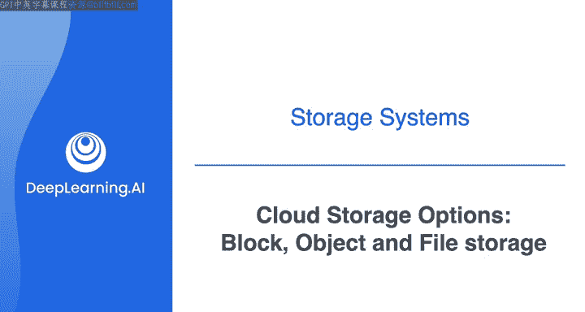
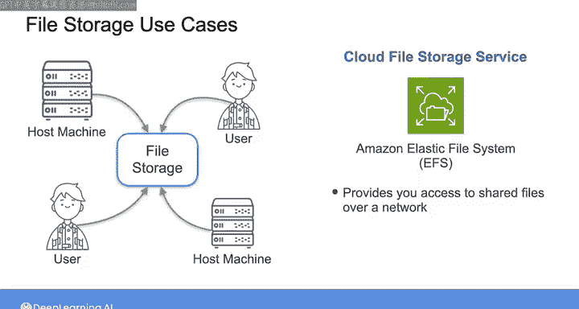
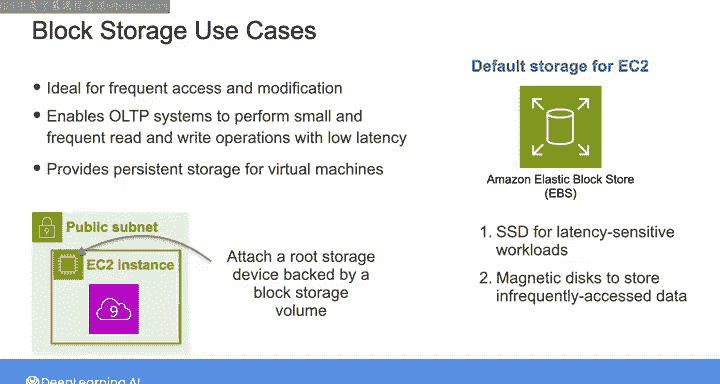
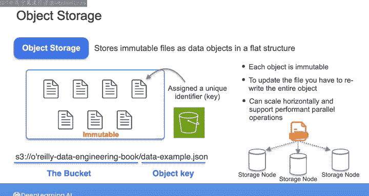
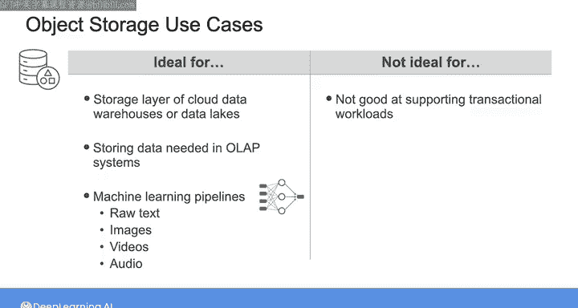
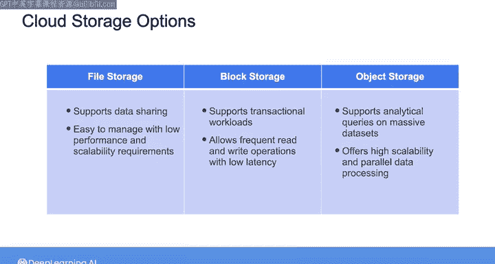

# 吴恩达《数据工程（导论，源系统、数据摄取和管道，数据存储和查询｜1-2-3课）｜DeepLearning.AI Data Engineering》 - P142：4_云存储选项：块存储、对象存储和文件存储.zh_en - GPT中英字幕课程资源 - BV1wTtWeeEH5

As a data engineer， you're faced with a large number of cloud storage options。

These storage systems exist at a level of abstraction above the wrong ingredients that you saw previously in this video we'll look at the three common types of cloud storage systems。

 These are block storage file storage and object storage you'll need to consider the performance and scalability tradeoffs between these options when choosing the best system for your use case。

 Let's start with the file storage systems which organize files into directory trees。

 similar to how the folders might be organized on your laptop Each folder contains metadata for its files and subfolds detailing the names。

 owners， less modification dates， access permissions and location pointers to the actual files and subfolds themselves。

 So to locate a file on disk you give the operating system a path to follow like this one following the hierarchical structure from left to right your operating system starts at the root directory indicated by the forward s。

 Then it finds the user directory then the Matthew Howsley subdirecty and finally it locates the file。

outputput TxtIn your work as a data engineer you use file storage when you need to provide centralized access to files that need to be easily shared and managed by multiple users or host machines you can use a managed cloud file storage service like Amazon elasticastic file system or EFS this service provides you your applications and your stakeholders access to shared files over network without the hassle of managing networking scaling disk clusters or configuration file storage is often built on top of block storage where the complexity of the underlying storage mechanisms is abstracted from you despite being a more accessible and understandable storage format file storage systems don't have the highest read and write performance because they need to keep track of the file hierarchy block storage on the other hand provides a performance of flexibility needed for high-s speed transactional data access blocklock storage divide files into small fixed sizeized blocks of data that you can store on magnetic disks or SSDs This allows you to precisely allocate storage space for any。

Given piece of data Each block has a unique identifier like the address for that block。

 which helps you efficiently retrieve and modify data in individual blocks。

 providing higher performance and lower latency than its file storage you often design block storage systems based on a distributed architecture spreading blocks of data across multiple storage disks which leads to higher scalability and stronger data durability This makes block storage the backbone of most modern storage solutions including your local file systems。

 transactional databases and virtual machine storage。When you store a file in block storage。

 the storage application writes the data into multiple blocks and records the blocks identifier into a data lookup table When you request a specific file。

 the application retrieves the data from the relevant blocks and merges them into the original sequence for you to read this is all abstracted from you so you can locate any block by its unique identifier and update the block without having to replace the entire file。

This makes block storage ideal for use cases where your data is accessed and modified often For example。

 transactional database systems generally access disks at a block level for high random access performance This enables OLTP systems to perform small andfr read and write operations with low latency Block storage is also used to provide persistent storage for virtual machines like AC2 instances so in the labs when you created all those cloud 9 environments that ran on E2 instances you automatically attach a root storage device that's backed by a block storage volume to each of your instances。

 you can install the operating system file system in other computing resources in the block storage volume with EC2 the default storage is Amazon Elastic blockstore or EBS and you can choose from various EBS volume types depending on your use case For example。

 some volumes are built on highper SSDs and are great for latency sensitive workloads while others use cost efficientfficient magnetic disks to store data that's infrequently accessed。

Since block storage volumes are typically attached to compute instances。

 scalability is limited by how much you can scale your compute resources and so block storage typically caps out at a few terabytes Object storage。

 on the other hand， decouples the data storage layer from the compute layer so it can scale to petabytes of storage or more in a cloud environment where your storage capacity is limited only by budget with object storage youll likely run out of money before you run out of object storage space。

 and so cloud object storage allows you to process data with ephemeral clusters and scale these clusters up and down on demand。

 These ephemeral clusters exist behind the scenes and you don't need to worry about them。

 This is a big factor in making big data available to smaller organizations that can't afford to own hardware for data jobs that will only occasionally run Let's review what you learned about object storage in a context of storage systems back in course2 Unlike a traditional hierarchical file storage system These store files is im mututable data objects in a flat structure in an object storage system you organize objects into。

opleve logical containers like an S3 bucket and each object is assigned a unique identifier or key that you can use to find the object within its container So an object identifier and S3 might look something like this。

 the first part refers to the bucket name which must be unique across all of AWS and data example that JSO is the key pointing to the particular object once you write the data initially the object becomes immutable even if you want to change one character of a one gigte file。

 you'll have to rewrite the entire object instead of just making a small change like you would have block storage This might seem like a constraint but it actually removes the overhead of supporting chain synchronization so you can distribute the object across many storage nodes that each contains their own disks eliminating the need to propagate data changes across all these nodes This allows object stores to scale horizontally and support extremely perform at parallel reads and writes across many disks Each node holds shards of objects which are replicated across。

Multiple nodes for durability This high scalability and durability makes object storage ideal for these storage layer of cloud data warehouses and data lakes it allows these storage abstractions to accommodate massive volumes of data in a costeffic way but since objects are immutable object storage is not good at supporting transactional workloads where many small update operations need to happen with low latency instead object storage are great for storing data needed in massive OLAP systems that focus on read heavy analytical workloads rather than right heavy transactional operations in modern data engineering applications Ob storage also plays a crucial role in machine learning pipelines that require large amounts of unstructured training data such as raw text images。

 videos and audio and so file block and object storage all have wide use cases。

If your focus is on simple data sharing and ease of management with low performance and scalability requirements。

 then file storage systems might be the most straightforward solution to support transactional workloads that require frequent read and write operations with low latency。

 you should choose block storage and if you need to perform analytical queries on massive data sets。

 you can choose object storage for its high scalability and parallel data processing capabilities Cloud providers typically offer different storage tiers within each of these three common storage options。

Join me in the next video to take a look at how to decide on an appropriate storage tier by considering the hot。

 warm and cold classification method use to categorize data based on access frequency。

